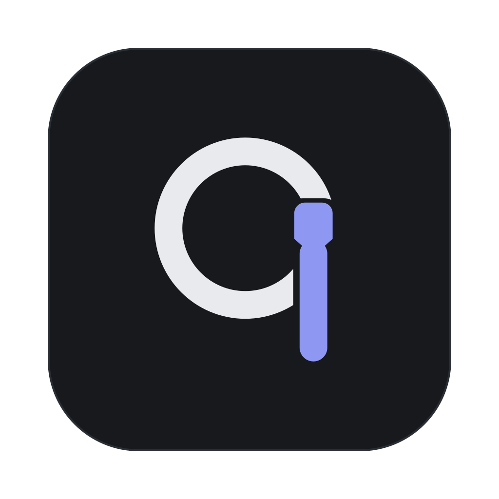
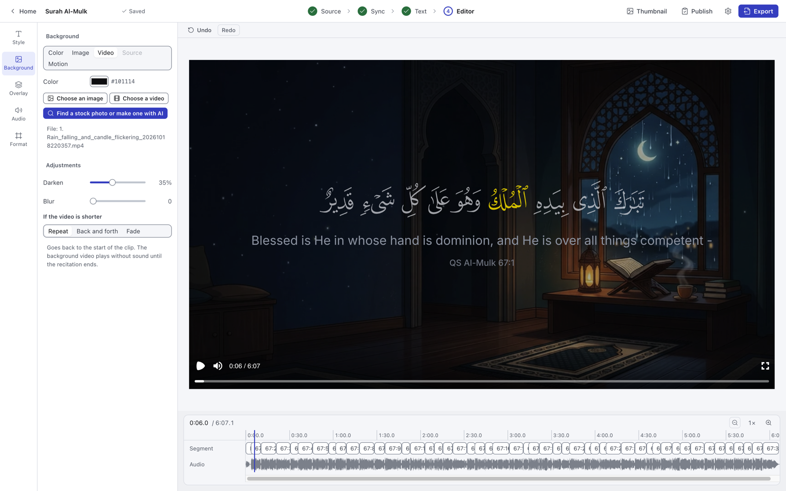
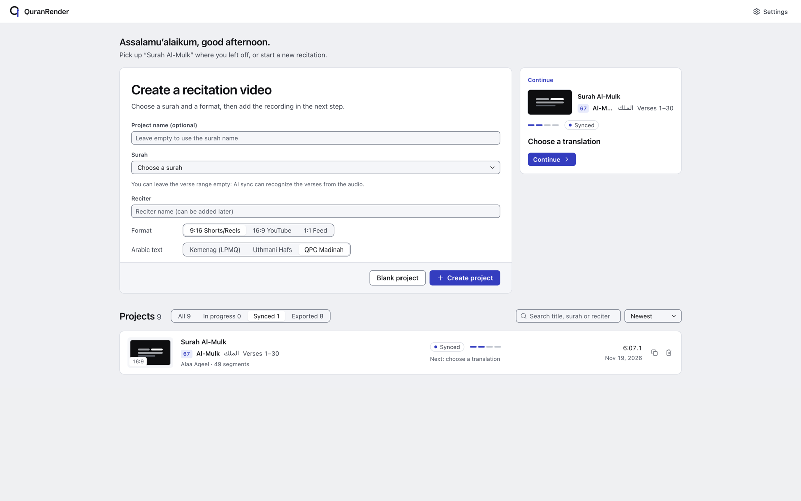
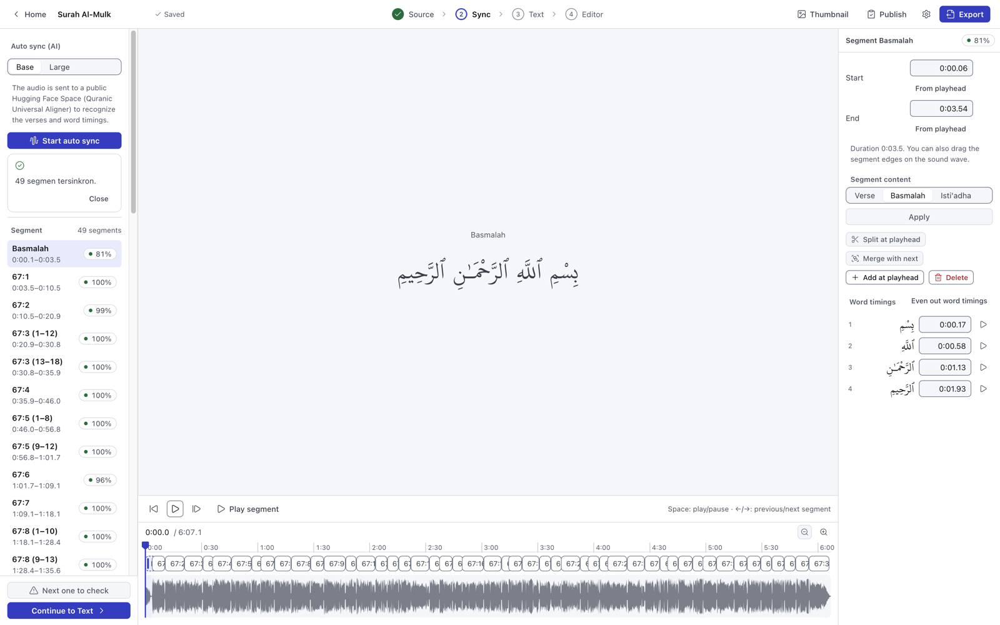
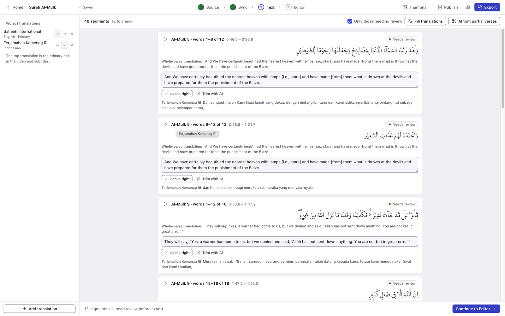
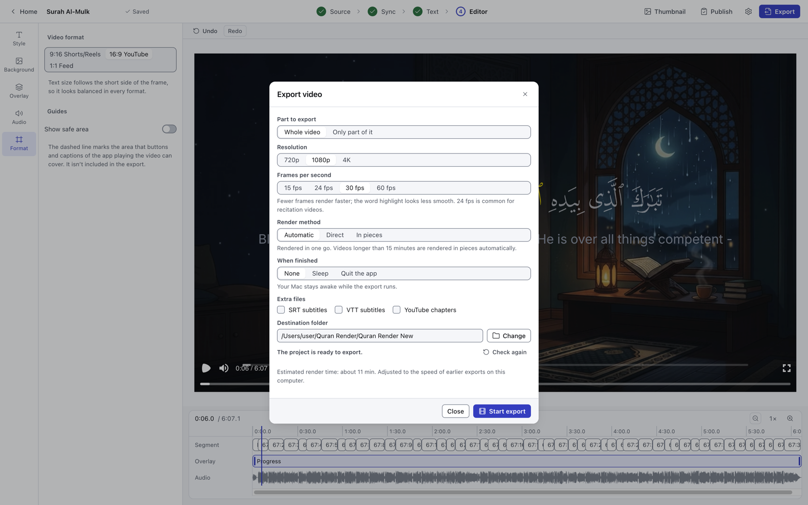
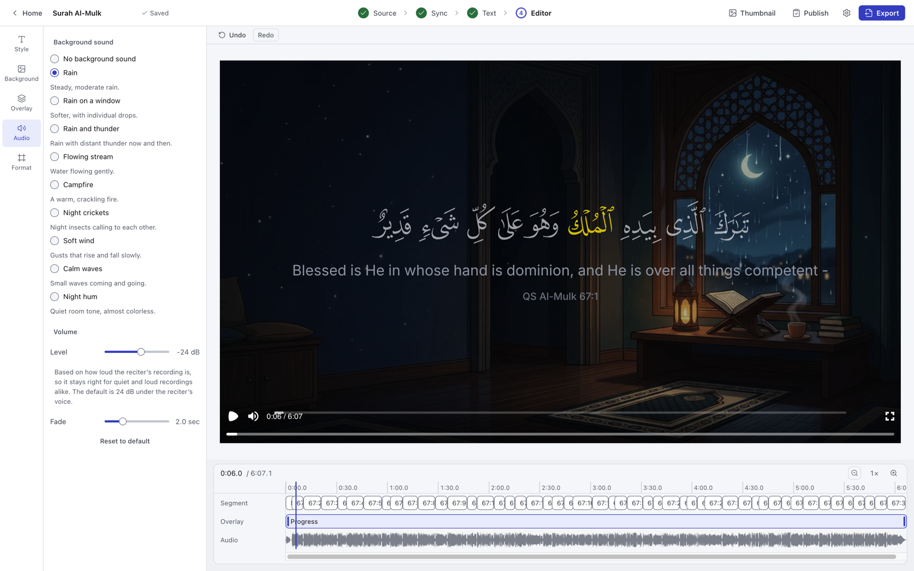
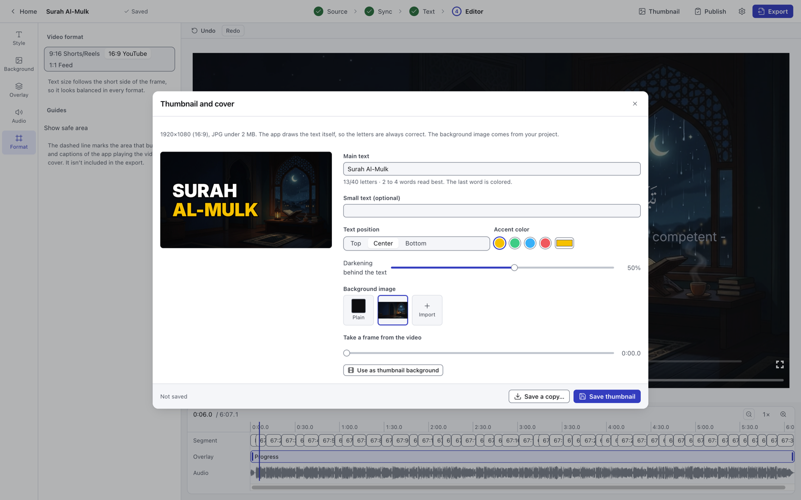
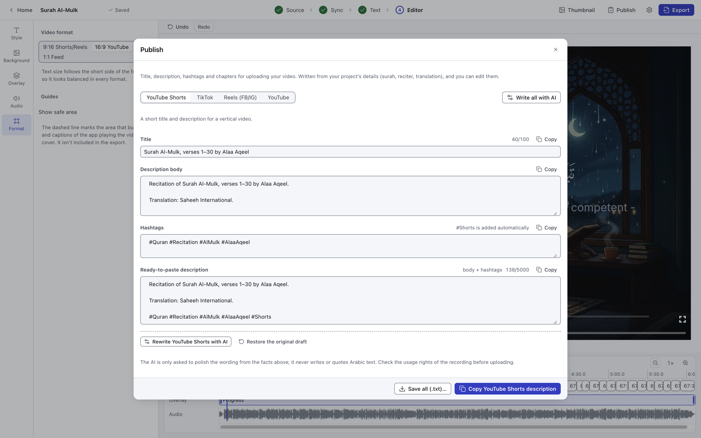

<div align="center">



# Quran Render

[Bahasa Indonesia](README.md) · **English**

**Turn recitation recordings into captioned videos with Arabic verses, translations, and word-by-word highlighting synced to the reciter's voice.**

[](LICENSE)
[](#download--installation)
[](https://github.com/abiiayyas/QuranRender/actions/workflows/ci.yml)
[](https://github.com/abiiayyas/QuranRender/actions/workflows/build.yml)

[Download](#download--installation) · [Features](#key-features) · [User Guide (EN)](docs/user/en.md) · [Panduan (ID)](docs/user/id.md) · [Development](#running-from-source) · [Changelog](CHANGELOG.md)

</div>

---

<div align="center">
  
</div>

## About Quran Render

**Quran Render** is a free, open-source desktop application for turning Quranic recitation recordings into captioned videos ready to upload to **YouTube, Shorts, Reels, or TikTok** (MP4 + SRT/VTT subtitles + YouTube chapters).

The interface is available in **English** and **Bahasa Indonesia** (*Settings > General > Language*). All projects and files stay local on your computer. An internet connection is only used when downloading recitations, Uthmani/QPC scripts, additional translations, cloud AI alignment (public Hugging Face Space), or optional AI translation trimming and background image generation.

---

## Screenshots & Workflow

<table>
  <tr>
    <td width="50%" valign="top">
      
      <br />
      <strong>Home</strong> — Start a new project (9:16, 16:9, 1:1; Kemenag, Uthmani Hafs, or QPC Madinah) and resume your last project in one click.
    </td>
    <td width="50%" valign="top">
      
      <br />
      <strong>Sync</strong> — Detect verses and word-level timings automatically with the AI Aligner, with segment editing directly on the waveform.
    </td>
  </tr>
  <tr>
    <td width="50%" valign="top">
      
      <br />
      <strong>Text &amp; Translations</strong> — Manage built-in Kemenag or Quran.com translations (such as Saheeh International) with AI trim for partial verses.
    </td>
    <td width="50%" valign="top">
      
      <br />
      <strong>Export</strong> — Render up to 4K (15–60 fps), export partial time ranges for Shorts/Reels, use resumable chunked rendering, and generate SRT, VTT, and YouTube chapters.
    </td>
  </tr>
</table>

<details>
<summary>More feature screenshots (Background Nature Sound, Thumbnail &amp; Cover, Publish Copy)</summary>
<br />
<table>
  <tr>
    <td width="33%" valign="top">
      
      <br />
      <strong>Background Sound</strong> — 9 built-in nature loops with no music, leveled automatically relative to the reciter's voice (default −24 dB).
    </td>
    <td width="33%" valign="top">
      
      <br />
      <strong>Thumbnail &amp; Cover</strong> — Create JPG covers under 2 MB from a project image or a video frame.
    </td>
    <td width="33%" valign="top">
      
      <br />
      <strong>Publish Copy</strong> — Ready-to-paste titles, descriptions, hashtags, and chapters for YouTube Shorts, TikTok, Reels, and YouTube (with optional AI rewrite).
    </td>
  </tr>
</table>
</details>

---

## Key Features

- **Guided, Auto-Saved Workflow:** **Home → 1 Source → 2 Sync → 3 Text → 4 Editor → Export**, plus a **Thumbnail** builder (JPG < 2 MB) and platform-specific **Publish** copy drafts.
- **Flexible Audio Sources:** Import local audio/video files, download surah recitations from **MP3Quran** or **QDC (Quran.com)**, or download from **YouTube** (`yt-dlp`), complete with start/end trimming and a zoomable waveform.
- **Word-by-Word Synchronization:** Automatic verse recognition and word-level timing via the *Quranic Universal Aligner* service or built-in QDC/MP3Quran timestamps, alongside manual segment and word timing tools.
- **Quranic Text Integrity:** Arabic text is displayed verbatim from verified sources — built-in offline **Kemenag (LPMQ)**, **Uthmani Hafs**, or **QPC Madinah** — and is never altered by AI. Pre-export policy checks block exports if any segment or word range is incomplete or invalid.
- **Translations & AI Trim:** Kemenag Indonesian translation is bundled, and additional editions can be installed from Quran.com. Supports **Auto split** and **AI trim** (via OpenAI-compatible APIs or local AI CLIs such as Claude Code, Codex, OpenCode) for partially recited verses.
- **What You See Is What You Export (WYSIWYG):** Preview and export share the exact same **Remotion** composition: 12 style presets, word-by-word highlight, verse/translation separator, procedural motion backgrounds, video loops (*repeat / ping-pong / fade*), stock photos/videos (Pexels, Unsplash, Pixabay), AI background images, ambient nature sounds, audio visualizer, and Subscribe/Follow overlays.
- **Flexible Export (720p–4K, 15–60 fps):** Supports **Partial export** for cutting long recordings into Shorts/Reels/TikTok clips, plus resumable **Chunked rendering**.

---

## Download & Installation

Download the latest installer for **macOS** (`.dmg`) and **Windows** (`.exe`) from **[GitHub Releases](https://github.com/abiiayyas/QuranRender/releases/latest)**.

> [!NOTE]
> **Opening the app for the first time (unsigned builds):**
> - **macOS (Gatekeeper):** Right-click *Quran Render* in Applications and choose **Open** → **Open** (or allow via *System Settings > Privacy & Security > Open Anyway*).
> - **Windows (SmartScreen):** In the *Windows protected your PC* dialog, click **More info** and then **Run anyway**.

---

## Running from Source

Requires **Node.js 22** or newer (macOS or Windows).

```bash
npm install
npm run dev          # run the app with hot reload
npm run typecheck    # strict TypeScript check (main, preload, renderer, remotion)
npm test             # Vitest unit tests (src/shared)
npm run lint:design  # verify qr-* classes and CSS tokens
npm run lint:a11y    # verify accessibility rules and token contrast
npm run build        # build app bundles to out/
npm run dist:mac     # build macOS DMG installer to dist/
npm run dist:win     # build Windows NSIS installer to dist/
```

To keep development data separate from your real app data:

```bash
QR_USER_DATA=/tmp/qr-dev npm run dev
```

Contribution guidelines and technical documentation are available in [CONTRIBUTING.md](CONTRIBUTING.md) and [docs/engineering/README.en.md](docs/engineering/README.en.md) (Indonesian docs: [docs/engineering/01_TECHNICAL_HANDOFF.md](docs/engineering/01_TECHNICAL_HANDOFF.md) and [docs/engineering/07_BUILD_DAN_TEST.md](docs/engineering/07_BUILD_DAN_TEST.md)).

---

## Structure & Tech Stack

```text
src/
  main/       main process: SQLite database, project files, downloads, AI sync, translations, export render
  preload/    window.api bridge (built from CHANNELS in src/shared/api.ts)
  shared/     types, IPC contracts, and pure rules shared across main, renderer, and Remotion
  renderer/   React UI
  remotion/   video and thumbnail compositions
assets/       Arabic/UI fonts and background nature loops
design/       CSS design tokens, component classes, logo, and app icons
resources/    bundled read-only quran.db dataset
docs/         user guides (EN/ID) and technical documentation
```

| Layer | Technology |
|---|---|
| Desktop Shell | Electron, electron-vite, Vite |
| User Interface | React 19, TypeScript, Zustand, CSS Design System |
| Storage | SQLite (`better-sqlite3`): local `studio.db` & bundled `resources/quran.db` |
| Video & Audio | Remotion, FFmpeg (`ffmpeg-static`, `ffprobe-static`) |
| AI & Stock Media | OpenAI-compatible APIs / local AI CLIs, Pollinations, Pexels, Unsplash, Pixabay |

---

## License & Attribution

- **Quran Render source code:** [MIT License](LICENSE).
- **Kemenag Quranic text & Indonesian translation:** Lajnah Pentashihan Mushaf Al-Qur'an, Indonesian Ministry of Religious Affairs.
- **Uthmani, QPC & additional translations:** Quran.com.
- **Recitations:** MP3Quran and QDC (Quran.com).

| Third-Party Component | License |
|---|---|
| [Remotion](https://www.remotion.dev/license) | Remotion License (free for individuals, non-profits, and organizations of up to 3 employees) |
| FFmpeg (`ffmpeg-static`) | GPL v3 |
| `yt-dlp` (downloaded on demand) | Unlicense |
| LPMQ, Amiri, Inter fonts & Ambient audio | See [THIRD_PARTY_NOTICES.md](THIRD_PARTY_NOTICES.md) and [assets/ambient/SOURCES.md](assets/ambient/SOURCES.md) |

To report security vulnerabilities, please follow [SECURITY.md](SECURITY.md).
