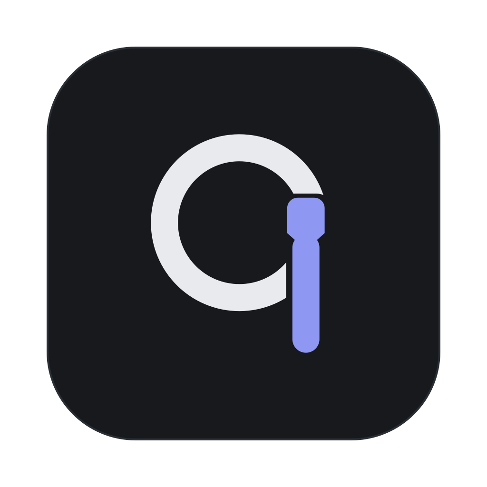
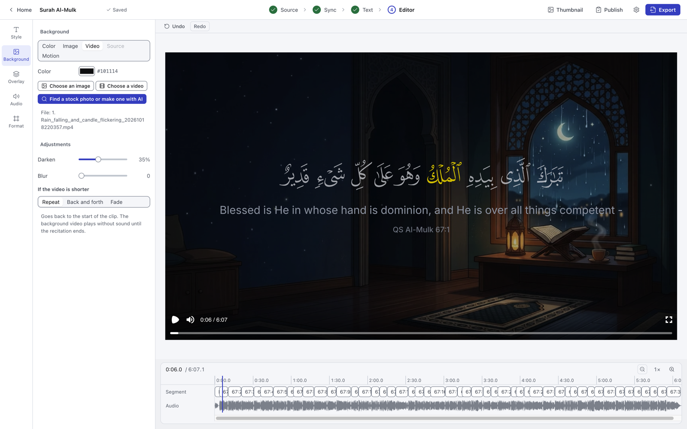
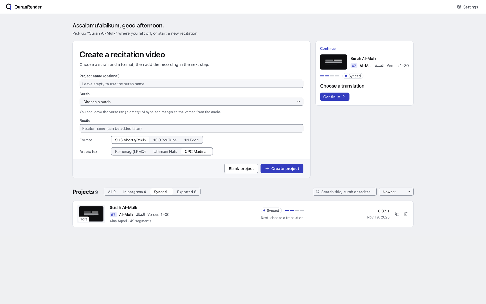
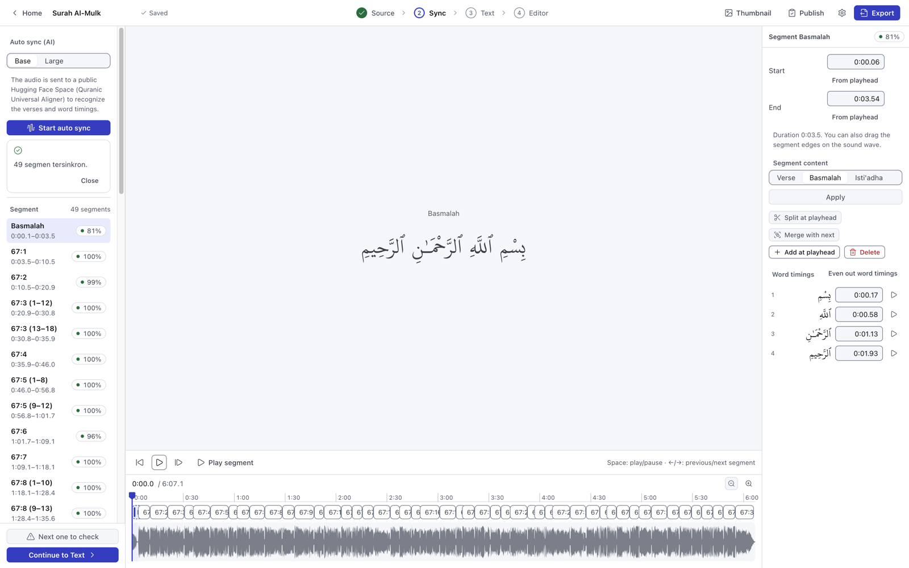
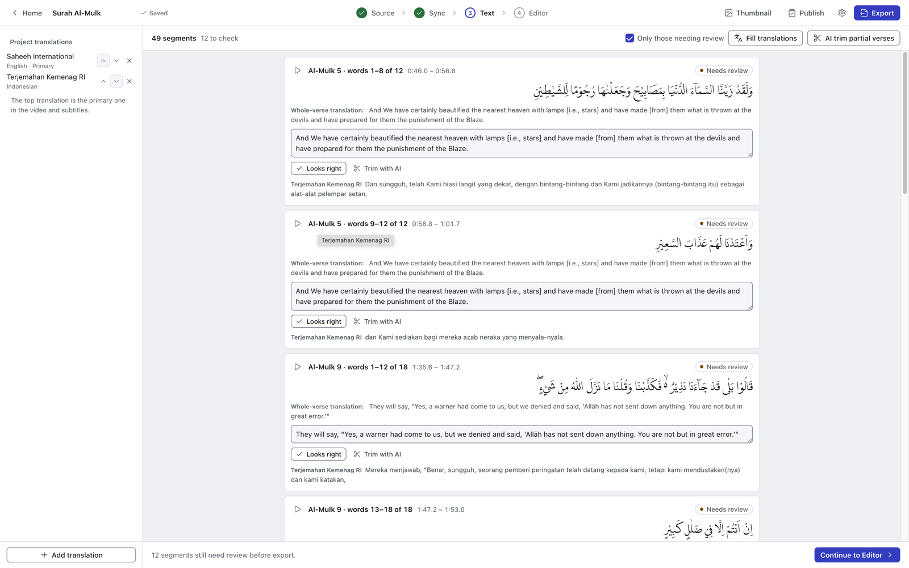
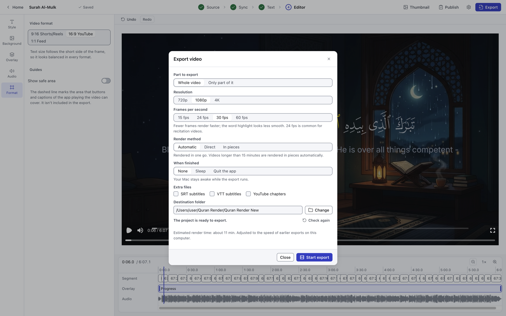
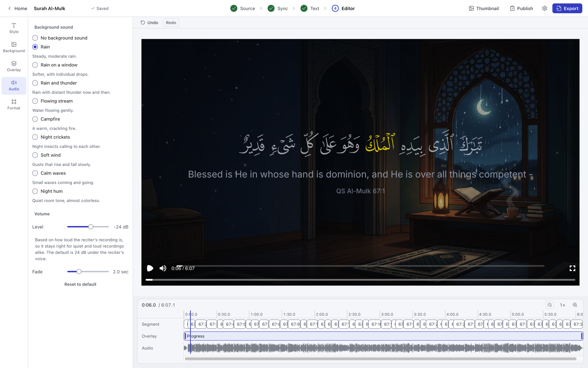
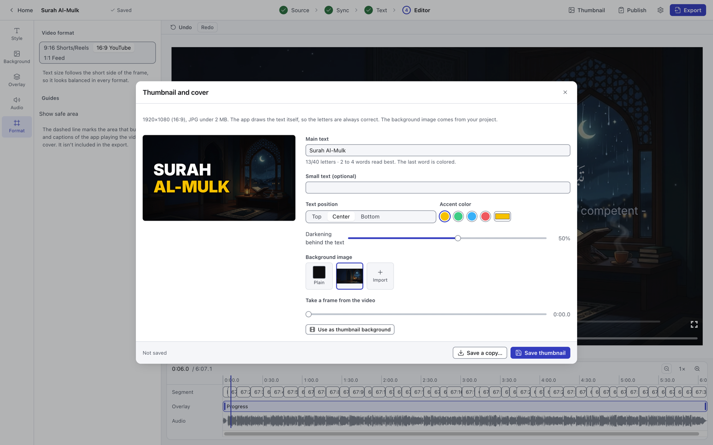
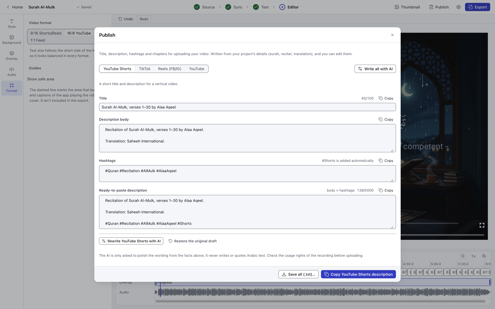

<div align="center">



# Quran Render

**Bahasa Indonesia** · [English](README.en.md)

**Ubah rekaman tilawah menjadi video berteks: ayat Arab, terjemahan, dan sorotan per kata yang sinkron dengan suara qari.**

[](LICENSE)
[](#unduh--instalasi)
[](https://github.com/abiiayyas/QuranRender/actions/workflows/ci.yml)
[](https://github.com/abiiayyas/QuranRender/actions/workflows/build.yml)

[Unduh / Download](#unduh--instalasi) · [Fitur](#fitur-utama) · [Panduan (ID)](docs/user/id.md) · [User Guide (EN)](docs/user/en.md) · [Pengembangan](#menjalankan-dari-kode-sumber) · [Changelog](CHANGELOG.md)

</div>

---

<div align="center">
  
</div>

## Tentang Quran Render

**Quran Render** adalah aplikasi desktop gratis dan sumber terbuka (*open source*) untuk membuat video tilawah yang siap diunggah ke **YouTube, Shorts, Reels, atau TikTok** (MP4 + subtitle SRT/VTT + bab YouTube).

Antarmuka tersedia dalam **Bahasa Indonesia** dan **English** (*Pengaturan > Umum > Bahasa*). Seluruh proyek dan berkas disimpan secara lokal di komputer Anda. Koneksi internet hanya dipakai saat mengunduh rekaman qari, teks Uthmani/QPC, terjemahan tambahan, sinkron AI (Hugging Face Space publik), serta pemotongan terjemahan atau gambar AI opsional.

---

## Tampilan & Alur Kerja

<table>
  <tr>
    <td width="50%" valign="top">
      
      <br />
      <strong>Beranda</strong> — Buat proyek baru (9:16, 16:9, 1:1; Kemenag, Uthmani Hafs, atau QPC Madinah) dan lanjutkan proyek terakhir dalam satu klik.
    </td>
    <td width="50%" valign="top">
      
      <br />
      <strong>Sinkron</strong> — Deteksi ayat dan waktu per kata otomatis lewat AI Aligner, dengan editor segmen dan penyesuaian langsung di gelombang suara.
    </td>
  </tr>
  <tr>
    <td width="50%" valign="top">
      
      <br />
      <strong>Teks & Terjemahan</strong> — Kelola terjemahan Kemenag RI maupun edisi Quran.com (seperti Saheeh International) lengkap dengan AI trim untuk ayat terpotong.
    </td>
    <td width="50%" valign="top">
      
      <br />
      <strong>Ekspor</strong> — Render hingga 4K (15–60 fps), ekspor sebagian rentang waktu untuk Shorts/Reels, render per potongan, serta hasilkan SRT, VTT, dan chapter YouTube.
    </td>
  </tr>
</table>

<details>
<summary>Lihat tangkapan layar fitur lainnya (Suara Latar Alam, Thumbnail &amp; Cover, Teks Publikasi)</summary>
<br />
<table>
  <tr>
    <td width="33%" valign="top">
      
      <br />
      <strong>Suara Latar Alam</strong> — 9 suara alam bawaan tanpa musik dengan level otomatis relatif terhadap kenyaringan qari (bawaan −24 dB).
    </td>
    <td width="33%" valign="top">
      
      <br />
      <strong>Thumbnail &amp; Cover</strong> — Buat cover JPG di bawah 2 MB langsung dari gambar proyek atau bingkai video.
    </td>
    <td width="33%" valign="top">
      
      <br />
      <strong>Teks Publikasi</strong> — Draf judul, deskripsi, hashtag, dan bab siap tempel untuk YouTube Shorts, TikTok, Reels, dan YouTube (opsional diperhalus AI).
    </td>
  </tr>
</table>
</details>

---

## Fitur Utama

- **Alur Terpadu & Simpan Otomatis:** **Beranda → 1 Sumber → 2 Sinkron → 3 Teks → 4 Editor → Ekspor**, ditambah pembuat **Thumbnail** (JPG < 2 MB) dan draf teks **Publikasi** per platform.
- **Sumber Audio Fleksibel:** Impor berkas audio/video lokal, unduh tilawah qari langsung dari **MP3Quran** atau **QDC (Quran.com)**, atau unduh dari **YouTube** (`yt-dlp`), lengkap dengan pemotongan awal/akhir (*trim*) dan pengukur gelombang suara.
- **Sinkronisasi Per Kata:** Deteksi ayat dan waktu kata otomatis melalui layanan AI *Quranic Universal Aligner* atau timestamp bawaan QDC/MP3Quran, dilengkapi editor linimasa dan segmen manual.
- **Amanah Teks Al-Qur'an:** Teks Arab ditampilkan verbatim dari sumber terverifikasi — **Kemenag (LPMQ)** bawaan offline, **Uthmani Hafs**, atau **QPC Madinah** — dan tidak pernah diubah oleh AI. Pemeriksaan pra-ekspor menolak ekspor bila ada segmen atau rentang kata yang tidak utuh.
- **Terjemahan & AI Trim:** Terjemahan Kemenag tersedia bawaan serta dapat ditambah edisi lain dari Quran.com. Mendukung **Belah otomatis** dan **AI trim** (via API kompatibel OpenAI atau AI CLI lokal seperti Claude Code, Codex, OpenCode) untuk ayat yang dibaca sebagian.
- **Pratinjau = Hasil Ekspor (WYSIWYG):** Pratinjau dan ekspor menggunakan komposisi **Remotion** yang sama: 12 preset gaya, sorotan kata demi kata, pemisah ayat/terjemahan, latar gerak prosedural, video loop (*ulang / bolak-balik / pudar*), stok foto/video (Pexels, Unsplash, Pixabay), gambar latar AI, suara latar alam, visualizer gelombang suara, serta overlay Subscribe/Follow.
- **Ekspor Fleksibel (720p–4K, 15–60 fps):** Mendukung **Ekspor sebagian** untuk memotong rekaman panjang menjadi klip Shorts/Reels/TikTok, serta **Render per potongan** yang dapat dilanjutkan bila terputus.

---

## Unduh & Instalasi

Unduh installer terbaru untuk **macOS** (`.dmg`) dan **Windows** (`.exe`) melalui halaman **[GitHub Releases](https://github.com/abiiayyas/QuranRender/releases/latest)**.

> [!NOTE]
> **Membuka aplikasi pertama kali (tanpa sertifikat berbayar):**
> - **macOS (Gatekeeper):** Klik kanan aplikasi *Quran Render* di folder Applications lalu pilih **Open** → **Open** (atau izinkan lewat *System Settings > Privacy & Security > Open Anyway*).
> - **Windows (SmartScreen):** Pada jendela *Windows protected your PC*, klik **More info** lalu pilih **Run anyway**.

---

## Menjalankan dari Kode Sumber

Membutuhkan **Node.js 22** atau lebih baru (macOS atau Windows).

```bash
npm install
npm run dev          # jalankan aplikasi dengan hot reload
npm run typecheck    # TypeScript strict (main, preload, renderer, remotion)
npm test             # uji unit Vitest (src/shared)
npm run lint:design  # verifikasi kelas qr-* dan token CSS
npm run lint:a11y    # verifikasi aksesibilitas dan kontras token
npm run build        # build aplikasi ke out/
npm run dist:mac     # buat installer DMG macOS ke dist/
npm run dist:win     # buat installer NSIS Windows ke dist/
```

Untuk memisahkan data uji dari proyek asli saat pengembangan, jalankan:

```bash
QR_USER_DATA=/tmp/qr-dev npm run dev
```

Panduan kontribusi dan detail teknis tersedia di [CONTRIBUTING.md](CONTRIBUTING.md), [docs/engineering/01_TECHNICAL_HANDOFF.md](docs/engineering/01_TECHNICAL_HANDOFF.md), dan [docs/engineering/07_BUILD_DAN_TEST.md](docs/engineering/07_BUILD_DAN_TEST.md).

---

## Struktur & Teknologi

```text
src/
  main/       proses utama: database, berkas proyek, unduhan, sinkron AI, terjemahan, render
  preload/    jembatan window.api (dibangun dari CHANNELS di src/shared/api.ts)
  shared/     tipe, kontrak IPC, dan aturan murni (dipakai main, renderer, dan Remotion)
  renderer/   antarmuka React
  remotion/   komposisi video dan thumbnail
assets/       font Arab/UI dan suara latar alam
design/       token desain, komponen CSS, logo, dan ikon aplikasi
resources/    dataset bawaan quran.db (read-only)
docs/         panduan pengguna (ID/EN) dan dokumentasi teknis
```

| Bagian | Teknologi |
|---|---|
| Aplikasi | Electron, electron-vite, Vite |
| Tampilan | React 19, TypeScript, Zustand, CSS Design System |
| Basis Data | SQLite (`better-sqlite3`): `studio.db` lokal & `resources/quran.db` bawaan |
| Video & Media | Remotion, FFmpeg (`ffmpeg-static`, `ffprobe-static`) |
| AI & Stok Media | API kompatibel OpenAI / AI CLI lokal, Pollinations, Pexels, Unsplash, Pixabay |

---

## Lisensi & Atribusi

- **Kode sumber Quran Render:** Lisensi [MIT](LICENSE).
- **Teks Al-Qur'an & Terjemahan Kemenag:** Lajnah Pentashihan Mushaf Al-Qur'an, Kementerian Agama RI.
- **Teks Uthmani, QPC & terjemahan tambahan:** Quran.com.
- **Tilawah:** MP3Quran dan QDC (Quran.com).

| Komponen Pihak Ketiga | Lisensi |
|---|---|
| [Remotion](https://www.remotion.dev/license) | Remotion License (gratis untuk individu, nirlaba, dan perusahaan hingga 3 karyawan) |
| FFmpeg (`ffmpeg-static`) | GPL v3 |
| `yt-dlp` (diunduh saat dipakai) | Unlicense |
| Font LPMQ, Amiri, Inter & Audio Latar | Lihat [THIRD_PARTY_NOTICES.md](THIRD_PARTY_NOTICES.md) dan [assets/ambient/SOURCES.md](assets/ambient/SOURCES.md) |

Pelaporan kerentanan keamanan dapat mengikuti panduan di [SECURITY.md](SECURITY.md).
