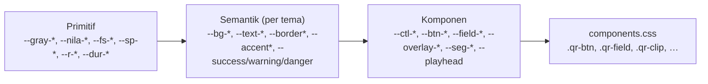

# 02 — Design System QuranRender

| Item | Nilai |
|---|---|
| Status | Tahap 2 untuk ditinjau pemilik produk (tinjauan independen: lulus) |
| Galeri | [`design/system/gallery.html`](../../design/system/gallery.html): 19 komponen, semua state, terang dan gelap berdampingan (buka lewat server lokal) |
| Kode | [`tokens.css`](../../design/system/tokens.css), [`components.css`](../../design/system/components.css), generator [`design/tools/build-gallery.mjs`](../../design/tools/build-gallery.mjs) |
| Terkait | [`01_BRAND_IDENTITY.md`](01_BRAND_IDENTITY.md), [`04_SCREEN_SPECIFICATIONS.md`](04_SCREEN_SPECIFICATIONS.md), [`DESIGN.md`](../../DESIGN.md), [`PRD.md`](../product/PRD.md) |

Design system ini menjadi kontrak antara desain dan implementasi React (`apps/desktop/src`). Nama kelas
`qr-*` di `components.css` adalah acuan visual. Komponen React wajib menghasilkan tampilan yang sama
dengan galeri, tetapi boleh memakai struktur internal sendiri.

---

## 1. Prinsip

1. **Tenang dan setara terang/gelap.** Setiap komponen hanya merujuk token semantik, sehingga satu
   kode berlaku untuk dua tema.
2. **Satu nila.** Nila hanya berarti terpilih, posisi sekarang, fokus, atau aksi utama. Warna status
   muncul sebagai titik, ikon, atau garis 1 px, tidak pernah sebagai bidang.
3. **Kepadatan editor desktop.** Kontrol 28 px, teks 13 px, angka tabular. Mouse dan keyboard menjadi
   masukan utama.
4. **Tidak ada yang hilang diam-diam.** Job yang dibatalkan, file yang hilang, dan opsi yang tidak
   tersedia tetap terlihat dan menyebut alasannya.
5. **Setiap masalah punya jalan keluar.** Peringatan, galat, dan toast selalu menyebut langkah
   berikutnya.

---

## 2. Arsitektur token

| Lapisan | Aturan |
|---|---|
| Primitif | Nilai mentah. Tidak dipakai langsung oleh komponen. |
| Semantik | Didefinisikan untuk terang (`:root`, `.t-light`) dan gelap (`[data-theme="dark"]`, `.t-dark`, serta `prefers-color-scheme`). |
| Komponen | Dideklarasikan di `:root, .t-light, .t-dark` supaya `var()` dihitung ulang di wadah yang temanya dipaksa (misalnya pratinjau tema di pengaturan). |

### 2.1 Token baru di tahap ini

| Token | Nilai | Dipakai untuk |
|---|---|---|
| `--r-2xs` | 2 px | Rel slider, isian progres, kepala playhead, pegangan trim |
| `--r-xs` | 4 px | Kotak centang, tombol pintasan (`kbd`) |
| `--r-ctl` | 6 px | Kontrol, item menu, klip timeline, pil asal gaya |
| `--r-seg` | 8 px | Wadah kontrol segmen (6 + 2, konsentris) |
| `--r-panel` | 10 px | Panel, menu, toast, peringatan |
| `--r-overlay` | 12 px | Dialog, palet perintah |
| `--r-pill` | 999 px | Lencana, sakelar |
| `--dur-1` / `--dur-2` / `--dur-3` | 120 / 220 / 320 ms | Hover · buka popover · dialog/toast masuk |
| `--ease-out`, `--ease-in-out` | kurva | Gerak masuk · gerak bolak-balik (progres tak tentu) |
| `--z-sticky` … `--z-tooltip` | 10 / 40 / 60 / 80 / 90 | Header, popover, dialog, toast, tooltip |
| `--accent-active` | nila-800 / gelap nila-500 | Tombol primer saat ditekan |
| `--bg-raised` | putih / gelap `#262a31` | Opsi segmen terpilih, selalu di atas warna hover |
| `--shadow-lift` | 1 px | Opsi segmen terpilih, kenop |
| `--scrim` | 32% terang / 55% gelap | Latar di belakang dialog |
| `--ctl-h-sm/md/lg` | 24 / 28 / 32 px | Tinggi kontrol, default 28 |
| `--overlay-ring` | transparan (terang) / 1 px abu (gelap) | Tepi lapisan mengapung. Di tema terang bayangan sudah cukup. |
| `--overlay-shadow` | `0 0 0 1px var(--overlay-ring)` + bayangan pop | Elevasi lapisan mengapung, dideklarasikan dalam satu `box-shadow` |
| `--track-label-w`, `--track-h`, `--seg-h` | 132 / 34 / 26 px | Timeline |

---

## 3. State interaksi (berlaku umum)

| State | Perlakuan | Catatan |
|---|---|---|
| Hover | Latar `--bg-hover` atau batas menjadi `--field-border-hover`. Durasi 120 ms. | Tidak pernah memakai nila, kecuali tombol primer yang menjadi `--accent-hover`. |
| Tekan | Latar sedikit lebih gelap. Tombol primer memakai `--accent-active` dan turun 0,5 px. | |
| Fokus keyboard | Outline 2 px `--focus`, offset 2 px (`:focus-visible`) | Wajib di semua kontrol. Isian memakai batas nila dan cincin 1 px. |
| Terpilih | `--accent-subtle` + teks utama, atau batas nila | Untuk konten (klip, item, menu). Kontrol pengaturan (segmen) memakai terpilih netral. |
| Nonaktif | Latar `--bg-sunken`, teks `--text-3`, kursor `not-allowed` | Elemen tetap terlihat. Bila tidak jelas alasannya, beri tooltip atau keterangan. |
| Memuat | Spinner 14 px menggantikan ikon, label berubah ke bentuk kerja ("Mengekspor…"), `aria-busy` | Lebar tombol dipertahankan. |
| Galat | Batas dan cincin `--danger`, pesan di bawah dengan ikon | Pesan menyebut format atau cara memperbaiki. |
| Ditinjau | Titik amber 7 px | Hanya untuk keyakinan sinkron rendah. |

Untuk dokumentasi, kelas `.is-hover/.is-active/.is-focus/.is-disabled` memaksa tampilan state. React
memakai pseudo-class asli.

---

## 4. Spesifikasi komponen

Nama React di bawah adalah usulan untuk `apps/desktop/src/ui/` dan dipakai sebagai kosakata bersama.

### 4.1 Tombol — `Button`, `IconButton`

| Properti | Nilai |
|---|---|
| Varian | `primary` (hanya Ekspor, satu per layar), `secondary`, `ghost` (bilah alat), `danger` (aksi menghapus; tetap bergaris, tidak terisi merah) |
| Ukuran | `sm` 24, `md` 28 (default), `lg` 32; ikon-saja persegi dengan ukuran yang sama |
| Isi | Ikon kiri opsional 16 px, label kata kerja ("Ekspor", "Impor", "Hapus proyek") |
| State | Default, hover, tekan, fokus, nonaktif, memuat; `aria-pressed` untuk toggle bilah alat (nila redup + ikon nila) |
| Aksesibilitas | Tombol ikon wajib punya `aria-label` dan tooltip yang menyebut pintasan |

### 4.2 Kontrol segmen — `SegmentedControl`

| Properti | Nilai |
|---|---|
| Pakai untuk | 2–4 pilihan setara (tema, rasio). Bukan untuk navigasi alur. |
| Anatomi | Wadah cekung + batas kontrol, padding 2 px, opsi 22 px |
| State | Terpilih = `--bg-raised` + `--shadow-lift` (netral), hover, fokus (outline di dalam), opsi nonaktif (opasitas 45%) |
| Aksesibilitas | `role="radiogroup"` + `role="radio"`, panah kiri/kanan berpindah opsi |

### 4.3 Isian teks — `TextField`, `SearchField`

| Properti | Nilai |
|---|---|
| Anatomi | Label 12 px tebal di atas, kotak 28 px (latar cekung, batas kontrol), ikon kiri opsional, bantuan/galat 12 px di bawah |
| State | Kosong (placeholder `--text-3`), hover, fokus (batas + cincin nila), terisi, galat (`aria-invalid`, pesan dengan ikon), nonaktif |
| Konten galat | Sebutkan formatnya, misalnya "Format waktu: jj:mm:dd:ff" |

### 4.4 Stepper angka & waktu — `NumberField`, `TimecodeField`

| Properti | Nilai |
|---|---|
| Anatomi | Nilai tabular rata kanan, satuan opsional ("px"), dua tombol naik/turun 20 px |
| Interaksi | Seret horizontal untuk menggeser nilai (kursor `ew-resize`). ↑/↓ = ±1 frame atau ±1, Shift = ±1 detik atau ±10, Enter konfirmasi, Esc batal. |
| Validasi | Waktu di luar batas segmen tetangga ditandai galat dan tidak di-commit |

### 4.5 Select & menu — `Select`, `Menu`, `MenuItem`

| Properti | Nilai |
|---|---|
| Select | Tampilan isian dengan chevron. Saat terbuka: batas dan cincin nila (`aria-expanded`). |
| Menu | Panel mengapung (`--overlay-shadow`, radius 10), padding 4, item 28 px, label grup 11 px |
| Item | Kolom ikon atau centang 16 px (centang nila untuk pilihan aktif), label, pintasan di kanan; varian `danger` (teks dan ikon merah, hover merah 10%) |
| Tidak tersedia | `aria-disabled`, tetap terlihat dengan alasan singkat ("glyph tidak lengkap") |
| Keyboard | ↑/↓, Home/End, ketik untuk mencari, Enter memilih, Esc menutup dan mengembalikan fokus |

### 4.6 Kotak centang, radio, sakelar — `Checkbox`, `Radio`, `Switch`

| Properti | Nilai |
|---|---|
| Ukuran | 16 px (centang/radio); sakelar 30 × 18 px |
| State | Mati, hidup (nila), sebagian (checkbox), fokus, nonaktif (termasuk "nonaktif hidup" untuk pilihan wajib, mis. atribusi) |
| Pakai | Sakelar hanya untuk pengaturan yang langsung berlaku. Pilihan dalam form memakai kotak centang. |

### 4.7 Slider — `Slider`

Rel 4 px (`--border-strong`), isian nila, kenop 14 px berlatar panel. Saat hover, kenop membesar 12%
dan batasnya menjadi nila. Slider selalu berpasangan dengan nilai tabular atau `NumberField` supaya
nilai bisa diketik. Panah ±1, Shift ±10.

### 4.8 Alur kerja — `WorkflowSteps`

| Properti | Nilai |
|---|---|
| Letak | Tengah header studio |
| State langkah | Selesai (lingkaran hijau + centang), berjalan (cincin nila ganda, teks tebal, `aria-current="step"`), belum (nomor redup), terhalang (cincin amber + "!") |
| Aturan | Bukan tab. Langkah boleh dilompati, dan semua langkah membuka studio yang sama dengan fokus berbeda. Langkah terhalang menyebut alasannya di tooltip. |

### 4.9 Panel & inspector — `Panel`, `InspectorGroup`, `PropertyRow`

| Properti | Nilai |
|---|---|
| Panel | Latar panel, hairline, radius 10. Kepala 36 px: judul 12 px tebal + aksi ikon di kanan. |
| Grup | `details/summary` dengan chevron yang berputar −90° saat dilipat, hairline di bawah |
| Baris properti | Label 88 px `--text-3`, kontrol rata kanan, tinggi minimal 30 px |
| Override | Titik nila 5 px setelah label = nilai ditimpa di tingkat klip (STY-1). Tombol "Kembalikan ke templat" di kepala panel. |
| Asal gaya | Pil Templat · Proyek · Klip. Lapisan teratas nila. |
| Keyframe | Tombol berlian 20 px di ujung baris. Tekan = buat/hapus keyframe di playhead. Isi nila = ada keyframe di posisi ini (TML-6). |

### 4.10 Item daftar — `ListItem`

State: default, hover, terpilih (nila redup), file hilang (ikon amber, nama redup, tautan "Hubungkan
ulang" sesuai PRJ-5), seret masuk (garis putus-putus nila). Nama dipotong dengan elipsis, sedangkan
metadata tabular di kanan.

### 4.11 Lencana, pintasan, tooltip — `Badge`, `Kbd`, `Tooltip`

| Komponen | Spesifikasi |
|---|---|
| Lencana | Pil 20 px, titik status 6 px. Varian: selesai, perlu ditinjau, ditolak, berjalan (nila), antre (netral), polos (Dibatalkan, Disunting AI, Diubah pengguna; CNT-4). |
| Pintasan | 20 px, batas bawah 2 px, font UI. macOS memakai simbol (⌘ ⇧ ⌥); Windows/Linux memakai teks (Ctrl, Shift, Alt). |
| Tooltip | Latar terbalik (`--text` di atas `--bg-panel`), 12 px, muncul setelah 500 ms, hilang saat pointer keluar, pintasan di kanan |

### 4.12 Peringatan dalam halaman — `InlineAlert`

| Properti | Nilai |
|---|---|
| Varian | Info (ikon nila), perlu ditinjau (amber), bahaya (merah), berhasil (hijau) |
| Anatomi | Ikon, judul tebal, isi `--text-2`, satu aksi sekunder kecil di kanan |
| Batas | 1 px dicampur 45% dengan warna status. Tidak ada garis sisi tebal. |
| Dipakai untuk | Penolakan kebijakan teks CNT-1..5 (selalu varian bahaya dengan aksi "Tampilkan segmen" atau yang setara), validasi pra-ekspor (EXP-6), info edisi terjemahan (QRN-12) |
| ARIA | Bahaya memakai `role="alert"`, varian lain `role="status"` |

### 4.13 Toast — `Toast`

Muncul di kanan bawah, lebar 360 px, untuk pekerjaan latar.

| Varian | Perilaku |
|---|---|
| Berhasil | Hilang otomatis setelah 6 detik. Punya aksi, misalnya "Buka folder". |
| Peringatan | Sesuatu tidak berjalan sesuai rencana tetapi aplikasi sudah memulihkannya, misalnya fallback encoder (EXP-2). Ikon amber. |
| Galat | Kegagalan nyata. Tetap tampil sampai ditutup, menyebut penyebab dan jalan keluar, serta menyediakan aksi "Coba lagi". |
| Progres | Spinner + progres + aksi "Lihat antrean" |

Paling banyak 3 toast bertumpuk.

### 4.14 Dialog — `Dialog`

| Properti | Nilai |
|---|---|
| Pakai | Hanya untuk keputusan yang tidak bisa dibatalkan atau tugas yang butuh fokus penuh |
| Anatomi | Judul berupa pertanyaan, isi yang menyebut akibatnya, kaki bersaku cekung dengan aksi utama di kanan |
| Fokus | Fokus awal pada tombol yang aman (Batal) untuk aksi menghapus. Fokus terkunci. Esc dan klik di scrim menutup, kecuali saat proses berjalan. |
| Lebar | Maksimal 440 px, radius 12 |

### 4.15 Antrean & progres — `JobRow`, `Progress`

| Properti | Nilai |
|---|---|
| Baris job | Kode ayat (tabular, tebal) · judul + keterangan · status (lencana + progres) · aksi ikon |
| State | Antre, berjalan % (progres nila), dijeda (progres abu), selesai, gagal (alasan + "Coba lagi"), dibatalkan (judul dicoret, tetap terlihat, "Jalankan ulang") |
| Progres | Rel 4 px. Isian bergerak dengan `transform: scaleX`. Mode tak tentu berupa animasi bolak-balik yang berhenti saat `prefers-reduced-motion`. |
| Persyaratan | BAT-2 (antrean persisten, klip gagal tidak menghentikan antrean), EXP-7 |

### 4.16 Kosong & area lepas — `EmptyState`, `DropZone`

Keadaan kosong berisi judul yang menyebut keadaan, kalimat yang menyebut langkah pertama, dan satu
tombol primer kecil. Area lepas memakai garis putus-putus `--border-control`. Saat file diseret masuk,
garis dan latarnya menjadi nila, dan isinya menampilkan nama file serta durasi.

### 4.17 Timeline — `Timeline`, `Track`, `Clip`, `Playhead`

| Elemen | Spesifikasi |
|---|---|
| Kepala track | 132 px: label + tombol tampil/bisu dan kunci (ikon 14 px; aktif = nila) |
| Track | Tinggi 34 px, lajur 26 px. Track terkunci diredam 55%, track tersembunyi 30%. |
| Klip ayat | Latar panel, batas kontrol, kode ayat tabular 12 px |
| State klip | Hover (batas `--text-3`), terpilih (nila redup + batas nila + pegangan trim 3 px di kedua tepi), perlu ditinjau (titik amber + persentase keyakinan), terkunci (cekung + ikon gembok) |
| Klip terjemahan | Garis putus-putus. Setelah disunting menjadi garis utuh dengan tag "diubah". Hasil AI diberi ikon tongkat. |
| Penggaris | Label waktu tabular dengan tik kecil |
| Playhead | Nila 2 px. Kepalanya segi lima 12 × 14 px, sama dengan kepala playhead di logo. Di atasnya ada pil waktu. |
| Klip audio | Menampilkan waveform. Nama file berada di atas waveform. |
| Elemen lain | Garis snap putus-putus nila 1 px dengan label di pita penggaris; penanda bab berupa bendera 8 px abu; rentang masuk/keluar diisi nila 8% dengan tepi nila; hover tepi klip menampilkan pegangan trim dan kursor `ew-resize` |
| Label klip | Kode ayat tidak pernah dipotong elipsis. Tag (mis. "diubah") hilang lebih dulu saat klip menyempit. |
| Interaksi (ringkas) | Klik memilih, Shift tambah, seret tepi untuk trim, S belah di playhead, Delete hapus, M penanda, I/O masuk/keluar, ⌘ +/− zoom |

### 4.18 Transport — `Transport`

Tombol ke awal, putar/jeda (lingkaran 32 px, hover nila), dan maju satu frame. Waktu berjalan tabular,
durasi total diredam. Spasi = putar/jeda, J/K/L = mundur/jeda/maju, ←/→ = satu frame.

### 4.19 Palet perintah — `CommandPalette`

| Properti | Nilai |
|---|---|
| Buka | ⌘K / Ctrl+K dari mana saja |
| Isi | Lebar 560 px. Grup: Alur, Perintah, Ayat. Item 32 px dengan ikon, label, dan pintasan. |
| Pencarian | Teks yang cocok ditebalkan nila. Ayat bisa dicari dengan "2:255", nama latin, atau nama Arab (Amiri). |
| Keyboard | ↑/↓, Enter menjalankan, Esc menutup |

---

## 5. Aksesibilitas

- **Kontras:** semua pasangan teks ≥ 4,5 : 1 dan batas kontrol ≥ 3 : 1 di kedua tema (diukur di papan
  identitas).
- **Fokus:** semua elemen interaktif menampilkan fokus `:focus-visible`. Urutan tab mengikuti urutan
  visual (header → media → kanvas → inspector → timeline).
- **Keyboard:** setiap aksi punya pintasan atau bisa dicapai lewat palet perintah (SET-3).
- **ARIA:** peran mengikuti spesifikasi di §4 (radiogroup, menu, dialog `aria-modal`, alert/status,
  `aria-current="step"`, `aria-pressed`, `aria-busy`, `aria-invalid`).
- **Gerak:** semua animasi (sorotan kata, spinner, progres tak tentu, sakelar, chevron) mematuhi
  `prefers-reduced-motion`.
- **RTL:** komponen memakai properti fisik yang bisa dicerminkan saat lokal RTL ditambahkan (SET-1).
  Teks Arab selalu `dir="rtl"` dengan `lang="ar"`.

---

## 6. Isi & bahasa

Mengikuti [`01_BRAND_IDENTITY.md` §6](01_BRAND_IDENTITY.md):

- Nada hangat dan sopan, label tombol berupa kata kerja.
- Galat menyebut masalah dan jalan keluar.
- Istilah tetap: ayat, segmen, tinjau, ekspor, paket unggah, templat.

---

## 7. Yang belum tercakup (tahap berikutnya)

- **Tahap 3:** selesai di [`03_INFORMATION_ARCHITECTURE.md`](03_INFORMATION_ARCHITECTURE.md). Komponen tata letak tingkat layar (rel Beranda, kartu proyek, lembar, panel geser) dibuat di tahap 4.
- **Tahap 4:** selesai di [`04_SCREEN_SPECIFICATIONS.md`](04_SCREEN_SPECIFICATIONS.md) dan prototipe [`design/prototype/index.html`](../../design/prototype/index.html). Komponen tingkat layar (lembar, panel geser, rel, kartu, gelembung panduan, baris pemeriksaan, kotak salin, tabel, kartu templat) didaftar di 04 §4 dan hidup di bagian "Tingkat layar" `components.css`.
- **Tahap 5:** selesai di [`05_VIDEO_TEMPLATES.md`](05_VIDEO_TEMPLATES.md). Spesifikasi format paket `.qrtemplate`, sistem koordinat kanvas bernormalisasi, batas area aman lintas platform, animasi karaoke per kata (ANM-2), dan katalog lengkap 12 templat video bawaan.
