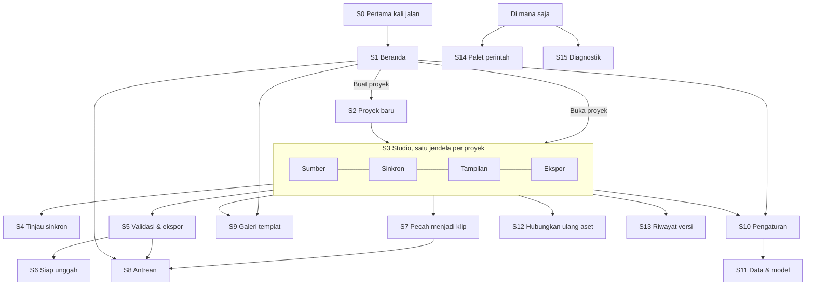
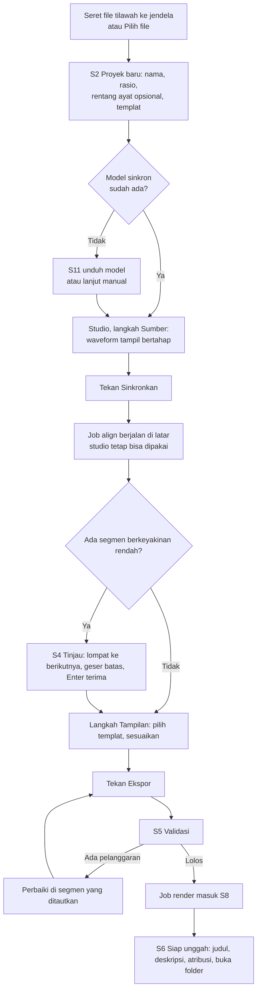
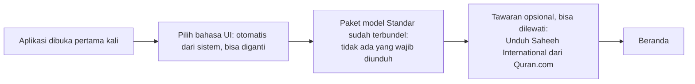
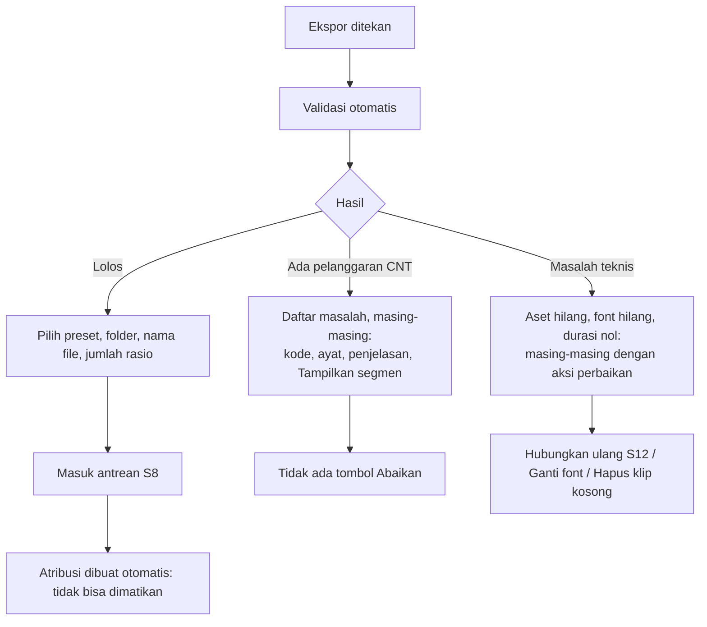

# 03 — Arsitektur Informasi & Alur

| Item | Nilai |
|---|---|
| Status | Tahap 3, untuk ditinjau pemilik produk |
| Dasar | [`PRD.md`](../product/PRD.md) baseline v1.0 (§6, §7), [`PRODUCT.md`](../product/PRODUCT.md), [`02_DESIGN_SYSTEM.md`](02_DESIGN_SYSTEM.md) |
| Keluaran berikutnya | Tahap 4 (selesai): prototipe hi-fi dan spesifikasi di [`04_SCREEN_SPECIFICATIONS.md`](04_SCREEN_SPECIFICATIONS.md) |

Dokumen ini menetapkan **layar apa saja yang ada, apa isi dan aksinya, bagaimana pengguna berpindah, dan
bagaimana setiap keadaan tidak ideal ditangani**. Tampilan visual ada di tahap 4.

---

## 1. Keputusan struktur

| # | Keputusan | Alasan |
|---|---|---|
| A1 | **Satu jendela, dua ruang:** *Beranda* dan *Studio*. Pengaturan, antrean, dan unduhan berupa panel/lembar di atasnya, bukan jendela terpisah. | Pengguna utama mengerjakan satu proyek dalam sesi panjang. Jendela ganda menyulitkan fokus dan membingungkan di macOS/Windows. |
| A2 | **Satu proyek per jendela.** Membuka proyek kedua membuka jendela baru (⌘N). Beranda hanya ada di jendela pertama dan dapat dibuka lagi lewat menu. | Editor profesional memakai pola ini. Proses worker dan preview tidak perlu berbagi state antar proyek. |
| A3 | **Empat langkah adalah *fokus kerja*, bukan halaman.** Header menampilkan Sumber → Sinkron → Tampilan → Ekspor. Berpindah langkah mengubah *panel mana yang menonjol di kiri dan kanan* serta isi bilah bawah. Kanvas dan timeline tidak pernah berganti. | Memenuhi PRD §6 (tanpa tab terpisah) sambil tetap membimbing pengguna baru. |
| A4 | **Antrean ekspor global, bukan per proyek.** Ikon antrean di header Beranda dan Studio membuka panel yang sama. | BAT-2: antrean persisten, lintas proyek, tetap berjalan setelah proyek ditutup. |
| A5 | **Kebijakan teks diperiksa sebelum Ekspor, bukan sesudah.** Tombol Ekspor selalu bisa ditekan. Hasilnya adalah lembar validasi yang menyebut masalah dan menautkan ke segmen penyebabnya. | CNT-1..5 tidak bisa dilewati, jadi pengguna harus tahu persis apa yang harus diperbaiki. Tombol nonaktif tanpa alasan adalah pola yang dihindari. |
| A6 | **Tidak ada akun, login, atau layar selamat datang yang memblokir.** Pengaturan awal hanya muncul bila ada yang wajib (paket model). | Gratis, offline-first, privasi default (PRD §5). |
| A7 | **Wizard adalah overlay pemandu di atas Studio yang sama**, bisa dimatikan. Bukan layar terpisah. | Satu kode, satu tampilan. Pengguna mahir mematikannya sekali. |

---

## 2. Peta layar



| ID | Layar | Jenis | Dibuka dari | Requirement PRD |
|---|---|---|---|---|
| S0 | Pertama kali jalan | Lembar modal, sekali | Peluncuran pertama | DST-5, SYN-8, QRN-3 |
| S1 | Beranda | Ruang | Peluncuran, menu "Beranda" | PRJ-1, PRJ-6 |
| S2 | Proyek baru | Lembar | Beranda, ⌘N, seret file | PRJ-1, SRC-1 |
| S3 | Studio | Ruang | Proyek dibuka | Seluruh §7 |
| S4 | Tinjau sinkron | Mode di dalam Studio | Studio, tombol "Tinjau" | SYN-5, SYN-6 |
| S5 | Validasi & ekspor | Lembar | Tombol Ekspor | EXP-1..7, CNT-1..5 |
| S6 | Siap unggah | Lembar | Setelah ekspor selesai | PKG-1, PKG-2 |
| S7 | Pecah menjadi klip | Lembar | Menu Proyek, palet perintah | BAT-1..3 |
| S8 | Antrean | Panel geser dari kanan | Ikon antrean di header | BAT-2, EXP-7 |
| S9 | Galeri templat | Lembar penuh | Beranda, Inspector (langkah Tampilan) | STY-6 |
| S10 | Pengaturan | Lembar | ⌘, | SET-1..5 |
| S11 | Data & model | Bagian pengaturan | S10, S0, peringatan terkait | QRN-3/4/12, SYN-7/8 |
| S12 | Hubungkan ulang aset | Lembar | Item aset hilang, saat membuka proyek | PRJ-5, EXP-6 |
| S13 | Riwayat versi | Panel geser | Menu Berkas | PRJ-3 |
| S14 | Palet perintah | Overlay | ⌘K / Ctrl+K | SET-3 |
| S15 | Diagnostik | Lembar | Pesan galat, menu Bantuan | PRD §8.3 |

**Jenis layar:** *Ruang* mengisi jendela. *Lembar* menutupi sebagian jendela dan memblokir bagian di
belakangnya (dialog besar dengan tombol Selesai/Batal). *Panel geser* tidak memblokir dan bisa tetap terbuka
sambil bekerja.

---

## 3. Alur utama

### 3.1 Dari file ke video pertama (target ≤ 10 menit, PRD G1)



**Titik gesekan yang dijaga:**

| Titik | Perlakuan |
|---|---|
| Pengguna tidak tahu surah/ayat | Rentang ayat opsional. Kosong berarti deteksi otomatis (SYN-2). |
| Menunggu sinkron | Studio tidak terkunci. Pengguna bisa mulai memilih templat sementara job berjalan. |
| Banyak segmen perlu tinjauan | Tinjau berurutan dengan satu tombol "Berikutnya" (N). Segmen yang diterima keluar dari daftar. |
| Ekspor ditolak | Lembar validasi menyebut penyebab dengan bahasa awam dan tombol "Tampilkan segmen". |

### 3.2 Pertama kali jalan (S0)



- Maksimal **dua layar**, keduanya bisa dilewati. Tidak ada pembuatan akun.
- Saheeh adalah satu-satunya tawaran unduhan di sini. Atribusi dan sumber (Quran.com) ditampilkan sebelum pengguna menekan Unduh.
- Bila offline, tawaran itu disembunyikan, dan tidak ada pesan galat.

### 3.3 Meninjau sinkron (S4)

Langkah ini adalah titik pengguna menjaga amanah teks, jadi dibuat paling efisien.

| Aksi | Pintasan | Perilaku |
|---|---|---|
| Segmen berikutnya yang perlu ditinjau | N | Playhead melompat ke awal segmen, memutar 2 detik ke belakang untuk konteks |
| Terima segmen | Enter | Menandai `reviewed`, titik amber hilang, lompat ke berikutnya |
| Geser batas | Seret atau ⌥←/→ (1 frame), ⇧⌥←/→ (10 frame) | Snap ke jeda waveform, bisa dimatikan |
| Set akhir di playhead | ] | Saat playback |
| Belah / gabung | S / ⌘J | Belah hanya di batas kata. Gabung hanya segmen bertetangga dari ayat yang sama. |
| Ganti ayat | ⌘F, lalu cari | Pencarian dari dataset. Tidak ada ketik bebas teks Arab (QRN-8). |
| Undo | ⌘Z | Termasuk hasil AI |

Daftar "Perlu ditinjau" di panel kiri menampilkan kode ayat, keyakinan, dan alasan singkat ("batas akhir ragu",
"kemungkinan pengulangan"). Header menampilkan hitungan sisa. Studio tidak menahan langkah berikutnya
selama masih ada segmen berkeyakinan rendah, karena CNT hanya menolak **pelanggaran teks**, bukan keraguan model.

### 3.4 Ekspor dan kebijakan teks (S5)



**Isi lembar S5** (satu lembar, tiga bagian vertikal):

1. **Pemeriksaan**: daftar centang hijau/amber/merah. Setiap baris yang gagal punya satu aksi.
2. **Keluaran**: preset platform (Shorts, Reels, TikTok, YouTube, Kustom), rasio, resolusi, fps, codec (otomatis dengan
   catatan encoder), folder, pola nama berkas (konflik nama diberi sufiks, EXP-5), transparan (opsi), subtitle (SRT/VTT/ASS).
3. **Ringkasan**: durasi, perkiraan ukuran, atribusi yang akan ditulis, dan tombol utama **Ekspor** (atau "Tambah ke antrean" bila antrean berjalan).

Peringatan platform (PKG-2) muncul sebagai peringatan amber: "Durasi 74 detik melebihi batas Shorts (60 detik)". Ini
tidak memblokir.

### 3.5 Pecah menjadi klip (S7, batch)

| Langkah | Isi |
|---|---|
| 1. Cara memecah | Pilihan: per N ayat, per durasi maksimum, per penanda, atau pilih manual. Pratinjau memperlihatkan hasil di timeline sebagai rentang. |
| 2. Tinjau daftar | Tabel klip dengan kode ayat, durasi, judul dari variabel (`{surah_name}`, `{ayah_range}`, `{reciter}`, `{translation_credit}`). Bisa dihapus atau digabung. |
| 3. Keluaran | Templat, preset, folder, rasio. Satu pengaturan untuk semua klip. |
| 4. Mulai | Semua klip masuk antrean. Klip yang melanggar CNT ditandai di daftar sebelum mulai, dan tidak membatalkan klip lain. |

### 3.6 Alur sekunder

| Alur | Ringkasan |
|---|---|
| **Membuka proyek dengan aset hilang** | Proyek terbuka. Banner amber di atas panel media: "2 aset tidak ditemukan" dengan "Hubungkan ulang". Preview menampilkan kerangka bertanda untuk klip yang hilang. S12 mencari lewat hash di folder pilihan pengguna. |
| **Pulih dari berkas rusak** | Lembar saat membuka: "Proyek ini tidak bisa dibaca. Pulihkan dari versi 14 menit lalu?" dengan pratinjau tanggal dan jumlah segmen. |
| **Proyek dibuat dengan versi dataset berbeda** | Lembar diff ringkas (QRN-14): "Terjemahan Saheeh diperbarui. Perbarui atau pertahankan versi proyek?". Defaultnya Pertahankan. |
| **Mengunduh terjemahan (QRN-12)** | Di S11. Tombol Unduh → progres → hasil dengan jumlah ayat dan catatan kaki. Gagal jaringan: pesan dengan "Coba lagi" dan catatan bahwa edisi yang ada tetap bisa dipakai. |
| **Encoder perangkat keras gagal (EXP-2)** | Toast peringatan "sudah dipulihkan", job tetap jalan dengan software. |
| **Aplikasi ditutup saat antrean berjalan** | Dialog: "2 ekspor masih berjalan. Lanjutkan di latar atau berhenti?" Lanjutkan hanya tersedia bila proses worker bisa hidup tanpa jendela. Bila tidak, antrean dilanjutkan saat aplikasi dibuka lagi (job kembali `queued`). |

---

## 4. Isi per layar

Notasi komponen mengacu ke [02_DESIGN_SYSTEM.md §4](02_DESIGN_SYSTEM.md).

### S1 — Beranda

```text
┌─ Header: logo · [Cari proyek ⌘F] ················ [Antrean ③] [Pengaturan] ┐
│ ┌ Rel kiri ─────┐ ┌ Isi ─────────────────────────────────────────────────┐ │
│ │ Semua proyek  │ │ [Buat proyek]  [Buka…]            Urut: Diubah ▾  ▦ ☰ │ │
│ │ Draf          │ │ ┌────┐ ┌────┐ ┌────┐ ┌────┐                          │ │
│ │ Siap          │ │ │thumb│ │    │ │    │ │    │   nama · qari · 12:08    │ │
│ │ Terbit        │ │ └────┘ └────┘ └────┘ └────┘   badge status           │ │
│ │ ─────────     │ │                                                       │ │
│ │ Kategori      │ │ (kosong: area lepas + "Mulai dengan menyeret file…")  │ │
│ │ Templat       │ │                                                       │ │
│ └───────────────┘ └───────────────────────────────────────────────────────┘ │
└──────────────────────────────────────────────────────────────────────────┘
```

| Bagian | Isi |
|---|---|
| Rel kiri | Filter status (Semua, Draf, Siap, Terbit), kategori buatan pengguna, tautan ke Templat |
| Isi | Kisi atau daftar proyek. Kartu: thumbnail frame terakhir, nama, qari, durasi, rentang ayat, status, tanggal diubah. Menu konteks: Buka, Duplikat, Ganti nama, Pindahkan ke kategori, Tampilkan di Finder/Explorer, Hapus. |
| Header | Pencarian (nama, qari, ayat), ikon antrean dengan hitungan aktif, pengaturan |
| Keadaan | **Kosong**: area lepas besar. **Memuat**: kerangka kartu. **Proyek hilang** (folder dipindah): kartu abu-abu dengan "Temukan…" dan "Hapus dari daftar". |

Beranda tidak menampilkan metrik, tips berputar, atau donasi.

### S2 — Proyek baru

Satu lembar dengan sedikit isian, semuanya punya default.

| Isian | Default | Catatan |
|---|---|---|
| Sumber audio/video | dari file yang diseret | Bisa menambah latar video terpisah nanti |
| Nama | nama file | |
| Qari | kosong | Dipakai di nama berkas dan atribusi (`{reciter}`) |
| Rentang ayat | Deteksi otomatis | Opsi "Kunci rentang" membuka pemilih surah/ayat dari dataset |
| Rasio | 9:16 | Segmen: 9:16, 16:9, 1:1, 4:5 |
| Templat | templat terakhir dipakai | Pilihan dari galeri kecil |
| Terjemahan | Kemenag (Indonesia) | Centang tambahan: Saheeh bila terpasang |
| Folder proyek | folder default | |

Tombol utama: **Buat dan sinkronkan** (menjalankan alignment) dengan alternatif sekunder **Buat tanpa sinkron**.

### S3 — Studio

```text
┌ Header ─────────────────────────────────────────────────────────────────────┐
│ ◂ Beranda  Nama proyek ·    ✓ Sumber › ② Sinkron › ③ Tampilan › ④ Ekspor  [Antrean][Ekspor] │
├ Panel kiri 232 ┬ Viewer ──────────────────────────────────┬ Inspector 272 ┤
│ (isi berubah    │ bar: zoom · rasio · area aman             │ (isi berubah   │
│  menurut        │ kanvas (dirender Rust)                    │  menurut       │
│  langkah)       │ transport                                 │  langkah)      │
├─────────────────┴───────────────────────────────────────────┴───────────────┤
│ Timeline: bilah alat · penggaris · Latar · Audio · Ayat · Terjemahan · Overlay │
└──────────────────────────────────────────────────────────────────────────┘
```

**Apa yang berubah per langkah (A3):**

| Langkah | Panel kiri | Inspector | Timeline | Aksi utama |
|---|---|---|---|---|
| **Sumber** | Aset proyek (impor, hilang, durasi), unduhan (P1), latar | Properti aset: potong, gain hingga +12 dB, normalisasi, fade | Track Audio dan Latar disorot | **Sinkronkan** |
| **Sinkron** | Daftar segmen + "Perlu ditinjau" (S4), pengaturan deteksi (kunci rentang, tingkat model) | Properti segmen: waktu, rentang kata, ayat, keyakinan, penanda (basmalah, isti'adzah) | Track Ayat dan Terjemahan disorot, waveform lebih tinggi | **Tinjau berikutnya** |
| **Tampilan** | Galeri templat kecil, lapisan (Ayat, Terjemahan, Nama surah, Qari, Logo, Overlay) | Gaya berlapis: Templat · Proyek · Klip, dengan titik override. Animasi, area aman. | Track Overlay muncul | **Terapkan ke semua** (bila ada override klip) |
| **Ekspor** | Preset dan paket unggah, daftar klip batch bila ada | Ringkasan keluaran | Tidak berubah | **Ekspor** (membuka S5) |

Aturan:
- Perpindahan langkah tidak menghapus pilihan. Playhead, zoom, dan seleksi dipertahankan.
- Langkah bisa dilompati. Status langkah (selesai, berjalan, belum, terhalang) dihitung dari keadaan proyek.
- "Terhalang" hanya dipakai untuk Ekspor dan hanya bila validasi menemukan pelanggaran.
- **Overlay pemandu (A7)**: gelembung kecil di dekat aksi utama langkah yang aktif untuk 3 proyek pertama. Satu tombol "Matikan panduan".

**Keadaan Studio:**

| Keadaan | Perlakuan |
|---|---|
| Sinkron berjalan | Bar tipis di bawah header dengan tahap ("Mengenali ayat… 40%") dan Batal. Studio tetap interaktif kecuali track Ayat yang dikunci sementara. |
| Sinkron gagal | Peringatan dalam halaman di panel Sinkron: penyebab + "Coba dengan rentang ayat dikunci" + "Sinkron manual". Segmen manual tetap bisa dibuat. |
| Preview lambat | Lencana kecil "Preview ½" di bar viewer dengan aksi "Turunkan kualitas". Tidak ada dialog. |
| Autosave | Indikator halus "Tersimpan" di header, berubah menjadi "Menyimpan…" saat menulis. Gagal menyimpan: toast galat tetap tampil dengan "Simpan sebagai…". |
| Dataset tidak lolos checksum | Lembar blokir (CNT-2): "Data Al-Qur'an tidak terverifikasi. Teks tidak ditampilkan." dengan "Unduh ulang data". |

### S4 — Tinjau sinkron
Bukan layar terpisah: ini keadaan Studio pada langkah Sinkron. Header tinjau muncul di atas daftar segmen: "3 dari 12 perlu ditinjau"
dengan tombol Berikutnya (N) dan Terima (Enter). Kanvas menampilkan sorotan kata sesuai waktu hasil model sehingga
kesalahan batas kata terlihat langsung.

### S5 — Validasi & ekspor
Lihat §3.4. Lembar lebar 560 px. Tombol: **Batal** (kiri), **Ekspor** (kanan, primer). Saat ada pelanggaran, tombol Ekspor
diganti **Perbaiki masalah** yang melompat ke pelanggaran pertama.

### S6 — Siap unggah
Muncul setelah ekspor selesai, atau dari item selesai di antrean.

| Bagian | Isi |
|---|---|
| Berkas | Nama, durasi, ukuran, tombol **Buka folder** dan **Putar** |
| Judul | Isian bisa diedit, tombol Salin. Dibuat dari variabel templat. |
| Deskripsi | Teks bisa diedit dengan atribusi (qari, teks Qur'an, terjemahan, font) sudah di dalamnya, tombol Salin |
| Hashtag | Daftar, tombol Salin |
| Bab YouTube (P1) | Daftar timestamp, tombol Salin |
| Peringatan platform | Durasi/rasio terhadap preset yang dipilih |

Tidak ada tombol "Unggah". Kalimat pengantar: "Unggah file ini dari akun Anda. Teks di bawah sudah siap ditempel."

### S8 — Antrean
Panel geser kanan 400 px. Daftar `JobRow` (lihat 02 §4.15) dikelompokkan: **Berjalan**, **Menunggu**, **Selesai**, **Gagal/Dibatalkan**.

| Aksi | Tempat |
|---|---|
| Jeda semua / Lanjutkan semua | Kepala panel |
| Urutkan ulang | Seret baris menunggu |
| Prioritas | Menu baris |
| Batalkan, jalankan ulang, coba lagi, buka folder, Siap unggah, salin diagnostik | Aksi baris dan menu |
| Hapus yang selesai | Kaki panel |

Baris gagal menampilkan penyebab dalam satu kalimat dan tombol "Salin diagnostik". Baris dibatalkan tetap terlihat.

### S9 — Galeri templat
Lembar penuh. Kiri: filter rasio, gaya (minimal, kaligrafi, mushaf, siaran), dan "Milik saya". Isi: kartu templat dengan pratinjau ayat contoh
(Al-Fatihah 1:5), nama, rasio yang didukung. Aksi: **Terapkan**, **Impor `.qrtemplate`**, **Ekspor**, **Duplikat**. Templat dengan font hilang
diberi lencana peringatan dan penjelasan.

### S10 — Pengaturan
Lembar dengan rel kiri dan isi di kanan. Bagian:

| Bagian | Isi | Requirement |
|---|---|---|
| Umum | Bahasa UI, tema (Sistem/Terang/Gelap), skala UI, folder proyek default | SET-1, SET-4 |
| Pintasan | Daftar semua aksi dengan pintasan yang bisa diubah, deteksi bentrok | SET-3 |
| Sinkron | Tingkat model, ambang tinjau, endpoint cloud (P1) | SYN-7/8 |
| Ekspor | Folder default, pola nama berkas, encoder (otomatis + uji), preset | EXP-2/5 |
| Data & model (S11) | Edisi terjemahan terpasang, unduh/hapus, versi dataset, model terpasang, ruang yang dipakai, bersihkan cache | QRN-3/4/12, DST-5 |
| Font | Font terbundel dan font impor (impor, hapus), cakupan glyph | STY-7, CNT-5 |
| Kunci & layanan | API key LLM dan stok media (hanya status "tersimpan di keychain" + ganti/hapus) | SET-2 |
| Privasi | Telemetri dan laporan crash (mati default) dengan pratinjau data | SET-5 |
| Tentang | Versi, lisensi pihak ketiga, atribusi dataset dan font, cek pembaruan, kanal (stable/beta) | DST-4 |

### S12 — Hubungkan ulang aset
Daftar aset hilang dengan nama, hash, dan tautan terakhir. Aksi per baris: **Pilih file…**; aksi massal: **Cari di folder…** (mencocokkan hash).
Hasil menampilkan "Cocok" dan "Berbeda isi" (hash tidak sama, dengan peringatan bahwa waktu sinkron mungkin tidak berlaku).

### S13 — Riwayat versi
Panel geser: daftar snapshot (waktu, ringkasan perubahan, jumlah segmen). Aksi: **Pratinjau** (membuka salinan baca-saja), **Pulihkan**
(membuat snapshot baru dari kondisi sekarang sebelum menimpa).

### S14 — Palet perintah
Lihat 02 §4.19. Grup: Alur, Perintah, Ayat, Proyek, Templat. Semua perintah di menu ada di palet.

### S15 — Diagnostik
Lembar berisi kode galat, penjelasan, langkah, dan tombol **Salin diagnostik** (versi, OS/GPU, encoder, 200 baris log terakhir tanpa teks
ayat dan tanpa rahasia). Ada tautan ke halaman isu proyek.

---

## 5. Navigasi & perintah

### 5.1 Bilah menu (macOS; di Windows/Linux sama sebagai menu di jendela)

| Menu | Isi utama |
|---|---|
| QuranRender | Tentang · Pengaturan… (⌘,) · Periksa pembaruan · Keluar |
| Berkas | Proyek baru (⌘N) · Buka… (⌘O) · Buka terbaru · Simpan versi (⌘S) · Riwayat versi · Ekspor arsip proyek… · Impor arsip… · Tutup (⌘W) |
| Edit | Urungkan (⌘Z) · Ulangi (⇧⌘Z) · Potong/Salin/Tempel · Pilih semua · Cari ayat (⌘F) |
| Proyek | Sinkronkan ulang… · Pecah menjadi klip… · Hubungkan ulang aset… · Terjemahan… · Properti proyek |
| Tampilan | Langkah 1–4 (⌘1–⌘4) · Zoom timeline · Area aman · Panel kiri/kanan · Layar penuh preview · Tema |
| Ekspor | Ekspor… (⇧⌘E) · Antrean (⌥⌘Q) · Ekspor subtitle… · Paket unggah |
| Bantuan | Panduan · Pintasan keyboard · Diagnostik · Laporkan masalah · Lisensi |

### 5.2 Pintasan inti

| Aksi | Pintasan |
|---|---|
| Putar / jeda | Spasi |
| Mundur / jeda / maju | J / K / L |
| Satu frame | ← / → |
| Belah di playhead | S |
| Hapus (riak) | Delete / ⇧Delete |
| Penanda | M |
| Masuk / keluar | I / O |
| Berikutnya perlu ditinjau | N |
| Terima segmen | Enter |
| Zoom timeline | ⌘+ / ⌘− / ⌘0 |
| Palet perintah | ⌘K |
| Langkah 1–4 | ⌘1–⌘4 |

Windows/Linux memakai Ctrl menggantikan ⌘. Semua pintasan bisa diubah (SET-3).

### 5.3 Fokus keyboard
Urutan: header → panel kiri → viewer/transport → inspector → timeline. F6 berpindah antar wilayah. Dalam timeline, panah memilih klip dan
Enter membuka inspector-nya.

---

## 6. Katalog keadaan tidak ideal

Konsisten dengan komponen di 02 dan nada di 01 §6.

| Situasi | Komponen | Pesan (ringkas) | Aksi |
|---|---|---|---|
| File tidak bisa didecode | Peringatan dalam halaman | "File ini tidak bisa dibuka. Format yang didukung: mp3, m4a, wav, mp4, mov." | Pilih file lain |
| Audio terlalu pendek (< 1 detik) | Peringatan | "Audio terlalu pendek untuk disinkronkan." | Ganti audio |
| Rentang ayat tidak cocok | Peringatan | "Bacaan tidak cocok dengan Al-Baqarah 255–257. Coba hapus kunci rentang." | Hapus kunci · Sinkron manual |
| Paket model tidak lolos hash | Dialog | "Paket model rusak dan tidak dimuat." | Unduh ulang |
| Font tidak punya glyph | Lembar S5 (CNT-5) | "Font Amiri belum memiliki tanda waqaf yang dipakai di 554 ayat." | Pakai LPMQ |
| Segmen memotong kata | Lembar S5 (CNT-1) | "Segmen 2:255 memotong sebuah kata." | Tampilkan segmen |
| Atribusi edisi kosong | Lembar S5 (CNT-3) | "Edisi terjemahan ini belum punya atribusi." | Buka edisi di Pengaturan |
| Ruang disk kurang | Toast galat | "Ruang disk tidak cukup (perlu 1,2 GB)." | Coba lagi |
| Unduhan terputus | Toast + baris di S11 | "Unduhan terhenti. Edisi yang ada tetap bisa dipakai." | Lanjutkan |
| Berkas proyek dikunci instance lain | Lembar | "Proyek ini sedang dibuka di jendela lain." | Buka baca-saja |
| Skema proyek lebih baru | Dialog | "Proyek ini dibuat dengan versi yang lebih baru. Perbarui QuranRender untuk membukanya." | Periksa pembaruan |

---

## 7. Ukuran jendela

| Lebar | Perilaku |
|---|---|
| ≥ 1440 | Tata letak penuh (tiga kolom + timeline) |
| 1100–1439 | Panel kiri dan kanan dipersempit (200 / 248 px), pil asal gaya merapat |
| < 1100 (minimum 960 × 640) | Panel kiri menjadi laci yang dibuka dengan ⌘⌥L. Inspector tetap. |
| Layar penuh preview | Kanvas memenuhi jendela dengan transport mengambang yang hilang otomatis |

---

## 8. Pemetaan ke PRD

| Kelompok PRD | Dicakup oleh |
|---|---|
| PRJ-1..6 | S1, S2, S12, S13, §3.6 |
| SRC-1..5 | S2, Studio langkah Sumber |
| QRN-1..14 | S0, S11, S5 (CNT), §3.6 |
| SYN-1..9 | Studio langkah Sinkron, S4, S10/S11 |
| TML-1..6 | Timeline di Studio, §5.2 |
| STY-1..9 | Studio langkah Tampilan, S9 |
| ANM-1..4 | Inspector langkah Tampilan (bagian Animasi) |
| RND-1..5 | Viewer Studio, bar kualitas preview |
| EXP-1..9 | S5, S8 |
| BAT-1..5 | S7, S8 |
| PKG-1..4 | S6 |
| CNT-1..5 | S5 |
| SET-1..6 | S10, §5 |
| DST-4 | S10 Tentang, menu QuranRender |

**Tidak ada layar** untuk integrasi publikasi (di luar cakupan rilis 1), akun, atau sinkronisasi cloud.

---

## 9. Pertanyaan untuk tahap 4

Tidak memblokir. Jawaban memengaruhi detail mockup, dan jika tidak dijawab saya memakai default tebal.

| ID | Pertanyaan | Default |
|---|---|---|
| T1 | Beranda memakai kisi kartu atau daftar baris sebagai tampilan awal? | Kisi kartu, bisa diganti ke daftar |
| T2 | Panduan bergelembung (A7) tetap ada, atau cukup keadaan kosong yang menjelaskan langkah? | Tetap ada, untuk 3 proyek pertama |
| T3 | Preview ½ perlu lencana permanen, atau hanya saat penurunan kualitas otomatis? | Hanya saat otomatis |
