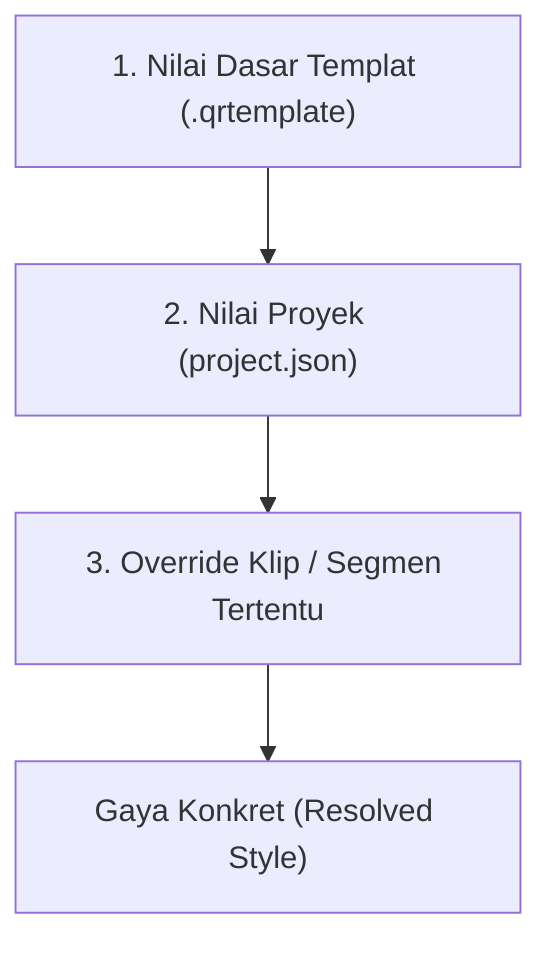
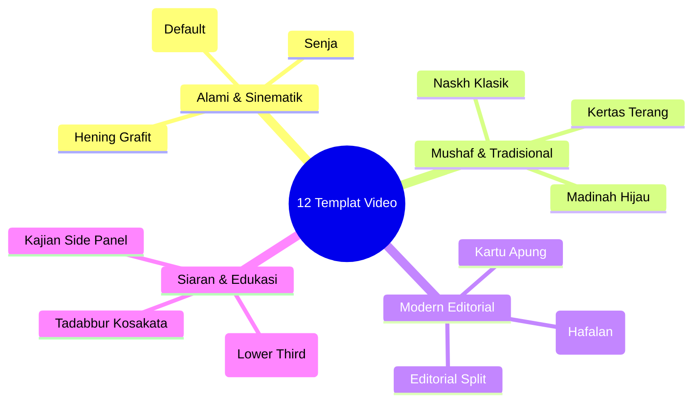

# 05 — Spesifikasi Templat Video & Format `.qrtemplate`

| Item | Nilai |
|---|---|
| Status | Tahap 5 — Spesifikasi Final Kontrak Desain Video |
| Dasar | [PRD.md](../product/PRD.md) v1.0 (STY-1..8, ANM-1..3, RND-1..5, CNT-1..5), [01 Identitas](01_BRAND_IDENTITY.md), [02 Sistem Desain](02_DESIGN_SYSTEM.md), [04 Layar](04_SCREEN_SPECIFICATIONS.md), ADR-0002 s.d. ADR-0006 |
| Pelaksana | Renderer Rust `qr-render` (saat ini CPU: `tiny-skia` + `harfrust`; backend GPU wgpu/vello belum ada) dan antarmuka Studio di `apps/desktop` |
| Output Terkait | Format berkas `.qrtemplate`, paket templat bawaan di `crates/qr-render/templates/`, tugas Fase 1 (A1-06, A1-15) |

---

## 1. Prinsip Desain Templat Video QuranRender

1. **Amanah Teks di Atas Segalanya (Brightest Ayah Rule).**
   Teks ayat Al-Qur'an adalah elemen fokal utama dengan kontras tertinggi di setiap bingkai. Elemen latar (video pemandangan, warna polos, ornamen) tidak boleh menenggelamkan keterbacaan huruf Arab maupun harakat dan tanda waqaf.
2. **Tanpa Representasi Makhluk Bernyawa (CNT-4).**
   Visual templat строго bebas dari siluet, foto, ilustrasi, atau representasi makhluk bernyawa. Latar hanya menggunakan pemandangan alam (alam semesta, pegunungan, awan, fajar, laut), tekstur fisik (kertas mushaf, batu grafit), atau grafis abstrak geometris murni.
3. **Bukan Dekorasi Semata (CNT-1 & QRN-8).**
   Teks ayat tidak pernah dipenggal sembarangan demi estetika tata letak. Setiap baris diatur berdasarkan batas kata (*word boundary*), dan teks selalu bersumber verbatim dari dataset Kemenag tanpa penambahan kaligrafi bebas yang mengubah struktur karakter.
4. **Responsif dan Deterministik Lintas 4 Rasio Aspek.**
   Setiap templat mendefinisikan tata letak untuk minimal rasio utama (9:16 vertikal dan 16:9 horizontal), serta rasio sekunder (1:1 persegi dan 4:5 potret Instagram). Semua koordinat dihitung berbasis unit relatif kanvas (`cw` / *canvas width* dan `ch` / *canvas height*) agar hasil render 720p, 1080p, dan 4K identik secara proporsional.
5. **Animasi Berbasis Audio Master Tick (ANM-3).**
   Seluruh transisi dan sorotan kata (*word-by-word karaoke*) dievaluasi sebagai fungsi murni dari posisi `tick` audio (48.000 Hz, `i64`). Tidak ada ketergantungan pada *wall-clock time* atau *frame rate* yang berfluktuasi.

---

## 2. Format Berkas `.qrtemplate`

Templat QuranRender didistribusikan dalam format berkas paket `.qrtemplate`. Berkas ini dapat berupa direktori terbuka (selama pengembangan) atau arsip ZIP mandiri tanpa kompresi berat (Store/Deflate) yang memuat:

```text
Nama-Templat.qrtemplate/
├─ template.json         Dokumen spesifikasi tata letak dan gaya (skema v1)
├─ thumbnail.webp        Gambar pratinjau kartu templat (rasio 9:16, 360×640 px)
├─ assets/               (Opsional) Aset latar default, grafis batas, tekstur
│  └─ background.webp
└─ README.md             Informasi lisensi templat, pembuat, dan atribusi aset
```

### 2.1 Skema JSON `template.json` (v1)

```json
{
  "$schema": "https://schema.quranrender.app/template/v1.json",
  "id": "subuh",
  "version": "1.0.0",
  "name": "Subuh",
  "description": "Latar panorama fajar dengan peredup gradien lembut dan terjemahan di bawah ayat.",
  "author": "QuranRender Team",
  "license": "GPL-3.0-or-later",
  "categories": ["nature", "cinematic"],
  "supported_ratios": ["9:16", "16:9", "1:1", "4:5"],
  "default_ratio": "9:16",
  "safe_area": {
    "9:16": { "top": 0.08, "bottom": 0.14, "left": 0.10, "right": 0.10 },
    "16:9": { "top": 0.08, "bottom": 0.08, "left": 0.08, "right": 0.08 },
    "1:1":  { "top": 0.06, "bottom": 0.06, "left": 0.06, "right": 0.06 },
    "4:5":  { "top": 0.08, "bottom": 0.10, "left": 0.08, "right": 0.08 }
  },
  "layers": [
    {
      "id": "bg",
      "kind": "background",
      "visible": true,
      "properties": {
        "source_type": "media_or_color",
        "default_color": "#111317",
        "dimmer_opacity": 0.55,
        "dimmer_type": "linear_gradient_vertical",
        "blur_radius": 0.0
      }
    },
    {
      "id": "surah_name",
      "kind": "surah_title",
      "visible": false,
      "properties": {
        "font_family": "Amiri",
        "font_style": "Regular",
        "font_size_cw": 0.065,
        "text_color": "#F4F5F7",
        "position_anchor": "top_center",
        "offset_y_ch": 0.155
      }
    },
    {
      "id": "ayah",
      "kind": "ayah_text",
      "visible": true,
      "properties": {
        "font_family": "LPMQ",
        "font_style": "Regular",
        "font_size_cw": 0.092,
        "line_height_multiplier": 1.95,
        "text_color": "#F4F5F7",
        "text_shadow": {
          "color": "rgba(0, 0, 0, 0.45)",
          "blur": 14.0,
          "offset_x": 0.0,
          "offset_y": 1.5
        },
        "highlight_style": "smooth_fade",
        "highlight_active_color": "#FFFFFF",
        "highlight_inactive_opacity": 0.72,
        "position_anchor": "center",
        "max_width_cw": 0.80
      }
    },
    {
      "id": "translation",
      "kind": "translation_text",
      "visible": true,
      "properties": {
        "font_family": "Inter",
        "font_style": "Regular",
        "font_size_cw": 0.040,
        "line_height_multiplier": 1.45,
        "text_color": "#E5E7EB",
        "opacity": 0.88,
        "position_relative_to": "ayah",
        "margin_top_ch": 0.025,
        "max_width_cw": 0.76
      }
    },
    {
      "id": "ref_badge",
      "kind": "reference_badge",
      "visible": true,
      "properties": {
        "font_family": "Inter",
        "font_style": "Medium",
        "font_size_cw": 0.032,
        "text_color": "rgba(244, 245, 247, 0.65)",
        "position_relative_to": "translation",
        "margin_top_ch": 0.018
      }
    },
    {
      "id": "qari_pill",
      "kind": "reciter_pill",
      "visible": false,
      "properties": {
        "font_family": "Inter",
        "font_size_cw": 0.034,
        "text_color": "#FFFFFF",
        "background_color": "rgba(8, 9, 12, 0.55)",
        "border_radius_cw": 0.02,
        "padding_cw": [0.008, 0.025],
        "position_anchor": "bottom_center",
        "offset_y_ch": 0.26
      }
    }
  ],
  "animations": {
    "transition_in": {
      "type": "fade",
      "duration_ticks": 15360,
      "easing": "ease_out"
    },
    "transition_out": {
      "type": "fade",
      "duration_ticks": 9600,
      "easing": "ease_in"
    },
    "karaoke": {
      "transition_duration_ticks": 3840,
      "easing": "ease_out"
    }
  }
}
```

---

## 3. Sistem Koordinat & Area Aman (Safe Area)

Untuk memastikan proporsi visual tetap presisi saat dirender pada berbagai resolusi (mis. 720×1280 vs 1080×1920 vs 2160×3840), renderer Rust mengadopsi sistem koordinat bernormalisasi:

- **`cw` (Canvas Width):** 1.0 = 100% lebar kanvas video.
- **`ch` (Canvas Height):** 1.0 = 100% tinggi kanvas video.
- **`cqw` / `cqh` pada Webview:** Mengikuti rasio yang identik untuk pratinjau DOM.

### 3.1 Matriks Area Aman per Rasio Aspek (Platform Margins)

Teks ayat dan tombol interaktif video tidak boleh terpotong oleh antarmuka bawaan platform media sosial (nama akun, deskripsi, tombol like, bilah audio di TikTok/Reels/Shorts).

```text
┌──────────────────────── 9:16 (Shorts / Reels / TikTok) ────────────────────────┐
│                                                                                │
│   ▲  Top Safe Inset: 8% (0.08 ch)                                             │
│   │  (Bebas dari ikon kamera, tombol cari, dan navigasi atas)                  │
│                                                                                │
│   ├───────────────── Inset Area Aman Konten Utama ─────────────────────────┤   │
│   │                                                                        │   │
│   │  ◄ Left: 10% (0.10 cw)             Right: 10% (0.10 cw) ►              │   │
│   │                                                                        │   │
│   │                                                                        │   │
│   │                                                                        │   │
│   │                         [ Teks Ayat Al-Qur'an ]                        │   │
│   │                         [ Terjemahan Kemenag  ]                        │   │
│   │                         [ Al-Fatihah : 5      ]                        │   │
│   │                                                                        │   │
│   │                                                                        │   │
│   ├────────────────────────────────────────────────────────────────────────┤   │
│                                                                                │
│   │  Bottom Safe Inset: 14% (0.14 ch)                                          │
│   ▼  (Bebas dari nama qari/akun, judul audio, tombol Like, Share, Komen)       │
│                                                                                │
└────────────────────────────────────────────────────────────────────────────────┘
```

| Rasio | Dimensi Acuan | Inset Atas | Inset Bawah | Inset Kiri | Inset Kanan | Keterangan Platform |
|---|---|---|---|---|---|---|
| **9:16** | 1080 × 1920 | **8%** (154 px) | **14%** (269 px) | **10%** (108 px) | **10%** (108 px) | YouTube Shorts, IG Reels, TikTok |
| **16:9** | 1920 × 1080 | **8%** (86 px) | **8%** (86 px) | **8%** (154 px) | **8%** (154 px) | YouTube Standar, TV Siaran |
| **1:1**  | 1080 × 1080 | **6%** (65 px) | **6%** (65 px) | **6%** (65 px) | **6%** (65 px) | Instagram Feed Kotak |
| **4:5**  | 1080 × 1350 | **8%** (108 px) | **10%** (135 px) | **8%** (86 px) | **8%** (86 px) | Instagram Feed Potret |

---

## 4. Model Gaya Berlapis (Layered Style Inheritance)

Sesuai kebutuhan **STY-1**, gaya pada video dihitung secara berjenjang dari tiga tingkatan (skema resolusi kaskade):



1. **Tingkat 1 — Templat (`template.json`):**
   Mendefinisikan gaya default seluruh elemen (font, warna, ukuran, bayangan, padding).
2. **Tingkat 2 — Proyek (`project.json`):**
   Pengguna mengubah parameter untuk seluruh video di Langkah Tampilan Studio (misalnya: menaikkan ukuran teks ayat 10%, mengubah warna sorotan kata menjadi nila, atau mematikan nama surah).
3. **Tingkat 3 — Override Klip:**
   Pengguna mengubah segmen tertentu secara spesifik (misalnya: ayat 2:282 yang sangat panjang dikecilkan ukurannya khusus untuk klip tersebut). Di antarmuka inspector, nilai yang di-override ditandai dengan **titik override** dan tombol kembalikan (*revert*).

---

## 5. Model Animasi & Sorotan Kata (Karaoke WBW)

### 5.1 Transisi Masuk & Keluar Segmen (ANM-1)

Setiap segmen ayat memiliki durasi transisi yang dihitung dalam satuan *tick* audio (48.000 tick = 1 detik):

| Jenis Animasi | Rumus Evaluasi pada Tick `t` | Default Durasi | Easing |
|---|---|---|---|
| **Fade (Pudar)** | $\alpha(t) = \text{clamp}\left(\frac{t - t_{\text{start}}}{t_{\text{in}}}, 0, 1\right)$ | 320 ms (15.360 tick) | Cubic Ease-Out |
| **Slide Up (Geser Naik)** | $y(t) = y_{\text{target}} + \Delta y \cdot (1 - \text{ease}(t))$ | 360 ms (17.280 tick) | Quartic Ease-Out |
| **Scale (Skala Halus)** | $s(t) = 0.96 + 0.04 \cdot \text{ease}(t)$ | 320 ms (15.360 tick) | Cubic Ease-Out |

### 5.2 Sorotan Kata-per-Kata Kontinu (ANM-2 Karaoke WBW)

Sorotan kata tidak boleh berpindah secara kasar (diskrit *on/off*), melainkan berpindah secara mulus sesuai progres waktu masing-masing kata:

1. **Rentang Kata $k$:** Dimulai pada $t_{k,\text{start}}$ dan berakhir pada $t_{k,\text{end}}$.
2. **Progres Normalisasi:**
   $$p_k(t) = \text{clamp}\left(\frac{t - t_{k,\text{start}}}{t_{k,\text{end}} - t_{k,\text{start}}}, 0, 1\right)$$
3. **Pilihan Gaya Sorotan:**
   - **Terang Bertahap (*Smooth Brightness*):**
     Kata yang aktif bertransisi dari opasitas tidak aktif ($\alpha_{\text{inactive}} = 0.70$) menuju warna penuh ($\alpha_{\text{active}} = 1.0$).
   - **Garis Bawah Aktif (*Underline Indicator*):**
     Garis horizontal halus di bawah kata memanjang dari lebar 0% ke 100% mengikuti $p_k(t)$.
   - **Latar Kotak Halus (*Pill Highlight*):**
     Kotak pembungkus translusen memudar masuk di belakang kluster karakter kata yang aktif.

---

## 6. Algoritma Tata Letak, Shaping Arab & Auto-fit (STY-8)

### 6.1 Pemenggalan Baris Berbasis Kata (Word-Aware Wrapping)

- Shaping teks Arab dilakukan dengan **`harfrust`** (HarfBuzz versi Rust murni). Spike S2 (ADR-0003) mengukur hasil identik dengan HarfBuzz C 14.5.0 pada 6.236 ayat (selisih 0, 0 `.notdef`); `harfbuzz-sys` tidak dipakai.
- **Larangan Keras:** Dilarang memotong di tengah kata atau memisahkan tanda waqaf dari kata yang diikutinya.
- Batas baris dihitung dari offset kata di tabel `word`. Jika sebuah kata menyebabkan lebar baris melebihi `max_width_cw`, seluruh kata beserta tanda waqafnya diturunkan ke baris berikutnya.

### 6.2 Auto-Fit Adaptif untuk Ayat Panjang

Ketika ayat melebihi ruang vertikal maksimum di dalam Area Aman, renderer menjalankan algoritma auto-fit terikat (maksimal 5 iterasi deterministik):

1. **Iterasi 1:** Ukuran font awal 100% (sesuai definisi templat).
2. **Iterasi 2–4:** Jika tinggi total teks > tinggi ruang aman, ukuran font diturunkan bertahap sebesar 7% per langkah hingga batas bawah 65%.
3. **Iterasi 5 (Batas Bawah):** Jika pada ukuran 65% teks masih melebihi ruang aman, jarak antarbaris (*line height*) diturunkan dari 1.95× menjadi minimal 1.65×. Teks terjemahan otomatis disesuaikan secara proporsional.

---

## 7. Katalog Lengkap 12 Templat Bawaan QuranRender

Katalog 12 templat dibagi menjadi 4 keluarga visual untuk memenuhi berbagai kebutuhan kreator:



### 7.1 Keluarga 1: Alami & Sinematik (Cinematic Nature)

#### 01. Subuh (Default)
- **ID:** `subuh` | **Kategori:** Sinematik / Alam
- **Rasio yang didukung:** 9:16 (Primer), 16:9, 1:1, 4:5
- **Konsep:** Latar pemandangan pegunungan/fajar bergradien hangat ke gelap. Peredup gradien vertikal 55% menjaga teks Arab putih bersinar terang di tengah layar.
- **Tipografi:** Ayat LPMQ 0.092 cw, Terjemahan Inter 0.040 cw di bawah ayat.
- **Sorotan WBW:** Terang bertahap (*smooth brightness* putih murni).

#### 02. Senja
- **ID:** `senja` | **Kategori:** Sinematik / Alam
- **Rasio yang didukung:** 9:16, 4:5
- **Konsep:** Nada warna latar jingga temaram pekat. Peredup solid 65% warna grafit dingin untuk mencegah warna jingga mendominasi teks.
- **Tipografi:** Ayat LPMQ 0.095 cw dengan bayangan tegas (*drop shadow* pekat).
- **Sorotan WBW:** Latar pil gelap lembut di belakang kata aktif.

#### 03. Hening Grafit
- **ID:** `hening` | **Kategori:** Minimalis / Khusyuk
- **Rasio yang didukung:** 9:16, 16:9, 1:1, 4:5 (Universal)
- **Konsep:** Latar polos warna grafit pekat (`#101114`). Tanpa foto latar dan tanpa distraksi. Pilihan terbaik untuk tilawah khusyuk dan murottal malam hari.
- **Tipografi:** Ayat LPMQ 0.098 cw perak terang (`#E5E7EB`), terjemahan abu-abu redup.
- **Sorotan WBW:** Terang bertahap ke putih bersih (`#FFFFFF`).

---

### 7.2 Keluarga 2: Mushaf & Tradisional (Traditional Paper)

#### 04. Kertas Terang
- **ID:** `terang` | **Kategori:** Tradisional / Cetak
- **Rasio yang didukung:** 9:16, 16:9, 1:1
- **Konsep:** Mensimulasikan halaman mushaf fisik Al-Qur'an dengan latar kertas krem gading hangat (`#F7F6F2`).
- **Tipografi:** Teks ayat hitam pekat (`#1A1C20`) dengan garis batas tipis netral. Terjemahan warna arang (`#374151`).
- **Sorotan WBW:** Garis bawah tipis nila lembut di bawah kata aktif.

#### 05. Madinah Hijau
- **ID:** `madinah` | **Kategori:** Tradisional / Klasik
- **Rasio yang didukung:** 16:9, 1:1
- **Konsep:** Latar hijau zaitun malam pekat khas Mushaf Madinah dengan ornamen bingkai garis ganda minimalis tanpa elemen figuratif.
- **Tipografi:** Ayat LPMQ keemasan lembut (`#E6C687`), terjemahan putih gading.
- **Sorotan WBW:** Kilau keemasan bertahap (*golden luminance*).

#### 06. Naskh Klasik
- **ID:** `naskh-klasik` | **Kategori:** Tradisional / Edukasi
- **Rasio yang didukung:** 9:16, 4:5
- **Konsep:** Tata letak vertikal menyerupai potongan satu halaman mushaf Al-Qur'an resmi Kemenag RI lengkap dengan nomor ayat di samping teks.
- **Tipografi:** Ayat LPMQ ukuran sedang (0.082 cw) agar dapat memuat hingga 3–4 baris teks tanpa auto-fit agresif.
- **Sorotan WBW:** Terang bertahap.

---

### 7.3 Keluarga 3: Modern Editorial (Modern Typography)

#### 07. Besar (Focus Hafalan)
- **ID:** `besar` | **Kategori:** Modern / Hafalan
- **Rasio yang didukung:** 9:16, 1:1
- **Konsep:** Dirancang khusus untuk hafalan dan tadabbur. Teks ayat berukuran sangat besar di tengah layar, tanpa menampilkan teks terjemahan.
- **Tipografi:** Ayat LPMQ ekstra besar (0.135 cw).
- **Sorotan WBW:** Terang bertahap kontras tinggi (redup 50% → terang 100%).

#### 08. Editorial Split
- **ID:** `editorial-split` | **Kategori:** Modern / Majalah
- **Rasio yang didukung:** 16:9, 9:16
- **Konsep:** Kanvas terbelah secara asimetris: 60% porsi untuk teks Arab dengan latar foto bergradien, dan 40% porsi warna grafit solid untuk terjemahan serta penjelasan makna kata.
- **Tipografi:** Layout seimbang antara teks Arab kanan (RTL) dan terjemahan kiri (LTR).
- **Sorotan WBW:** Latar kotak teks aktif (*box highlight*).

#### 09. Kartu Apung (Floating Card)
- **ID:** `kartu-apung` | **Kategori:** Modern / Clean
- **Rasio yang didukung:** 9:16, 4:5
- **Konsep:** Teks ayat dan terjemahan dibungkus dalam kartu apung translusen dengan efek *backdrop blur* halus dan sudut membulat modern (`border-radius: 16px`).
- **Tipografi:** Ayat LPMQ di dalam kartu dengan padding nyaman (0.06 cw).
- **Sorotan WBW:** Garis bawah tipis (*underline indicator*).

---

### 7.4 Keluarga 4: Siaran & Edukasi (Broadcast & Study)

#### 10. Papan Siaran (Lower Third)
- **ID:** `siaran-lower-third` | **Kategori:** Siaran / Video Panjang
- **Rasio yang didukung:** 16:9 (Utama YouTube & TV)
- **Konsep:** Format standar video lanskap profesional: video latar (tilawah/pemandangan) tampil penuh di dua pertiga atas, sementara ayat dan terjemahan tampil di baris sepertiga bawah (*lower third*) dengan latar peredup horizontal.
- **Tipografi:** Ayat di baris atas lower third, terjemahan Indonesia di baris bawahnya.
- **Sorotan WBW:** Terang bertahap.

#### 11. Tadabbur Kosakata (Word By Word Study)
- **ID:** `tadabbur-wbw` | **Kategori:** Edukasi / Kosakata
- **Rasio yang didukung:** 9:16, 1:1
- **Konsep:** Menampilkan ayat di area atas, terjemahan utuh di tengah, dan kartu sorotan khusus di area bawah yang menampilkan kata aktif yang sedang dibaca beserta arti perkata secara mendalam.
- **Tipografi:** Ayat 0.085 cw, kartu kosakata aktif 0.045 cw.
- **Sorotan WBW:** Sinkronisasi ganda: kata di teks ayat menyala bersamaan dengan pembaruan kartu kosakata di bawahnya.

#### 12. Kajian Side Panel
- **ID:** `kajian-side-panel` | **Kategori:** Siaran / Podcast
- **Rasio yang didukung:** 16:9
- **Konsep:** Dirancang untuk rekaman kajian atau podcast video: video pembicara/qari menempati 70% sisi kiri, sedangkan panel samping kanan (30%) menampilkan surah, ayat aktif yang sedang dibahas, dan terjemahan secara dinamis.
- **Tipografi:** Format teks kolom vertikal terstruktur rapi di panel samping.
- **Sorotan WBW:** Terang bertahap.

---

## 8. Matriks Perbandingan 12 Templat Bawaan

| # | ID Templat | Nama | Keluarga | Rasio Didukung | Gaya Sorotan WBW | Lapisan Bawaan |
|---|---|---|---|---|---|---|
| 01 | `subuh` | Subuh (Default) | Sinematik | 9:16, 16:9, 1:1, 4:5 | Terang bertahap | Latar, Ayat, Terjemahan, Ref |
| 02 | `senja` | Senja | Sinematik | 9:16, 4:5 | Latar pil gelap | Latar, Ayat, Terjemahan, Qari |
| 03 | `hening` | Hening Grafit | Sinematik | Universal (Semua) | Terang bertahap | Latar polos, Ayat, Terjemahan |
| 04 | `terang` | Kertas Terang | Mushaf | 9:16, 16:9, 1:1 | Garis bawah | Latar kertas, Ayat, Terjemahan |
| 05 | `madinah` | Madinah Hijau | Mushaf | 16:9, 1:1 | Kilau keemasan | Latar hijau, Bingkai, Ayat, Tr |
| 06 | `naskh-klasik` | Naskh Klasik | Mushaf | 9:16, 4:5 | Terang bertahap | Latar, Ayat, No.Ayat, Tr |
| 07 | `besar` | Besar (Hafalan) | Modern | 9:16, 1:1 | Terang bertahap | Latar, Ayat Besar |
| 08 | `editorial-split`| Editorial Split | Modern | 16:9, 9:16 | Kotak sorot | Latar split, Ayat, Terjemahan |
| 09 | `kartu-apung` | Kartu Apung | Modern | 9:16, 4:5 | Garis bawah | Latar, Kartu Glass, Ayat, Tr |
| 10 | `siaran-lower-third` | Papan Siaran | Siaran | 16:9 | Terang bertahap | Latar video, Strip bawah, Ayat, Tr |
| 11 | `tadabbur-wbw` | Tadabbur Kosakata | Edukasi | 9:16, 1:1 | Kotak + Kartu WBW | Latar, Ayat, Tr, Kartu Kata |
| 12 | `kajian-side-panel` | Kajian Side Panel | Siaran | 16:9 | Terang bertahap | Video kiri, Panel teks kanan |

---

## 9. Validasi & Pengujian Renderer (Kesesuaian Preview-Export)

Untuk memenuhi kriteria rilis dan gerbang kualitas teknis:

1. **Uji Kesetaraan Preview–Export (RND-1) — terimplementasi** (`crates/qr-cli/src/preview_export_equivalence.rs`, `cargo test -p qr-cli equivalence`):
   - Proyek nyata (Al-Fatihah 1:1, templat `subuh`, 4 dtk @30 fps, 360×640, sorotan kata aktif) diekspor lewat `run_render_job` (jalur produk: RGBA → YUV420 BT.709 di Rust → FFmpeg). 50 frame dipilih deterministik (25 frame beruntun pertama + 25 tersebar), didekode kembali ke RGB (BT.709 rentang TV, `qr_media::extract_rgb24_frames`) dan dibandingkan dengan frame preview (`SceneBuilder` + `SoftwareRenderer`) pada tick yang sama.
   - Metrik: SSIM luma BT.709, jendela seragam 8×8, langkah 1 (`qr_media::ssim`); selisih kanal maksimum, dipisah antara seluruh piksel dan "area datar" (piksel yang jendela 5×5 luma preview-nya berentang ≤ 6, yaitu di luar antialiasing tepi font/bentuk).
   - **Hasil terukur (macOS, FFmpeg 8.1, 50 tick):**

     | Varian | SSIM min / rata-rata | Selisih kanal maks (semua / area datar) |
     |---|---|---|
     | Encoder default (`h264_videotoolbox`, 8000 kbps) | 0,99906 / 0,99915 | 40 / 6 |
     | `libx264` 8000 kbps | 0,99929 / 0,99934 | 12 / 5 |
     | `libx264 -crf 0` (lossless) | 0,99929 / 0,99934 | 7 / **2** |

   - **SSIM ≥ 0,995 terpenuhi di ketiga varian.** Selisih kanal ≤ 2/255 di area datar hanya terpenuhi pada varian lossless; varian lossy melampauinya (5–6/255) karena kuantisasi DCT H.264, sehingga uji lossy hanya menegakkan SSIM ≥ 0,995 dan batas atas 10/255 untuk regresi, bukan klaim RND-1 kanal. Sisa 2/255 pada lossless adalah batas fisik YCbCr 8-bit 4:2:0 rentang TV (simulasi bulat-ke-bulat: galat kanal B hingga 2).
   - **Bug produk yang ditemukan dan diperbaiki oleh uji ini:** frame YUV420 yang sudah BT.709 dikirim sebagai rawvideo tanpa tag warna; karena keluaran ditandai `-colorspace bt709`, FFmpeg menyisipkan konversi BT.601→BT.709 sehingga luma bergeser (Y 49 → 46) dan seluruh video menjadi lebih gelap ±5/255 (SSIM 0,987, selisih area datar 7/255 bahkan pada lossless). Perbaikan: tag input `-color_range tv -colorspace bt709 -color_primaries bt709 -color_trc bt709` sebelum `-i` (`build_ffmpeg_export_args`); koefisien konversi RGB→YUV dinaikkan ke 16-bit.
   - **Uji mutasi:** membandingkan ekspor dengan preview yang digeser +1 frame menurunkan SSIM min menjadi 0,9489 (< 0,995) sehingga uji gagal bila preview dan ekspor berdivergensi (`equivalence_check_detects_one_frame_tick_offset`, permanen).
   - **Cakupan diperluas (A1-11), 50 tick tiap kasus, semua ayat dari `data/surah/*.json`:**
     - Sorotan kata kini memakai indeks kata 1-based (sama dengan tokenizer); fixture lama keliru 0-based sehingga sorotan bergeser satu kata. Angka tabel di atas dari run terbaru.
     - **13 kombinasi templat × rasio** (sama dengan kunci `manifest.json` golden; dijaga oleh `combos_match_golden_manifest`), lebar 270 px, dua segmen berterjemahan (1:2 dan 1:5, 3 dtk masing-masing) dengan 3 frame wajib per segmen (`start+1`, `start+6`, `end-2`: transisi masuk/keluar + sorotan) + sisanya acak xorshift berbenih; ekspor `libx264 -crf 0` (`all_13_template_ratio_combos_equivalent_on_random_ticks`):

       | Templat | Rasio | Ukuran | SSIM min | SSIM rata-rata | Selisih maks (semua / datar) |
       |---|---|---|---|---|---|
       | subuh | 9:16 | 270×480 | 0,99906 | 0,99924 | 7 / 2 |
       | subuh | 16:9 | 270×150 | 0,99834 | 0,99905 | 7 / 2 |
       | subuh | 1:1 | 270×270 | 0,99873 | 0,99910 | 8 / 2 |
       | subuh | 4:5 | 270×336 | 0,99895 | 0,99918 | 7 / 2 |
       | hening | 9:16 | 270×480 | 0,99812 | 0,99847 | 7 / 1 |
       | hening | 16:9 | 270×150 | 0,99769 | 0,99869 | 8 / 1 |
       | hening | 1:1 | 270×270 | 0,99799 | 0,99857 | 8 / 1 |
       | hening | 4:5 | 270×336 | 0,99807 | 0,99853 | 7 / 1 |
       | terang | 9:16 | 270×480 | 0,99986 | 0,99999 | 50 / **4** |
       | terang | 16:9 | 270×150 | 0,99949 | 0,99997 | 73 / **4** |
       | terang | 1:1 | 270×270 | 0,99974 | 0,99998 | 70 / **4** |
       | besar | 9:16 | 270×480 | 0,99819 | 0,99846 | 2 / 2 |
       | besar | 1:1 | 270×270 | 0,99809 | 0,99853 | 3 / 2 |

       Seluruh 13 kombinasi lolos SSIM ≥ 0,995 (ambang global tidak diturunkan). Selisih kanal area datar ≤ 2/255 terpenuhi untuk subuh/hening/besar. **`terang` terukur 4/255** (bukan 2): diselidiki per piksel — 11–40 piksel per frame, semuanya piksel latar krem (247,246,242 → 248,246,239; kanal B −3) tepat 3 px dari tepi garis biru jenuh (97,100,215). Bleeding chroma 4:2:0 menjangkau ±3 px luma (interpolasi chroma bikubik FFmpeg), lebih lebar daripada jendela tepi 5×5 (±2 px) di metrik. Ini batas fisik YCbCr 4:2:0 pada tepi kroma jenuh, bukan bug produk; uji menegakkan batas bernama 4/255 khusus `terang` (`flat_bound`), bukan melonggarkan 2/255 global.
     - **Video 60 dtk** (1:1…1:7 × 4 dtk + 2:255 dibagi 4 rentang kata 1–13/14–26/27–39/40–51 × 8 dtk, subuh 9:16 360 px, encoder default `h264_videotoolbox`, 50 tick acak): SSIM min 0,99715 / rata-rata 0,99894, selisih kanal maks 23 / area datar 7 (batas lossy 10) — `long_60s_video_default_encoder_equivalent_on_random_ticks`.
     - **Segmen berrentang kata** (2:255 → 3 potongan 1–17/18–34/35–51, hening 16:9 540×304, lossless, tanpa terjemahan): SSIM min 0,99799 / 0,99859, selisih 5 / 1 — `word_range_split_segments_equivalent_lossless`.
     - **Audio ter-mux** (sinus 7 dtk → video 6 dtk, terang 1:1, lossless): SSIM min 0,99983 / 0,99999, selisih 68 / 4 (`terang`, lihat di atas); aliran audio AAC ada dan durasinya 6,000 dtk = durasi video — `export_with_audio_is_equivalent_and_has_audio_stream`.
     - **Mutasi permanen pada harness acak** (`random_tick_harness_detects_one_frame_offset`): preview digeser +1 frame pada subuh 9:16 → SSIM min 0,98365 (< 0,995), uji gagal sebagaimana mestinya.
     - Waktu uji (macOS, mode release, 10 uji kesetaraan paralel): ≈ 18 dtk; seluruh `cargo test --release -p qr-cli` ≈ 20 dtk (tanpa kompilasi). Belum Windows/Linux (NVENC/QSV/AMF belum diukur).
2. **Uji Golden Render 4 Rasio:**
   - 4 templat primer (`subuh`, `hening`, `terang`, `besar`) dirender pada rasio yang **didukung masing-masing** menurut matriks §8 (subuh 4 + hening 4 + terang 3 + besar 2 = **13 frame**, bukan 16) di `tests/golden/render/`. Kombinasi yang tidak didukung ditolak oleh `SceneBuilder`, bukan dirender.
   - `tests/golden/render/manifest.json` memuat SHA-256 piksel tiap frame dan dibandingkan oleh `cargo test -p qr-render --test render_golden`; pembaruan sengaja dengan `QR_UPDATE_GOLDEN=1`.
   - Identik lintas macOS/Linux/Windows **belum terbukti**: golden baru dihasilkan di macOS; CI belum pernah dijalankan.
   - Ayat yang tidak muat satu layar pada ukuran minimum (mis. 2:282) ditandai `text_overflow` dan harus dibagi per rentang kata (`AyahSegment.word_range`); terjemahan tidak ditampilkan pada segmen terbagi (menunggu fitur pemotongan terjemahan, P1).
3. **Pemeriksaan Kerapatan Teks Terhadap Area Aman:**
   - Unit test di `qr-policy` memastikan tidak ada karakter ayat atau terjemahan yang menembus kotak batas Area Aman pada seluruh 12 templat katalog.

---

## 10. Hubungan dengan Rencana Implementasi Fase 1

Dokumen spesifikasi ini mengunci kontrak desain untuk tugas-tugas rekayasa Fase 1 — Alpha:
- **A1-06 (Scene Builder & Draw Vello):** Menggunakan struktur layer, normalisasi unit `cw`/`ch`, dan algoritma auto-fit dari Bab 2, 3, dan 6.
- **A1-15 (4 Template Awal):** Membangun berkas `subuh.qrtemplate`, `hening.qrtemplate`, `terang.qrtemplate`, dan `besar.qrtemplate` berbasis definisi Bab 7.
- **A1-16 (Validator Kebijakan Konten):** Menggunakan batas Area Aman dari Bab 3 untuk memvalidasi syarat pra-ekspor CNT-1 dan CNT-5.
