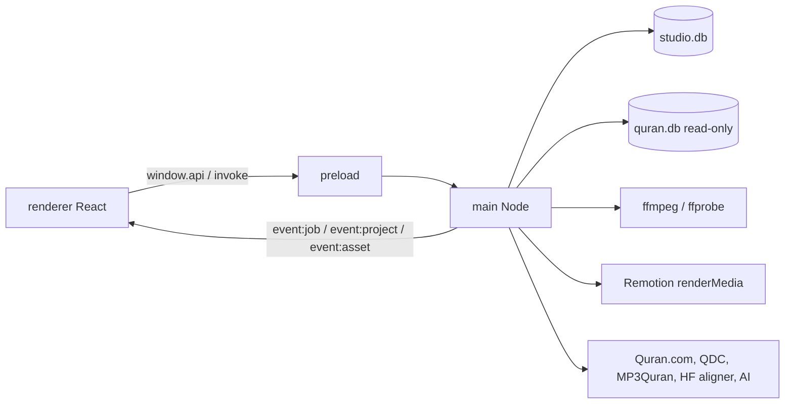

# 01 — Technical Handoff: Quran Render

| Item | Nilai |
|---|---|
| Status | v0.2.0, arsitektur Electron (keputusan di [`08_MIGRASI_ELECTRON.md`](08_MIGRASI_ELECTRON.md)) |
| Audiens | Engineer yang mulai mengerjakan Quran Render |
| Dokumen terkait | [`../product/PRODUCT.md`](../product/PRODUCT.md), [`02_DATABASE_SPECIFICATION.md`](02_DATABASE_SPECIFICATION.md), [`07_BUILD_DAN_TEST.md`](07_BUILD_DAN_TEST.md), [`../../AGENTS.md`](../../AGENTS.md) |

## 1. Aturan yang tidak bisa ditawar

1. **Clean-room.** Jangan membuka, menyalin, atau mengadaptasi kode, aset, prompt, string UI, atau desain Quran Caption
   (CC BY-NC 4.0). Layanan publik yang juga dipakai Quran Caption (Quran.com, MP3Quran, HF Space aligner) boleh dipakai.
2. **Teks Al-Qur'an tidak pernah diubah.** Teks Arab ditampilkan verbatim dari sumbernya (Kemenag bawaan, Uthmani/QPC
   dari Quran.com). AI hanya menghasilkan waktu dan potongan terjemahan.
3. **Satu jalur render.** Pratinjau (`@remotion/player`) dan ekspor (`@remotion/renderer`) memakai komposisi yang sama
   dengan props yang sama (`VideoProps`); hanya alamat berkas (`baseUrl`) yang berbeda. Komposisi murni terhadap nomor
   frame: tanpa `Date`, tanpa acak.
4. **Tanpa Python di runtime.** Sinkron AI berjalan di HF Space publik; sinkron manual selalu tersedia.
5. **Tanpa rahasia milik tim di aplikasi.** Kunci AI milik pengguna, dienkripsi dengan `safeStorage` (Keychain).
6. **GPL-3.0.** Dependensi harus kompatibel. Font dengan lisensi non-komersial tidak dibundel.

## 2. Proses

- Jendela: `sandbox`, `contextIsolation`, tanpa `nodeIntegration`, CSP ketat di `src/renderer/index.html`. Navigasi ke
  luar aplikasi diblok; tautan https dibuka di browser.
- IPC: tiap metode `StudioApi` (`src/shared/api.ts`) adalah kanal `group:method`. Preload membangun `window.api` dari
  `CHANNELS`; main mendaftarkan handler bertipe lewat `handle()` (`src/main/ipc.ts`). Handler melempar `Error` berbahasa
  Indonesia yang tampil sebagai toast.
- Berkas proyek dan font disajikan protokol `studio://asset/<proyek>/<path>` dan `studio://fonts/<berkas>` dengan HTTP
  Range (`src/main/protocol.ts`). Saat ekspor, main membuka server http lokal sementara dengan aturan yang sama, karena
  Chrome Headless tidak bisa membaca `studio://`.

## 3. Data

- `studio.db` (`src/main/db.ts`, migrasi hanya ditambah): `projects` (satu JSON per proyek), `assets` (milik main, path
  relatif ke folder proyek), `jobs`, `settings`, `secrets`, `cache` (respons API yang tidak berubah), `editions` dan
  `edition_text` (terjemahan terpasang).
- `resources/quran.db`: dataset Kemenag bawaan, read-only (skema di 02 §3).
- Waktu: milidetik pada audio sumber, yang juga waktu video. Memotong sumber membuat aset baru dan menggeser semua segmen,
  sehingga waktu 0 selalu awal sumber.
- **Nomor kata kanonis** = posisi kata Quran.com (1-based, tanpa penanda akhir ayat). Timestamp QDC, glyph QPC, teks
  Uthmani, dan aligner memakai nomor ini; kata Kemenag dipetakan ke slot kanonis dengan peta kata (`src/shared/wordMap.ts`).

## 4. Alur dan kepemilikan state

Beranda → 1 Sumber → 2 Sinkron → 3 Teks → 4 Editor → Ekspor. `Project.step` hanya navigasi; `Project.status` hanya maju
(`advanceStatus`).

- Renderer memegang proyek di `useProject` (Zustand). `update()` adalah edit pengguna: dicatat untuk undo (100 langkah,
  edit sejenis dalam 600 ms digabung) dan disimpan otomatis 1,2 detik kemudian (`projects:save`).
- Job main (unduh, potong, sinkron, AI trim) menulis hasilnya dengan `patchProject`, yang menyimpan lalu mengirim
  `event:project`; renderer menggabungkannya (`applyPatch`) tanpa langkah undo. Renderer memanggil `flush()` sebelum
  memulai job.
- Antrean job (`src/main/jobs.ts`): `net` 3 paralel, `cpu` 1 (FFmpeg, Remotion), `align` 1. Job yang terputus saat
  aplikasi ditutup ditandai gagal saat dibuka lagi.

## 5. Layanan luar

| Layanan | Dipakai untuk |
|---|---|
| Quran.com API v4 | Teks Uthmani, kode glyph QPC, katalog dan isi terjemahan |
| CDN font Quran.com | Font QPC per halaman dan font Uthmani Hafs |
| MP3Quran API v3 | Daftar qari, berkas surah, waktu ayat |
| QDC (`api.qurancdn.com`) | Daftar qari, berkas surah, waktu per kata |
| HF Space `hetchyy-quranic-universal-aligner` | Sinkron AI: deteksi ayat, waktu per kata, basmalah, isti'adzah |
| API kompatibel OpenAI (pilihan pengguna) | AI trim terjemahan, teks Publikasi (`/chat/completions`); gambar latar AI (`/images/generations`) |
| AI CLI di komputer (`claude`, `codex`, `opencode`, atau perintah sendiri) | Alternatif tanpa kunci untuk AI trim dan teks Publikasi (`src/main/cli.ts`: prompt lewat stdin, tanpa bendera `--dangerously-*`, PATH dari login shell); Codex juga membuat gambar latar |
| Pollinations (`image.pollinations.ai`) | Gambar latar AI gratis tanpa akun (bawaan): satu gambar per 45 detik per IP, maksimum 768 x 768; layanan membubuhkan logo kecil di pojok kanan bawah; atas persetujuan pemilik produk aplikasi memangkas 7% tepi kanan dan bawah (`src/main/imagegen.ts`) |
| Pexels, Unsplash, Pixabay | Foto dan video latar stok (kunci gratis milik pengguna, `safeStorage`; unduhan hanya dari host penyedia; kredit tersimpan di `meta.credit` aset dan masuk teks Publikasi) |
| GitHub release yt-dlp | Mengunduh yt-dlp saat fitur YouTube dipakai |
