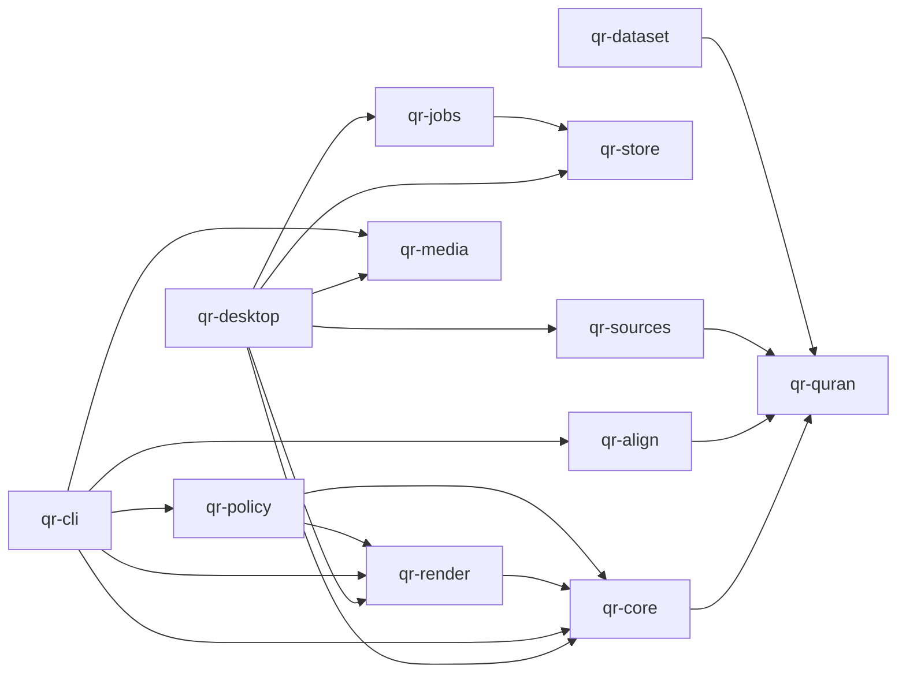
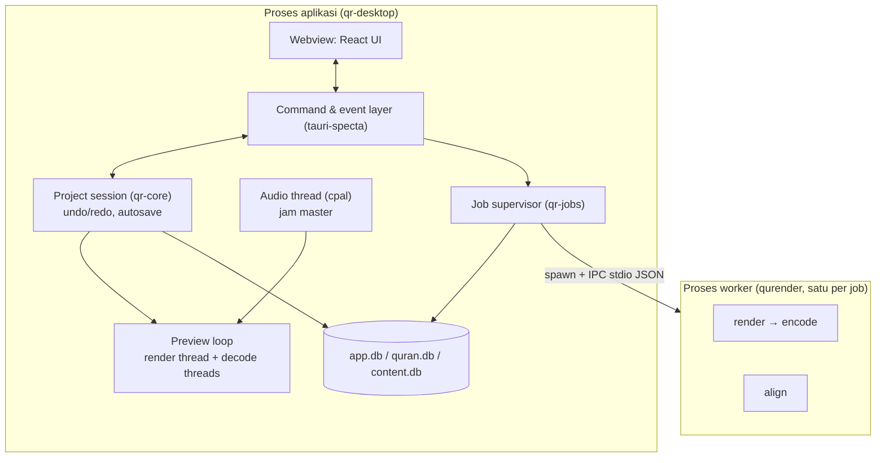
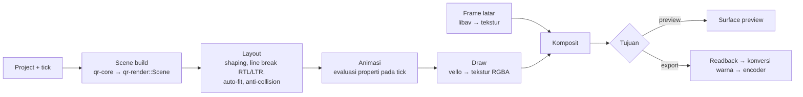
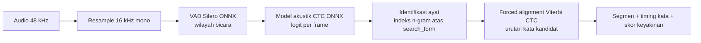

# 01 — Technical Handoff: QuranRender

| Item | Nilai |
|---|---|
| Status | v1.0, mengacu ke PRD baseline v1.0 (terkunci 2026-10-22) |
| Audiens | Engineer yang mulai mengerjakan QuranRender |
| Dokumen terkait | [`../product/PRD.md`](../product/PRD.md), [`02_DATABASE_SPECIFICATION.md`](02_DATABASE_SPECIFICATION.md), [`03_DATASET_PIPELINE.md`](03_DATASET_PIPELINE.md), [`04_IMPLEMENTATION_PLAN.md`](04_IMPLEMENTATION_PLAN.md) |

Dokumen ini menerjemahkan PRD menjadi keputusan teknis, batasan, dan kontrak antar-komponen.
Keputusan berstatus **Final** tidak dibuka ulang tanpa ADR. Keputusan berstatus **Spike** baru final
setelah spike terkait (S1–S5, PRD §9.1) lulus.

---

## 1. Aturan yang tidak bisa ditawar

1. **Clean-room.** Jangan membuka, menyalin, atau mengadaptasi kode, aset, prompt, string UI, atau
   desain dari Quran Caption (CC BY-NC 4.0). Hasil reverse engineering hanya dipakai di PRD §2 sebagai
   analisis masalah. File yang byte-identik dengan aset Quran Caption wajib punya sumber asli yang
   tercatat di `content-manifest.json` (PRD Q8).
2. **Teks Al-Qur'an tidak pernah diubah.** Teks Arab disimpan verbatim dari dataset terverifikasi.
   Tidak ada normalisasi Unicode untuk teks yang ditampilkan. AI hanya menghasilkan *waktu*, tidak
   pernah *teks*. Lihat PRD §5 dan §7.15.
3. **Satu jalur render.** Preview dan export memanggil fungsi render yang sama di Rust. Konten video
   tidak boleh dirender oleh DOM/CSS webview.
4. **Tanpa Python di runtime.** Inferensi memakai ONNX Runtime dari Rust.
5. **Tanpa rahasia milik tim di binary.** Tidak ada API key, client secret, atau token yang dibundel.
6. **Offline-first.** Semua fitur P0 kecuali pengunduhan berjalan tanpa jaringan.
7. **GPL-3.0.** Semua dependensi harus kompatibel dengan GPL-3.0. FFmpeg dibangun dengan konfigurasi
   GPL, dan kode sumber serta skrip build-nya ikut dipublikasikan.

---

## 2. Sumber kebenaran

| Hal | Lokasi |
|---|---|
| Kebutuhan produk | `docs/product/PRD.md` (baseline v1.0, terkunci) |
| Dataset sumber (Kemenag) | `data/surah/*.json`, `data/surah/list-surah.json`, `data/juz/*.json`, `data/juz/list_juz.json` |
| Font Qur'an | `assets/fonts/quran/` (LPMQ, Amiri Regular/Bold, Uthmanic/me_quran, IndoPak) |
| Manifest konten | `content-manifest.json` (dibuat di fase 0, lihat 03 §3) |
| Keputusan arsitektur | `docs/engineering/adr/NNNN-judul.md` (dibuat sejak fase 0) |
| Desain visual | `docs/design/` (belum ada; UI fase 1 memakai token sementara) |

---

## 3. Stack & keputusan teknologi

| Area | Keputusan | Status | Catatan |
|---|---|---|---|
| Shell aplikasi | Tauri 2 | Final | PRD D5 |
| Bahasa core | Rust stable (edisi 2021), workspace Cargo | Final | Versi toolchain dipin di `rust-toolchain.toml` |
| UI | React + TypeScript (strict) + Vite | Final | PRD D5 |
| State UI | Zustand, dengan store terpisah dari tree React | Final | Core Rust adalah sumber kebenaran (§8) |
| Komponen UI aksesibel | React Aria Components | Final | PRD SET-4 |
| i18n UI | ICU MessageFormat via FormatJS (`react-intl`) | Final | PRD SET-1 |
| IPC bertipe | `tauri-specta`: binding TS digenerate dari Rust | Final | Tidak ada nama command berupa string manual di UI |
| Timeline | Digambar di `<canvas>` 2D dengan model virtualisasi sendiri | Spike S5 | Pembanding: virtualisasi DOM |
| Renderer video | `wgpu`, rasterisasi 2D dengan `vello` | Spike S1/S4 | Fallback CPU: `vello_cpu` atau `tiny-skia` (RND-5) |
| Shaping & layout teks | Trait `TextShaper`. Kandidat: `parley` + `harfrust`, atau HarfBuzz C (`harfbuzz-sys`) | Spike S2 | Implementasi yang lulus set uji tipografi Arab yang dipakai |
| Media decode/encode | FFmpeg libav (`ffmpeg-next`) dibangun di CI, dibundel sebagai library relatif (`@rpath`/`$ORIGIN`) | Final | PRD DST-3 |
| Audio output | `cpal` | Final | Callback audio menjadi jam master (§6) |
| Inferensi | ONNX Runtime via crate `ort`, runtime dibundel | Final | Model dipilih di S3 |
| Database lokal | SQLite via `rusqlite` (fitur `bundled`) | Final | Lihat 02 |
| HTTP | `reqwest` + `rustls`, dibungkus allowlist domain | Final | PRD §8.4 |
| Rahasia | Crate `keyring` (Keychain, Credential Manager, Secret Service) | Final | PRD SET-2 |
| Tanda tangan konten | minisign (`minisign-verify` di runtime) | Final | Update, dataset, dan paket model |
| Logging | `tracing` + file log berotasi | Final | §12 |
| Pembaruan aplikasi | `tauri-plugin-updater` + kunci minisign proyek | Final | PRD DST-4 |
| Format waktu | Tick = 1 sampel pada 48.000 Hz, `i64` | Final | §6 |
| ID entitas | ULID (string) | Final | Lihat 02 §6 |

Versi dependensi dipin di `Cargo.lock` dan `pnpm-lock.yaml`. Dokumen ini tidak menyebut nomor versi
supaya tidak cepat usang.

---

## 4. Struktur repo

```text
QuranRender/
├─ apps/
│  └─ desktop/
│     ├─ src/                 React + TS (UI)
│     ├─ src-tauri/           crate `qr-desktop`: shell Tauri tipis, command → core
│     └─ package.json
├─ crates/
│  ├─ qr-core/               model proyek, timeline, gaya berlapis, undo/redo, migrasi skema
│  ├─ qr-quran/              akses dataset runtime (quran.db/content.db), normalisasi teks, tokenizer
│  ├─ qr-render/             scene → frame: layout, shaping, animasi, wgpu/vello, fallback CPU
│  ├─ qr-media/              decode/encode libav, audio engine (cpal), waveform, thumbnail
│  ├─ qr-align/              VAD, model akustik ONNX, identifikasi ayat, forced alignment
│  ├─ qr-policy/             validator kebijakan konten CNT-1..5 + validasi pra-export
│  ├─ qr-jobs/               antrean job persisten (render, align, batch, unduhan)
│  ├─ qr-store/              app.db, indeks proyek, pengaturan, keychain
│  ├─ qr-sources/            adapter jaringan: Quran.com (QRN-12), paket model, update data
│  ├─ qr-cli/                biner `qurender` (headless render/align/validate) — RND-4
│  └─ qr-dataset/            biner `qr-dataset` (pipeline dataset, hanya build/CI) — lihat 03
├─ data/                     dataset sumber dari pemilik produk (read-only)
├─ assets/fonts/quran/       font Qur'an dari pemilik produk
├─ content-manifest.json     sumber, lisensi, SHA-256 untuk data/ dan assets/
├─ third_party/ffmpeg/       skrip build FFmpeg + konfigurasi GPL + lisensi
├─ tests/
│  ├─ golden/                frame emas, golden tokenisasi
│  └─ fixtures/              audio uji (yang lisensinya mengizinkan), proyek contoh
└─ docs/
```

Aturan dependensi antar-crate (dicek di CI dengan `cargo deny` dan uji arsitektur):



- `qr-core` tidak bergantung pada GPU, jaringan, atau Tauri.
- `qr-render` tidak bergantung pada Tauri.
- Hanya `qr-desktop` yang mengenal Tauri.
- `qr-dataset` dan aplikasi memakai kode normalisasi dan tokenisasi yang sama dari `qr-quran`, supaya
  hasil build dan runtime identik.

---

## 5. Arsitektur runtime



Keputusan:

- **Export dan alignment berjalan di proses worker** (`qurender`, biner yang sama dengan CLI RND-4,
  dibundel sebagai sidecar). Alasannya:
  - crash di encoder, driver GPU, atau ONNX tidak menjatuhkan editor;
  - membatalkan job cukup dengan mematikan proses (EXP-7);
  - batch headless dan uji CI memakai jalur yang persis sama.
- **Protokol worker:** proses induk mengirim spesifikasi job (JSON) lewat stdin. Worker menulis event
  JSON per baris ke stdout (`progress`, `log`, `result`, `error`) dan menulis file output ke path yang
  ditentukan job. Kontraknya ada di `qr-jobs::protocol`, berversi.
- **Preview berjalan in-process** untuk latensi rendah.
- **Thread:**
  - UI/IPC: thread utama Tauri;
  - render: satu thread pemilik `wgpu::Device`;
  - decode video: pool kecil untuk prefetch frame latar;
  - audio: callback `cpal` yang wajib *realtime-safe* (tanpa alokasi, lock yang bisa memblokir, atau
    I/O; data dikirim lewat ring buffer);
  - alignment: tidak pernah berjalan di proses aplikasi.

---

## 6. Model waktu

- **Satuan waktu timeline adalah tick:** 1 sampel audio pada 48.000 Hz, tipe `i64`. Semua audio
  di-resample ke 48 kHz saat dimuat.
- Waktu tidak pernah disimpan sebagai float milidetik (PRD SYN-9).
- Frame ke-*n* pada fps rasional `num/den` dimulai pada `tick = floor(n × 48000 × den / num)`. Hasilnya
  bilangan bulat untuk 24/25/30/48/50/60 fps. Untuk 29,97/59,94 dipakai pembulatan ke bawah yang
  deterministik.
- **Jam master preview** adalah jumlah sampel yang sudah diserahkan ke perangkat audio, dikurangi
  latensi output yang dilaporkan `cpal`. Render thread meminta frame untuk tick tersebut, dan video
  latar disinkronkan ke tick, bukan sebaliknya.
- **Export tidak memakai jam dinding.** Frame dirender untuk tick yang ditentukan rumus di atas.
- **Determinisme:** `render(scene, tick)` adalah fungsi murni dari isi proyek, aset, dan tick. Tidak
  boleh ada waktu sistem, angka acak tanpa seed, atau state hasil frame sebelumnya. Animasi dihitung
  dari `tick` (ANM-3).

---

## 7. Pipeline render

### 7.1 Tahapan



1. **Scene build.** Scene berisi daftar node yang aktif pada tick: latar, overlay, blok ayat, blok
   terjemahan, dan dekorasi. Gaya diselesaikan dengan urutan *Template → Proyek → Override klip*
   (STY-1) menjadi properti konkret.
2. **Layout.**
   - **Shaping:** teks Arab dishape dari string ayat verbatim. Batas kata berasal dari offset byte di
     tabel `word` (02 §3.4), sehingga sorotan WBW memetakan kata ke cluster glyph tanpa memotong
     cluster.
   - **Cache layout:** hasil layout di-cache per (teks, font, ukuran, lebar box). Animasi yang hanya
     mengubah warna atau opasitas tidak memicu re-layout.
   - **Anti-collision dan auto-fit (STY-8):** berjalan di tahap ini, deterministik, dengan batas
     iterasi.
3. **Animasi.** Properti dievaluasi dari keyframe/preset pada tick. Karaoke per kata (ANM-2)
   menghitung progres sorotan dari `word.start..word.end`, sehingga transisinya kontinu dan tidak
   melompat per state.
4. **Draw.** Hasilnya tekstur RGBA premultiplied linear, digambar dengan vello.
5. **Komposit.**
   - Frame latar video didecode, di-scale *contain/cover*, lalu diunggah sebagai tekstur.
   - Preview dan export memakai shader komposit yang sama. Preview hanya mungkin memakai resolusi lebih
     rendah (½), dan export selalu resolusi penuh.

### 7.2 Warna & alpha

- Ruang kerja renderer: sRGB linear, alpha premultiplied.
- **Export H.264/H.265:** konversi ke BT.709 *limited range* dilakukan di GPU (shader), kemudian
  readback NV12/YUV420P. Ini mengurangi bandwidth readback (S4).
- **Export transparan (EXP-3):**
  - ProRes 4444 (`yuva444p10le`), WebM VP9 (`yuva420p`), PNG sequence;
  - alpha ditulis *straight* (un-premultiply sebelum encode);
  - dokumentasi format alpha masuk ke paket unggah.

### 7.3 Uji kesetaraan preview–export (RND-1)

Uji ini berjalan di CI dan di perangkat referensi:

1. Pada 50 tick, render jalur preview dengan resolusi penuh lalu readback.
2. Render jalur export, lalu decode kembali frame dari file hasil encode lossless (FFV1 untuk uji).
3. Bandingkan dengan ambang PRD §8.2 (SSIM ≥ 0,995, selisih per kanal ≤ 2/255 di luar tepi glyph).

Golden lintas OS memakai toleransi per backend GPU yang dicatat di `tests/golden/README.md`.

---

## 8. Kontrak UI ↔ core

### 8.1 Prinsip

- **Core adalah sumber kebenaran state proyek.** UI mengirim *intent* (command) dan menerima *patch*
  lewat event. UI tidak memodifikasi model proyek secara lokal kecuali untuk state transien seperti
  drag yang belum dilepas.
- **Setiap command mutasi masuk ke undo stack** di core sebagai satu transaksi (PRJ-4). Drag yang
  panjang di-commit sekali saat dilepas.
- **Binding TS digenerate** dari Rust oleh `tauri-specta` ke `apps/desktop/src/bindings.ts`. File ini
  tidak diedit manual dan diperiksa di CI (`bindings.ts` harus bersih setelah generate).

### 8.2 Kelompok command awal

| Kelompok | Contoh command | Requirement PRD |
|---|---|---|
| `project` | `project_create`, `project_open`, `project_close`, `project_list`, `project_duplicate`, `project_restore_snapshot` | PRJ-1..6 |
| `asset` | `asset_import`, `asset_relink`, `asset_waveform` | SRC-1, SRC-2 |
| `timeline` | `timeline_apply` (batch operasi bertipe), `timeline_undo`, `timeline_redo` | TML-*, PRJ-4 |
| `quran` | `quran_search`, `quran_ayah_range`, `quran_editions`, `quran_download_edition` | QRN-*, QRN-12 |
| `align` | `align_start`, `align_cancel`, `align_review_next` | SYN-* |
| `style` | `style_set`, `template_apply`, `template_import`, `template_export` | STY-* |
| `preview` | `preview_play`, `preview_pause`, `preview_seek`, `preview_set_quality` | RND-3 |
| `export` | `export_validate`, `export_enqueue` | EXP-*, CNT-* |
| `jobs` | `jobs_list`, `jobs_pause`, `jobs_resume`, `jobs_cancel`, `jobs_reorder` | BAT-2 |
| `settings` | `settings_get`, `settings_set`, `secret_set`, `secret_delete` | SET-* |

### 8.3 Event

- `project://patch`: patch model proyek dengan revisi bertambah monoton. UI yang menerima revisi
  terlewat meminta snapshot penuh.
- `preview://clock`: posisi tick, maksimum 30×/detik ke UI. Playhead digambar UI dari nilai ini.
- `jobs://update`: perubahan state/progres job.
- `app://error`: error yang tidak terikat ke command.

### 8.4 Error

Semua command mengembalikan `Result<T, AppError>`:

```text
AppError {
  code: string          // stabil, mis. "EXPORT_FONT_MISSING_GLYPH"
  messageKey: string    // kunci i18n
  params: object        // nilai untuk pesan
  details?: string      // teknis, untuk "salin diagnostik"
}
```

Kode error tercatat di `crates/qr-core/src/error_codes.rs` dan dipakai juga oleh worker.

---

## 9. Preview di jendela Tauri (spike S1)

Tiga opsi diuji dengan kriteria lulus PRD S1 (≥ 30 fps pada 1080p½ di R-Low, tanpa tearing, di tiga
OS):

| Opsi | Cara | Kelebihan | Risiko |
|---|---|---|---|
| A. Surface native | Child window/view native (NSView, HWND, Wayland subsurface/X11 child) dengan `wgpu::Surface`, diposisikan di bawah area transparan webview | Tanpa salinan frame, latensi terendah | Z-order, DPI, dan event input di Linux/Wayland |
| B. Frame streaming | Render ke tekstur, readback, kirim lewat custom protocol `qr-frame://` atau shared memory, lalu digambar di `<canvas>`/WebGL | Portabel dan sederhana | Bandwidth (≈ 60 MB/s untuk 960×540 RGBA 30 fps) |
| C. Hybrid | Opsi A bila didukung, B sebagai fallback | Andal di semua OS | Dua jalur yang harus dirawat |

Dokumen ini mengasumsikan **C** sampai S1 selesai. Hasil S1 dicatat sebagai ADR.

---

## 10. Media

### 10.1 FFmpeg

- **Build:** dari sumber di CI (`third_party/ffmpeg/build.sh` per OS) dengan versi rilis yang dipin.
- **Konfigurasi:**
  - `--enable-gpl --enable-libx264 --enable-libx265 --enable-libvpx`;
  - encoder hardware per OS: VideoToolbox (macOS), NVENC/QSV/AMF (Windows/Linux sesuai ketersediaan
    SDK);
  - decoder umum;
  - tanpa komponen *nonfree*.
- **Dibundel sebagai shared library** dengan path relatif. CI memeriksa `otool -L` / `ldd` / `dumpbin`:
  tidak boleh ada path absolut di luar library sistem (DST-3).
- **Lisensi:** FFmpeg, x264, dan x265 masuk `THIRD_PARTY_LICENSES` di dalam bundle.

### 10.2 Decode & audio

- Audio sumber didecode dan di-resample (libswresample) ke 48 kHz float stereo. Waveform peak
  dihitung bertahap dan di-cache (`cache/waveform-<hash>.bin`) agar file 60 menit tampil ≤ 2 detik
  (SRC-1).
- **Gain dan loudness (SRC-2):**
  - gain hingga +12 dB, diterapkan di mixer;
  - pengukuran LUFS EBU R128 dilakukan saat impor dan di-cache;
  - normalisasi menghasilkan gain statis, bukan kompresor dinamis.
- **Video latar:** didecode dengan seek akurat ke keyframe lalu maju ke frame target. Mode loop,
  reverse, dan kecepatan (SRC-5) dihitung di pemetaan tick → timestamp sumber. Reverse memakai cache
  GOP terbalik di proses worker untuk export.

### 10.3 Encode (EXP-1, EXP-2)

1. **Probe encoder:** saat start, encoder hardware diuji dengan encode 8 frame kecil. Hasilnya di-cache
   per versi driver di `app.db` (02 §5).
2. **Urutan pilihan:** encoder hardware → software (libx264/libx265).
3. **Fallback saat encode:** kegagalan di frame mana pun pada encoder hardware memicu restart dari
   frame 0 dengan software, tanpa membatalkan job.
4. **Audio:** di-mux sebagai AAC. Bila hanya ada satu sumber audio yang kompatibel dan tidak ada
   gain/trim, stream disalin tanpa re-encode.

---

## 11. Alignment (qr-align)

### 11.1 Pipeline



- **Identifikasi ayat (SYN-2):**
  - decode greedy CTC menghasilkan hipotesis teks;
  - hipotesis dicocokkan dengan indeks n-gram karakter atas `word.search_form` (02 §3.4) untuk
    menemukan rentang kandidat;
  - pengguna bisa mengunci rentang surah/ayat, dan pencarian dibatasi ke rentang itu.
- **Kasus khusus (SYN-3):** template isti'adzah, basmalah, takbir, dan *sadaqallah* disertakan sebagai
  kandidat tambahan. Pengulangan ayat ditangani dengan mengizinkan graf alignment melompat mundur ke
  awal ayat atau kata sebelumnya dengan penalti.
- **Output:** segmen berisi `ayah_id`, `word_from..word_to`, tick mulai/akhir per kata, `kind`, dan
  `confidence` ∈ [0,1]. Ambang peninjauan (SYN-5) dikonfigurasi di model pack.
- **Kontrak.** Trait `Aligner` punya implementasi `LocalOnnxAligner` dan `RemoteAligner` (P1, SYN-7).
  Keduanya menghasilkan JSON hasil yang sama. Skema JSON dipublikasikan di
  `crates/qr-align/schema/alignment-result.v1.json`.

### 11.2 Model pack

```text
model-pack/
├─ manifest.json        {key, tier, version, inputs, sample_rate, vocab, thresholds, license, sha256 per file}
├─ vad.onnx
├─ acoustic.onnx
├─ vocab.json
└─ manifest.json.minisig
```

- Model pack tingkat Standar dibundel di installer.
- Tingkat lain diunduh dan diverifikasi tanda tangannya (SYN-8).
- Model mana yang dipakai ditentukan lewat spike S3 (PRD D8).

---

## 12. Keamanan, privasi, diagnostik

- **Tauri capabilities:**
  - default deny;
  - webview hanya memuat aset lokal aplikasi;
  - CSP ketat tanpa `unsafe-eval` dan tanpa origin remote;
  - akses file hanya lewat dialog atau scope folder proyek dan folder data aplikasi;
  - plugin `shell` hanya mengizinkan sidecar `qurender` dan `yt-dlp` (P1).
- **Jaringan:**
  - satu `HttpClient` di `qr-sources` dengan allowlist domain (PRD §8.4): `api.quran.com`, host update,
    host paket model, serta endpoint milik pengguna (LLM, cloud aligner);
  - permintaan ke domain lain ditolak di layer ini.
- **Rahasia:** disimpan di keychain dengan service `app.quranrender.desktop` dan account
  `<jenis>:<nama>`, misalnya `llm:openai`, `stock:pexels`. Daftar lengkapnya di 02 §7.
- **Log:**
  - `tracing` ke file harian di folder log aplikasi, retensi 14 hari;
  - level default `info`;
  - teks ayat, terjemahan, dan path home pengguna tidak dicatat di level `info`;
  - "Salin diagnostik" mengemas log terakhir, versi, OS/GPU, dan konfigurasi encoder tanpa rahasia.
- **Telemetri dan crash report:** mati secara default (SET-5). Implementasinya ditunda sampai ada
  endpoint yang disepakati; crash lokal tetap ditulis ke folder log.

---

## 13. Pengujian

| Lapisan | Alat | Cakupan wajib |
|---|---|---|
| Unit Rust | `cargo nextest` | Model waktu, gaya berlapis, undo, migrasi, tokenisasi, kebijakan konten |
| Snapshot | `insta` | Hasil layout (posisi glyph), scene build, JSON proyek setelah migrasi |
| Golden tokenisasi | `qr-dataset` + `tests/golden/tokenization.tsv` | 6.236 ayat (03 §6) |
| Golden render | Renderer headless | Template × rasio × backend. Toleransi didokumentasikan. |
| Kesetaraan preview–export | Worker + FFV1 | §7.3 |
| Alignment | Harness evaluasi `qurender align --eval` | Metrik PRD §12. Set uji tidak dibundel. |
| UI unit | Vitest + Testing Library | Store, komponen, i18n |
| E2E | WebdriverIO + `tauri-driver` | Windows & Linux. `tauri-driver` tidak mendukung macOS, jadi macOS diuji asap manual per rilis. |
| Instalasi | Job CI per format paket | Aplikasi terbuka, render 1 frame (DST-2) |

---

## 14. Build, rilis, distribusi

- **Matriks CI:** macOS (arm64 dan x86_64, digabung menjadi universal), Windows x64, Linux x64
  (Ubuntu 20.04 sebagai baseline glibc).
- **Artefak:**
  - `.dmg` (app universal, ad-hoc signed);
  - NSIS `.exe` dan `.msi`;
  - `.AppImage`, `.deb`;
  - manifest Flatpak di repo terpisah untuk Flathub.
- **Kunci updater minisign:** private key hanya ada di secret CI. Public key dibundel di aplikasi.
- **Rilis:** tag `vX.Y.Z` memicu build, uji instalasi, `SHA256SUMS` + `SHA256SUMS.minisig`, lalu
  `latest.json` untuk updater di GitHub Releases. Kanal beta memakai prerelease.
- **Dataset dan model pack** dibangun dan ditandatangani di pipeline yang sama (03 §8).

---

## 15. Konvensi

- **Rust:** `rustfmt`, `clippy -D warnings`, tanpa `unwrap()` di luar test (dicek `clippy::unwrap_used`).
  Error memakai `thiserror` di library dan `anyhow` hanya di biner.
- **TypeScript:** `strict`, ESLint, Prettier, dan tanpa `any` implisit.
- **Commit:** Conventional Commits. Setiap PR yang mengubah perilaku menyertakan ID requirement PRD,
  misalnya `feat(render): karaoke highlight (ANM-2)`.
- **ADR:** keputusan yang mengubah tabel §3 atau kontrak di §8/§11 wajib punya ADR.
- **Teks Qur'an di kode:** tidak boleh di-hardcode, kecuali di fixture test yang berasal dari dataset.

---

## 16. Item terbuka

| ID | Item | Pemilik | Batas |
|---|---|---|---|
| S1–S5 | Spike teknis (PRD §9.1) | Engineering | Akhir fase 0 |
| Q5 | Verifikasi codepoint tak lazim di dataset | Pemilik produk | Sebelum beta (memengaruhi word index 18:74, lihat 03 §6.4) |
| Q8 | Sumber dan lisensi font di manifest | Pemilik produk + engineering | Sebelum beta |
| Q9 | Izin Saheeh International | Pemilik produk | Sebelum Saheeh dibundel |

---

## 17. Glosarium

| Istilah | Arti |
|---|---|
| Tick | 1 sampel audio pada 48 kHz, satuan waktu timeline |
| Segmen | Rentang waktu yang menampilkan satu rentang kata dari satu ayat |
| WBW | *Word-by-word*: timing atau sorotan per kata |
| Dataset | Kumpulan teks Arab + data kata + metadata yang dibangun pipeline 03 (`quran.db`) |
| Edisi | Satu terjemahan dengan versi dan hash tertentu |
| Worker | Proses `qurender` yang menjalankan satu job |
| Model pack | Paket model alignment bertanda tangan |
