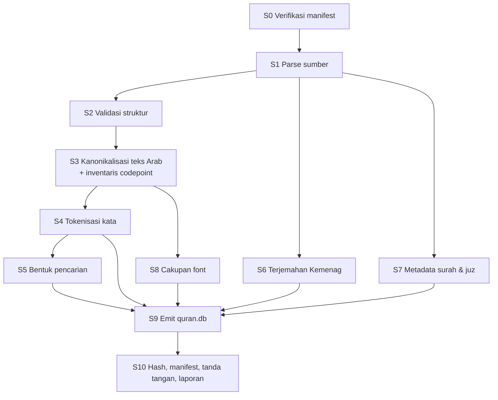

# 03 — Dataset Pipeline

| Item | Nilai |
|---|---|
| Status | v1.0, mengacu ke PRD baseline v1.0 |
| Cakupan | Mengubah `data/` + `assets/fonts/quran/` menjadi `quran.db` bertanda tangan, plus adapter runtime Quran.com untuk edisi unduhan |
| Alat | Biner `qr-dataset` (crate `crates/qr-dataset`). Logika teks dipakai bersama dengan aplikasi lewat `qr-quran::text`. |
| Terkait | PRD QRN-1..14, CNT-1..5, §11; [`02_DATABASE_SPECIFICATION.md`](02_DATABASE_SPECIFICATION.md) §3–4 |

---

## 1. Tujuan & prinsip

1. **Verbatim.** Teks Arab yang keluar dari pipeline sama persis dengan sumber, kecuali spasi di awal
   dan akhir yang dipangkas. Tidak ada normalisasi Unicode, penggantian karakter, atau "perbaikan"
   otomatis.
2. **Gagal keras.** Setiap penyimpangan dari invarian yang terdokumentasi menggagalkan build. Anomali
   yang sudah diketahui hanya lolos bila terdaftar eksplisit di `data-anomalies.toml`.
3. **Reproducible.** Input yang sama menghasilkan `quran.db` yang byte-identik. Tidak ada timestamp
   build atau urutan hash map di dalam output.
4. **Satu implementasi.** Normalisasi terjemahan, tokenisasi, dan bentuk pencarian ada di
   `qr-quran::text` dan dipakai oleh pipeline build maupun adapter runtime, sehingga hasilnya tidak
   bisa berbeda.
5. **Jejak asal.** Setiap file input tercatat di `content-manifest.json` beserta sumber, lisensi, dan
   SHA-256.

---

## 2. Input & output

### 2.1 Input

| Input | Isi | Peran |
|---|---|---|
| `data/surah/{1..114}.json` | `{"data": [Ayah]}` | **Sumber utama** teks Arab dan terjemahan Kemenag |
| `data/surah/list-surah.json` | Array metadata 114 surah | Metadata surah (QRN-9) |
| `data/juz/juz_{1..30}.json` | `{nomor, nama_latin, deskripsi, data: [Ayah]}` | **Hanya pemeriksaan silang** (harus identik dengan `surah/`) dan rentang juz |
| `data/juz/list_juz.json` | Array metadata 30 juz | Label juz |
| `assets/fonts/quran/*.ttf` | LPMQ, Amiri Regular/Bold, Uthmanic (me_quran), IndoPak | Font terbundel + matriks cakupan |
| `content-manifest.json` | §3 | Hash dan lisensi semua input |
| `data-anomalies.toml` | §5.3 | Registri anomali yang sudah diketahui |
| `fonts.toml` | §5.7 | Peran setiap font |

Field `Ayah` di sumber: `aya_id`, `aya_number`, `aya_text`, `sura_id`, `juz_id`, `page_number`,
`translation_aya_text`, `translation_en`.

### 2.2 Output (folder `build/dataset/`)

| Output | Isi |
|---|---|
| `quran.db` | Database read-only sesuai 02 §3 |
| `dataset-manifest.json` | `dataset_id`, `dataset_version`, `content_sha256`, `quran_db_sha256`, `tokenizer_version`, hash input, statistik |
| `dataset-manifest.json.minisig` | Tanda tangan minisign (hanya di CI rilis) |
| `tokenization.tsv` | Golden tokenisasi: `ayah_id`, `idx`, `span_start`, `span_end`, `core_start`, `core_end`, `text` |
| `report.json`, `report.md` | Laporan validasi, statistik, cakupan font, daftar anomali |

---

## 3. `content-manifest.json`

### 3.1 Skema

```json
{
  "schema": 1,
  "entries": [
    {
      "path": "data/surah/list-surah.json",
      "sha256": "8ec118888cd0de2ce90171f5c5bffec57008d734ad798ea7a34d35697bfa396f",
      "kind": "dataset-source",
      "source": "Kemenag RI, format API quran.kemenag.go.id, disediakan pemilik produk",
      "license": "Izin bundling dikonfirmasi pemilik produk (PRD D1, D7)",
      "attribution": "Lajnah Pentashihan Mushaf Al-Qur'an, Kementerian Agama RI",
      "redistribution": "bundled"
    },
    {
      "path": "assets/fonts/quran/IndoPak.ttf",
      "sha256": "4c8f002e7538ef6351ac676eb0f2c1708ecd17f6f8a5fc4a19dbc8eaf4dddff5",
      "kind": "font",
      "source": "PERLU DIISI: URL resmi QuranWBW (PRD Q8)",
      "license": "PERLU DIISI",
      "attribution": "AlQuran IndoPak by QuranWBW",
      "redistribution": "bundled"
    }
  ]
}
```

| Field | Nilai yang diizinkan |
|---|---|
| `kind` | `dataset-source`, `font`, `registry` |
| `redistribution` | `bundled`, `user_download_only`, `excluded` |

### 3.2 Aturan

- Setiap file di `data/` dan `assets/fonts/quran/` wajib punya entri. File tanpa entri menggagalkan
  build.
- Hash yang tidak cocok menggagalkan build.
- Entri dengan nilai `PERLU DIISI` diperbolehkan di build dev. **Build rilis menolaknya** (PRD Q8
  wajib selesai sebelum beta).
- `qr-dataset manifest --update` menghitung ulang hash untuk entri yang sudah ada. Perintah ini tidak
  pernah membuat entri baru secara otomatis, supaya sumber dan lisensi selalu diisi manusia.

---

## 4. Tahapan pipeline



Perintah:

```text
qr-dataset verify-sources        # S0–S2 saja, cepat, dipakai pre-commit
qr-dataset build --out build/dataset [--release]
qr-dataset check-fonts           # S8 saja
qr-dataset diff <a/quran.db> <b/quran.db>   # beda per ayat/kata/terjemahan antar versi dataset
```

---

## 5. Aturan per tahap

### 5.1 S0 — Verifikasi manifest

- Aturan §3.2 diterapkan.
- `data-anomalies.toml` dan `fonts.toml` ikut tercatat di manifest dengan `kind: "registry"`.

### 5.2 S1–S2 — Parse & validasi struktur

**Sumber utama** adalah `data/surah/*.json`. `juz/` hanya untuk pemeriksaan silang.

| Invarian | Nilai yang diharapkan (terukur 2026-10-22) |
|---|---|
| Jumlah file surah | 114 |
| Jumlah ayat total | 6.236 |
| `aya_id` | 1–6236, unik, berurutan tanpa celah, urut mengikuti (surah, ayat) |
| `aya_number` | 1..n berurutan dalam setiap surah |
| `sura_id` di setiap ayat | Sama dengan nomor file |
| `jumlah_ayat` di `list-surah.json` | Sama dengan jumlah ayat di file surah |
| `juz_id` | 1–30, tidak menurun sepanjang `aya_id` |
| `page_number` | 1–604, tidak menurun sepanjang `aya_id`, 604 nilai unik |
| `juz/` vs `surah/` | Himpunan ayat sama. `aya_text` dan `translation_aya_text` identik byte demi byte. |
| `tempat_turun` | `mekah` (86) → `makkiyah`, `madinah` (28) → `madaniyah`. Nilai lain menggagalkan build. |

Rentang juz (`juz.first_ayah_id`, `last_ayah_id`) dihitung dari `juz_id` per ayat, lalu dicek
terhadap `deskripsi` di `list_juz.json` (format `"<Surah> s:a — <Surah> s:a"`).

### 5.3 S3 — Kanonikalisasi teks Arab & inventaris codepoint

1. `text = aya_text` dengan whitespace di awal dan akhir dipangkas (3.371 ayat saat ini). Spasi di
   tengah tidak diubah.
2. **Tidak ada normalisasi Unicode.** Saat ini 5.713 ayat tidak dalam bentuk NFC. Laporan mencatat
   angka ini, tetapi build tidak menggagalkannya.
3. **Allowlist codepoint** (`qr-quran::text::ARABIC_ALLOWLIST_V1`, 75 codepoint):

   ```text
   U+0020, U+0608–U+0609, U+0621–U+0624, U+0626–U+063A, U+0640–U+0657, U+0670,
   U+06D4–U+06DC, U+06DE–U+06E0, U+06E2–U+06E4, U+06E7–U+06EC, U+08D6
   ```

   Codepoint di luar allowlist menggagalkan build. Menambah allowlist berarti menaikkan versi
   tokenizer dan wajib punya catatan di ADR.
4. **Codepoint yang diawasi:** U+0608, U+0609, U+06D4. Setiap kemunculannya harus terdaftar di
   `data-anomalies.toml`, atau cocok dengan aturan pola yang terdaftar. Kemunculan baru yang tidak
   terdaftar menggagalkan build.

```toml
# data-anomalies.toml — PRD Q5 (status menunggu verifikasi pemilik produk)
[[anomaly]]
ayah = "18:74"
codepoint = "U+0608"
code = "word_joiner_suspect"
status = "needs_review"
note = "Berada di antara زَكِيَّةً dan بِغَيْرِ tanpa spasi; tokenizer v1 membaca keduanya sebagai satu kata."

[[anomaly]]
ayah = "17:86"
codepoint = "U+0609"
count = 2
code = "trailing_symbol"
status = "needs_review"
note = "Dua U+0609 di akhir ayat setelah tanda waqaf."

[[anomaly_rule]]
codepoint = "U+06D4"
position = "ayah_end_token"
expected_count = 29
code = "juz_end_marker"
status = "confirmed_intentional"
note = "Penanda akhir juz; tidak dihitung sebagai kata (QRN-2)."
```

- Ayat dengan anomali `needs_review` diberi flag `NEEDS_REVIEW` (02 §3.3).
- **Build rilis beta menolak** anomali `needs_review` (PRD: Q5 wajib selesai sebelum beta). Build dev
  dan alpha mengizinkannya.

### 5.4 S4 — Tokenisasi kata (tokenizer v1, QRN-2)

**Definisi:**

- *Token* adalah hasil split `text` pada U+0020. Spasi berurutan menghasilkan token kosong yang
  diabaikan.
- *Token huruf* adalah token yang memuat minimal satu karakter berkategori Unicode `Lo` (huruf
  Arab).
- *Token tanda* adalah token tanpa karakter `Lo`.

**Aturan, diterapkan berurutan per token:**

| # | Kondisi token | Tindakan |
|---|---|---|
| 1 | `== "۔"` (U+06D4) | Dibuang dari kata. Ayat diberi flag `HAS_JUZ_END_MARK`. |
| 2 | `== "۞"` (U+06DE) | Disimpan sebagai *prefix tertunda* dan menempel ke kata huruf berikutnya. Flag `HAS_RUB_EL_HIZB_PREFIX`. |
| 3 | Token huruf | Membuka kata baru: `core = token`. Prefix tertunda, bila ada, masuk ke rentang kata. |
| 4 | Token tanda lain (waqaf, ࣖ, ۩, harakat lepas) | Menempel ke kata terakhir: rentang kata diperpanjang sampai akhir token ini. Flag `HAS_WAQF`/`HAS_SAJDAH` sesuai isi. |

**Offset dan teks kata:**

- `span_start..span_end` mencakup prefix ۞ (bila ada), token huruf, dan semua token tanda yang
  menempel, termasuk spasi di antaranya.
- `core_start..core_end` hanya mencakup token huruf.
- Semua offset dalam byte UTF-8 dari `ayah.text` yang sudah dipangkas.
- `word.text` adalah substring `span`, sehingga renderer menampilkan kata beserta tandanya persis
  seperti di mushaf, dan sorotan WBW menutupi tanda yang menempel.

**Kondisi gagal:**

- Token tanda (selain ۔ dan ۞) di awal ayat, sebelum ada kata huruf.
- Prefix ۞ yang tidak diikuti kata huruf.
- Ayat dengan 0 kata.

Pada dataset saat ini tidak ada satu pun kondisi gagal.

**Hasil terukur (dataset saat ini, tokenizer v1):**

| Statistik | Nilai |
|---|---|
| Total kata | 77.511 |
| Kata terbanyak dalam satu ayat | 129 (2:282) |
| Ayat dengan ۞ di awal | 181 |
| Ayat dengan ۩ | 15 |
| Ayat dengan ۔ (akhir juz) | 29 |
| Token tanda yang menempel ke kata sebelumnya (per karakter) | U+06D7 760, U+08D6 560, U+06DA 328, U+06D9 230, U+06D6 91, U+06E2 32, U+06D8 29, U+06DB 20, U+06E9 15, U+06E7 5, U+064E 5, U+0653 2, U+06DC 1 |
| Kegagalan aturan | 0 |

**Golden test:**

- `tests/golden/tokenization.tsv` dikomit ke repo.
- Build membandingkan hasil dengan golden. Perbedaan apa pun menggagalkan build, kecuali versi
  tokenizer dinaikkan dan golden diperbarui di PR yang sama.

**Isu terbuka (Q5):** di 18:74, U+0608 menyambung زَكِيَّةً dan بِغَيْرِ menjadi satu token. Bila Q5
memutuskan itu seharusnya spasi, dataset dikoreksi di sumber (§9). Akibatnya indeks kata 18:74 bergeser
dan dataset naik versi mayor.

### 5.5 S5 — Bentuk pencarian

Dipakai untuk FTS (02 §3.8) dan identifikasi ayat di alignment (01 §11). **Tidak pernah
ditampilkan.**

`search_form(word.core)`:

1. Buang tanda: U+064B–U+065F, U+0670, U+06D6–U+06ED, U+08D3–U+08FF, U+0640 (tatweel).
2. Petakan U+0622 آ, U+0623 أ, U+0625 إ, U+0671 ٱ → U+0627 ا.
3. Petakan U+0649 ى → U+064A ي, dan U+0629 ة → U+0647 ه.
4. Buang U+0608 dan U+0609.

Fungsi ini memakai versi tokenizer yang sama. Mengubahnya berarti menaikkan `tokenizer_version`.

### 5.6 S6 — Terjemahan Kemenag (`id.kemenag`)

Sumbernya `translation_aya_text`, diproses dengan normalisasi terjemahan `qr-quran::text::clean_translation`:

1. Ekstrak penanda catatan kaki `<sup foot_note=ID>N</sup>`. Untuk Kemenag saat ini tidak ada.
2. Buang semua tag HTML. Saat ini hanya ada `<p>…</p>` di 1:1.
3. Decode entitas HTML. Saat ini tidak ada.
4. Ubah whitespace berurutan menjadi satu spasi, lalu pangkas tepi.
5. Teks kosong setelah pembersihan menggagalkan build.

**Metadata edisi** (`translation_edition`):

| Field | Nilai |
|---|---|
| `key` | `id.kemenag` |
| `language` | `id` |
| `direction` | `ltr` |
| `name` | `Terjemahan Kemenag RI` |
| `translator` | `Tim Penerjemah Kementerian Agama RI` |
| `source` | `data/ (format API Kemenag)` |
| `permission` | `granted` |
| `version` | Hash pendek sumber |
| `attribution` | Teks atribusi dari manifest |

**`translation_en` dibuang di tahap ini** (PRD D11). Build memastikan tidak ada string dari kolom ini
di `quran.db` dengan memeriksa 20 ayat sampel. Edisi apa pun yang `permission`-nya bukan `granted`
ditolak masuk `quran.db`.

### 5.7 S7 — Metadata surah & juz

- Pemetaan field ke tabel `surah`: `nama` → `name_ar`, `nama_latin` → `name_latin`,
  `english_name` → `name_en`, `arti` → `meaning_id`, `english_meaning` → `meaning_en`,
  `jumlah_ayat` → `ayah_count`.
- `deskripsi` disanitasi dengan allowlist `<i>` dan `<br>`. Tag `<a>` (2 kemunculan) dibuang tetapi
  teksnya dipertahankan. Atribut dibuang.
- `audio` (URL CDN equran.id) **tidak disimpan** (QRN-9).

### 5.8 S8 — Cakupan font

`fonts.toml` menetapkan peran setiap font:

```toml
[[font]]
key = "lpmq"
file = "assets/fonts/quran/LPMQ.ttf"
roles = ["ayah"]
required_for_dataset = true     # wajib lulus cakupan penuh

[[font]]
key = "amiri-regular"
file = "assets/fonts/quran/Amiri-Regular.ttf"
roles = ["surah_name", "ui_arabic"]

[[font]]
key = "amiri-bold"
file = "assets/fonts/quran/Amiri-Bold.ttf"
roles = ["surah_name", "ui_arabic"]

[[font]]
key = "me-quran"
file = "assets/fonts/quran/Uthmanic.ttf"
roles = ["reserved_uthmani"]

[[font]]
key = "indopak"
file = "assets/fonts/quran/IndoPak.ttf"
roles = ["style_indopak_non_ayah"]
```

**Pemeriksaan:**

1. Parse font dengan `skrifa`/`read-fonts`. File yang bukan font valid menggagalkan build; kasus lama
   `Indopak.ttf` yang berisi HTML akan tertangkap di sini.
2. Hitung codepoint yang tidak ada di cmap terhadap inventaris S3 (untuk peran `ayah`) dan terhadap
   karakter `surah.name_ar` (untuk peran `surah_name`).
3. Font dengan `required_for_dataset = true` wajib punya 0 codepoint hilang. Font berperan
   `surah_name` wajib mencakup semua karakter nama surah.
4. **Shaping:** setiap ayat dishape dengan font `ayah` memakai shaper produksi (`qr-render`). Hasil
   yang memuat glyph `.notdef` (gid 0) menggagalkan build. Pemeriksaan ini lebih ketat dari cmap
   karena ikut memeriksa GSUB/GPOS.

**Hasil terukur saat ini (cmap):**

| Font | Codepoint hilang terhadap dataset |
|---|---|
| LPMQ | 0 |
| Amiri | 1 (U+08D6). Nama surah: 0. |
| me_quran | 5 |
| IndoPak | 3 |

### 5.9 S9 — Emit `quran.db`

- Database dibuat baru (bukan diubah), dengan `page_size = 4096` dan `journal_mode = OFF` selama
  build.
- Insert dilakukan dalam satu transaksi dengan urutan tetap, yaitu urutan primary key.
- FTS dibangun setelah tabel utama, lalu `INSERT INTO ayah_search(ayah_search) VALUES('optimize')`.
- Proses diakhiri `VACUUM` dan `PRAGMA user_version = 1`.
- **Uji reproducibility:** CI membangun dua kali di direktori berbeda dan membandingkan SHA-256
  `quran.db`. Hasilnya harus identik.

### 5.10 S10 — Hash, manifest, tanda tangan, laporan

`content_sha256` adalah hash isi kanonik yang tidak bergantung pada layout file SQLite. Nilainya
SHA-256 atas aliran byte berikut, dengan nilai dipisah `\t` dan baris diakhiri `\n`:

```text
"ayah"  id  surah_id  number  juz_id  page  text
"word"  ayah_id  idx  span_start  span_end  core_start  core_end
"tr"    edition_key  ayah_id  text
"surah" id  name_ar  name_latin  ayah_count
```

Baris diurutkan per jenis dan per kunci.

- `dataset-manifest.json` berisi `content_sha256` dan `quran_db_sha256`.
- Di CI rilis, manifest ditandatangani dengan kunci minisign dataset (berbeda dari kunci updater).
- Aplikasi memverifikasi tanda tangan, lalu `quran_db_sha256`, sebelum membuka `quran.db` (02 §3.1).

---

## 6. Adapter runtime Quran.com (QRN-12)

Dipakai saat pengguna menekan "Unduh Saheeh International". Kode ada di `qr-sources::qdc`. Normalisasi
memakai fungsi yang sama dengan S6.

### 6.1 Permintaan

```text
GET https://api.quran.com/api/v4/quran/translations/20?foot_notes=true&fields=verse_key
Accept: application/json
User-Agent: QuranRender/<versi> (+https://github.com/<org>/quranrender)
```

Daftar edisi untuk UI diambil dari `GET https://api.quran.com/api/v4/resources/translations`.

- Respons berstatus `Cache-Control: public, max-age=691200` (terukur 2026-10-22). Adapter menghormati
  cache HTTP dan tidak meminta ulang sebelum pengguna memintanya.
- Adapter **tidak** memanggil endpoint per catatan kaki (`/api/v4/foot_notes/{id}`), karena
  `foot_notes=true` sudah mengembalikan semua catatan dalam satu respons.

### 6.2 Validasi respons

Respons ditolak dan tidak disimpan bila salah satu terjadi:

- status bukan 200, atau body bukan JSON;
- jumlah `translations` ≠ 6.236;
- urutan `verse_key` ≠ urutan `(surah, number)` di `quran.db`;
- `resource_id` bukan 20 di salah satu entri;
- ada teks kosong setelah normalisasi.

### 6.3 Ekstraksi catatan kaki (QRN-13)

Untuk setiap ayat:

1. Cari penanda dengan pola `<sup foot_note=(\d+)>(\d+)</sup>`. Grup 1 menjadi `source_ref`, grup 2
   menjadi nomor tampilan.
2. Buang penanda dari teks. Offset byte posisinya di teks bersih dicatat sebagai `anchor`.
3. Ambil isi catatan dari objek `foot_notes[source_ref]`.
4. Penanda yang tidak punya isi dicatat sebagai peringatan di laporan unduhan, dan catatannya
   dilewati. Teks ayat tetap disimpan.
5. Pola `<sup>` bersarang atau rusak (terlihat di edisi lain, mis. id 134) membuat edisi ditolak oleh
   adapter v1. Saheeh (id 20) tidak memuatnya: 1.903 catatan di 1.612 ayat, terukur 2026-10-22.

### 6.4 Penyimpanan

- Hitung `content_sha256` atas `tr` + baris catatan kaki kanonik.
- Tulis ke `content.db` (02 §4) dengan:

| Field | Nilai |
|---|---|
| `key` | `en.saheeh.qdc20` |
| `language` | `en` |
| `direction` | `ltr` |
| `name` | `Saheeh International` |
| `translator` | `Saheeh International` |
| `source` | `quran.com resource 20` |
| `permission` | `user_download_only` (sampai Q9 disetujui) |
| `attribution` | `Saheeh International, via Quran.com` |

- Seluruh penulisan dilakukan dalam satu transaksi. Kegagalan di tengah tidak meninggalkan versi
  setengah jadi.

### 6.5 Migrasi ke Content API

Bila API lama dimatikan (PRD R4), dibuat adapter baru `qdc-content-v4` dengan:

- base URL `https://apis.quran.foundation/content/api/v4`;
- header `x-auth-token` dan `x-client-id`;
- token dari OAuth2 *client credentials*.

Validasi dan normalisasi tidak berubah. Karena *client secret* tidak boleh ada di aplikasi, jalur yang
paling mungkin adalah snapshot oleh CI yang dipublikasikan sebagai paket data bertanda tangan. Jalur
ini butuh keputusan produk (Change Request).

---

## 7. Integrasi CI

| Job | Kapan | Langkah |
|---|---|---|
| `dataset-verify` | Setiap PR | `qr-dataset verify-sources` + golden tokenisasi |
| `dataset-build` | Setiap PR yang menyentuh `data/`, `assets/`, `crates/qr-quran`, `crates/qr-dataset` | Build penuh, uji reproducibility, unggah `report.md` sebagai artefak |
| `dataset-release` | Tag rilis | Build `--release`: menolak `PERLU DIISI` dan anomali `needs_review`, lalu menandatangani manifest dan menyalin `quran.db` ke resource bundle |

---

## 8. Penandatanganan & distribusi

- **Kunci minisign dataset:** private key hanya ada di secret CI `DATASET_MINISIGN_KEY`. Public key
  dikomit di `crates/qr-quran/keys/dataset.pub` dan dikompilasi ke aplikasi.
- **Distribusi rilis 1:** `quran.db` dan `dataset-manifest.json(.minisig)` ikut di bundle aplikasi.
- **Pembaruan dataset tanpa update aplikasi** belum masuk rilis 1. Bila nanti dibutuhkan, paket
  dataset bertanda tangan bisa memakai mekanisme unduhan yang sama dengan paket model (SYN-8).

---

## 9. Mengubah dataset

1. Koreksi hanya dilakukan di sumber (`data/`), dengan alasan tercatat (mis. hasil verifikasi Q5
   terhadap mushaf cetak resmi), lalu `content-manifest.json` diperbarui.
2. `qr-dataset diff` terhadap rilis sebelumnya menghasilkan daftar ayat, kata, dan terjemahan yang
   berubah.
3. **Versi dataset (SemVer):**

   | Jenis perubahan | Versi |
   |---|---|
   | Hanya metadata atau terjemahan | patch |
   | Teks Arab berubah tanpa mengubah jumlah/urutan kata | minor |
   | Indeks kata berubah (mis. kasus 18:74) | **mayor** |

4. **Perubahan mayor wajib menyertakan** `dataset-migrations/<from>-<to>.json`, yaitu peta
   `(ayah_id, idx_lama) → idx_baru | null`. Aplikasi memakainya untuk memigrasi segmen proyek (02 §6.4).
5. Golden tokenisasi diperbarui di PR yang sama dan ditinjau manual.

---

## 10. Ringkasan status dataset saat ini

| Pemeriksaan | Status |
|---|---|
| Struktur (114/6.236, ID, urutan, juz/halaman) | Lulus |
| `surah/` vs `juz/` | Identik |
| Allowlist 75 codepoint | Lulus |
| Tokenizer v1 | 77.511 kata, 0 kegagalan aturan |
| Anomali `needs_review` | 2 (18:74, 17:86). Blok build beta (Q5). |
| Font peran `ayah` (LPMQ) | Cakupan penuh |
| Manifest | Belum dibuat. Fase 0, lihat 04. |
| Lisensi font di manifest | Belum diisi (Q8) |
| Saheeh (unduhan) | Endpoint tervalidasi: 6.236 ayat, urutan cocok, 1.903 catatan kaki |
