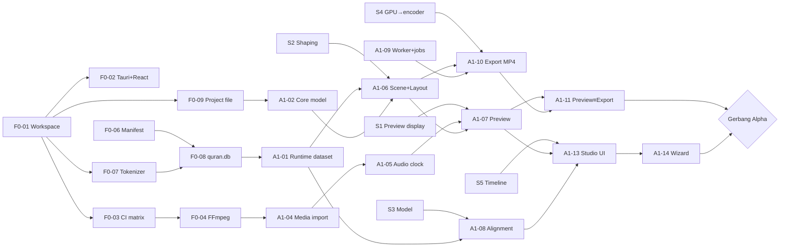

# 04 — Rencana Implementasi

| Item | Nilai |
|---|---|
| Status | v1.0, mengacu ke PRD baseline v1.0 (§14 rencana rilis) |
| Cakupan | Urutan kerja, dependensi, gerbang fase, dan definisi selesai dari fase 0 sampai v1.0 |
| Terkait | [`01_TECHNICAL_HANDOFF.md`](01_TECHNICAL_HANDOFF.md), [`02_DATABASE_SPECIFICATION.md`](02_DATABASE_SPECIFICATION.md), [`03_DATASET_PIPELINE.md`](03_DATASET_PIPELINE.md) |

Rencana ini disusun berdasarkan urutan dan dependensi, bukan tanggal. Setiap tugas punya ID,
dependensi, requirement PRD yang dipenuhi, dan kriteria selesai yang bisa diverifikasi. Fase hanya
selesai bila gerbangnya lulus.

---

## 1. Prinsip eksekusi

1. **Risiko teknis terbesar didahulukan.** Kelima spike (S1–S5) selesai sebelum fitur dibangun di
   atasnya.
2. **Vertical slice secepatnya.** Akhir fase 1 harus punya jalur ujung-ke-ujung: impor audio →
   segmentasi → preview → export MP4. Polesan menyusul.
3. **Satu jalur render sejak hari pertama.** Tidak ada preview "sementara" berbasis DOM.
4. **Gerbang otomatis.** Kriteria gerbang dijadikan job CI sejauh mungkin: golden tokenisasi, golden
   render, kesetaraan preview–export, uji instalasi.
5. **PRD terkunci.** Perubahan cakupan lewat Change Request (PRD §17), bukan lewat tugas.

---

## 2. Workstream

| WS | Nama | Crate / area | Fokus |
|---|---|---|---|
| A | Platform & CI | repo, `apps/desktop/src-tauri`, CI | Workspace, Tauri shell, matriks CI, FFmpeg build, packaging, updater |
| B | Data Al-Qur'an | `qr-quran`, `qr-dataset`, `qr-sources` | Pipeline 03, akses runtime, adapter Quran.com |
| C | Core & penyimpanan | `qr-core`, `qr-store` | Model proyek, undo/redo, autosave, migrasi, `app.db` |
| D | Media | `qr-media` | Decode, audio engine, waveform, loudness, encode |
| E | Render | `qr-render` | Scene, layout, shaping, animasi, wgpu/vello, fallback CPU |
| F | Alignment | `qr-align` | VAD, model akustik, identifikasi ayat, forced alignment, model pack |
| G | UI | `apps/desktop/src` | Wizard, studio, timeline canvas, inspector, command palette, i18n |
| H | Export, job, kebijakan | `qr-jobs`, `qr-policy`, `qr-cli` | Worker, antrean, validasi pra-export, CNT-1..5, batch, paket unggah |

---

## 3. Fase 0 — Fondasi

**Tujuan:** menghilangkan ketidakpastian teknis dan menyiapkan fondasi yang dipakai semua workstream.

### 3.1 Tugas fondasi

| ID | Tugas | WS | Dependensi | PRD | Selesai bila |
|---|---|---|---|---|---|
| F0-01 | Workspace Cargo + pnpm, struktur repo sesuai 01 §4, `rust-toolchain.toml`, lint/format, `cargo deny` | A | — | — | CI hijau di 3 OS untuk workspace kosong |
| F0-02 | Shell Tauri 2 + React + Vite + `tauri-specta`, satu command contoh dengan binding tergenerate | A | F0-01 | — | Aplikasi terbuka di 3 OS. `bindings.ts` dicek bersih di CI. |
| F0-03 | Matriks CI: macOS arm64 + x86_64 → universal, Windows x64, Linux x64 (glibc baseline Ubuntu 20.04) | A | F0-01 | DST-1, DST-2 | Artefak `.app` universal ad-hoc signed, NSIS, AppImage, `.deb` terbentuk |
| F0-04 | Build FFmpeg GPL dari sumber per OS (`third_party/ffmpeg`), dibundel dengan path relatif, plus pemeriksaan linkage | A | F0-03 | DST-3 | Job CI `linkage-check` lulus: tanpa path absolut non-sistem |
| F0-05 | Kunci minisign: updater dan dataset (dua kunci). Secret CI, public key di repo. | A | F0-03 | DST-4 | Uji verifikasi tanda tangan di CI lulus |
| F0-06 | `content-manifest.json` awal untuk semua file di `data/` dan `assets/fonts/quran/` | B | — | §11 | `qr-dataset verify-sources` lulus. Entri lisensi yang belum diketahui ditandai `PERLU DIISI` (Q8). |
| F0-07 | `qr-quran::text`: allowlist, tokenizer v1, `search_form`, `clean_translation`, dengan unit test | B | F0-01 | QRN-1, QRN-2 | Statistik sama dengan 03 §5.4: 77.511 kata, 0 kegagalan |
| F0-08 | `qr-dataset build`: S0–S10, `quran.db` sesuai 02 §3, laporan, uji reproducibility | B | F0-06, F0-07 | QRN-1..3, QRN-9..10 | Dua build berurutan menghasilkan hash identik. Golden `tokenization.tsv` dikomit. |
| F0-09 | Skema `project.json` v1 (tipe Rust + `schemars`), penulisan atomik, lock, snapshot | C | F0-01 | PRJ-2, PRJ-3 | Uji kill-during-save (fault injection) tidak pernah merusak proyek |
| F0-10 | `app.db` migrasi awal (02 §5) + penolakan rahasia di `setting` | C | F0-01 | SET-2 | Uji migrasi dari kosong lulus. Kunci rahasia ditolak. |
| F0-11 | Template ADR + ADR-0001 (stack di 01 §3) | A | — | — | ADR dikomit |

### 3.2 Spike

Setiap spike menghasilkan prototipe yang **dibuang** (bukan kode produksi), laporan pengukuran, dan ADR.

| ID | Pertanyaan | Langkah | Pengukuran | Lulus bila (PRD §9.1) | Output |
|---|---|---|---|---|---|
| S1 | Cara menampilkan frame wgpu di jendela Tauri | Prototipe opsi A (surface native) dan B (frame streaming) dari 01 §9 di 3 OS, termasuk Wayland dan X11 | fps, latensi input → frame, tearing, perilaku resize/DPI, CPU% | ≥ 30 fps 1080p½ di R-Low, tanpa tearing | ADR pilihan A/B/C |
| S2 | Shaping teks Arab dataset Kemenag dengan LPMQ | Shape 6.236 ayat dengan kandidat `parley`+`harfrust` dan HarfBuzz C. Bandingkan ID glyph dan posisi dengan `hb-shape`. | % ayat identik, selisih posisi maksimum, waktu shaping | 100% tanpa `.notdef`, posisi identik dengan referensi HarfBuzz atau selisih ≤ 1 unit font | ADR `TextShaper` |
| S3 | Model alignment yang memenuhi target | Kumpulkan kandidat model open-weight. Konversi ke ONNX. Bangun harness evaluasi (`qurender align --eval`) dengan set uji kecil berlisensi. | Akurasi identifikasi ayat, galat batas kata median/P90, waktu per menit audio di R-Mac/R-Win/R-Low | Mendekati target PRD §8.2 (≥ 98% identifikasi, median ≤ 80 ms, 10 menit ≤ 2 menit) atau ada jalur fine-tune yang jelas | ADR model + rencana model pack |
| S4 | GPU → encoder tanpa salinan berlebih | Render 1080p30 60 detik: konversi BT.709 di shader, readback NV12, encode HW dan software | fps export, memori puncak, CPU% | ≥ 3× real-time dengan encoder HW di R-Mac/R-Win | ADR pipeline export |
| S5 | Timeline React berperforma tinggi | Prototipe timeline canvas vs virtualisasi DOM dengan 2.000 klip, zoom, scroll, drag | fps saat scroll/zoom, waktu respons drag | 60 fps stabil | ADR timeline |

### 3.3 Gerbang keluar fase 0

- [ ] S1–S5 lulus, ADR dikomit. **Status audit:** S2 selesai dengan pengukuran nyata (ADR-0003). S1, S3, S4, S5 **belum dikerjakan** (ADR-0002/0004/0005/0006 berstatus "Belum dikerjakan"; angka di versi sebelumnya dicabut karena tidak pernah diukur).
- [x] `quran.db` dibangun reproducible dari `data/`, dan golden tokenisasi dikomit (F0-08). *Diverifikasi ulang saat audit: dua build menghasilkan SHA-256 identik `f06b7c28…8b79a`.*
- [ ] CI menghasilkan artefak 3 OS dengan FFmpeg terbundel yang lolos `linkage-check` (F0-03, F0-04). **Belum terbukti:** workflow belum pernah dijalankan di GitHub; `linkage-check` hanya dijalankan lokal pada `target/debug`, tidak pada bundel FFmpeg.
- [x] Penulisan atomik proyek lolos uji fault injection (F0-09). *Injeksi kegagalan di dalam proses (hook sebelum rename); belum ada uji kill proses sungguhan.*

---

## 4. Fase 1 — Alpha (vertical slice)

**Tujuan:** pengguna internal bisa membuat proyek dari audio, menyinkronkan otomatis, melihat preview,
dan mengekspor MP4 + SRT dengan 4 template.

| ID | Tugas | WS | Dependensi | PRD | Selesai bila |
|---|---|---|---|---|---|
| A1-01 | `qr-quran` runtime: buka `quran.db` dengan verifikasi tanda tangan + hash, API ayat/kata/terjemahan/pencarian | B | F0-08 | QRN-1, CNT-2 | Hash rusak memicu error `DATASET_INTEGRITY` dan teks tidak ditampilkan |
| A1-02 | Model domain `qr-core`: timeline, segmen, gaya berlapis (tanpa template), undo/redo transaksional | C | F0-09 | PRJ-4, STY-1 | Uji properti: undo/redo acak 10.000 operasi mengembalikan state awal |
| A1-03 | Indeks proyek + beranda (daftar, buat, buka, duplikat) | C, G | A1-02, F0-10 | PRJ-1, PRJ-6 | Proyek dibuat, ditutup, dan dibuka ulang. Indeks bisa dibangun ulang dari folder. |
| A1-04 | Impor media + probe + waveform bertahap + LUFS | D | F0-04 | SRC-1, SRC-2 | File 60 menit menampilkan waveform awal ≤ 2 detik |
| A1-05 | Audio engine `cpal` + jam master tick + seek | D | A1-04 | SYN-9, RND-3 | Drift jam vs posisi sampel 0 setelah 60 menit playback (uji otomatis) |
| A1-06 | Scene builder + layout teks (shaper hasil S2) + draw vello: ayat, terjemahan, latar warna/gambar | E | S2, A1-01, A1-02 | RND-1, RND-2 | Golden render 4 rasio lulus |
| A1-07 | Panel preview sesuai ADR S1, sinkron dengan jam audio | E, G | S1, A1-05, A1-06 | RND-3 | ≥ 30 fps di R-Mac/R-Win, scrubbing ≤ 50 ms/frame |
| A1-08 | Alignment lokal: VAD + model akustik + identifikasi ayat + forced alignment + WBW, di worker | F | S3, A1-01 | SYN-1..5 | Metrik set uji internal tercatat di laporan. Target gerbang ada di §4.1. |
| A1-09 | Worker `qurender` + protokol job + supervisor `qr-jobs` (antrean dasar, batal) | H | F0-10 | RND-4, EXP-7 | Membatalkan job mematikan worker. Job yatim kembali `queued` saat start. |
| A1-10 | Export MP4 (H.264) di worker, encoder HW + fallback, audio mux | H, D, E | S4, A1-06, A1-09 | EXP-1, EXP-2 | Export 1080p30 60 detik ≥ 3× real-time (HW). Encoder HW yang gagal paksa jatuh ke software. |
| A1-11 | Uji kesetaraan preview–export di CI | E, H | A1-07, A1-10 | RND-1 | SSIM ≥ 0,995 pada 50 tick |
| A1-12 | Export SRT/VTT tanpa nomor indeks | H | A1-02 | EXP-4 | Validator format SRT/VTT lulus |
| A1-13 | UI studio dasar: kanvas preview, timeline (hasil S5), inspector minimal, koreksi segmen dengan pintasan | G | S5, A1-07, A1-08 | SYN-6, TML-1, TML-3 | Alur penuh bisa dijalankan dengan keyboard saja |
| A1-14 | Wizard Sumber → Sinkron → Tampilan → Ekspor | G | A1-13 | PRD §6, G1 | Pengguna uji internal membuat video pertama tanpa bantuan |
| A1-15 | 4 template awal (16:9, 9:16, 1:1, 4:5) dalam format `.qrtemplate` | E, G | A1-06 | STY-6 | Template terender identik di 3 OS (golden) |
| A1-16 | Validator `qr-policy` CNT-1, CNT-2, CNT-5 di `export_validate` | H | A1-01, A1-06 | CNT-1, CNT-2, CNT-5, EXP-6 | Fixture pelanggaran memblokir export dengan kode error yang benar |

### 4.1 Gerbang keluar fase 1

- [ ] Alur ujung-ke-ujung berjalan di 3 OS dari installer CI (A1-03, A1-07, A1-13, A1-14). **Belum:** tidak ada installer CI; belum ada uji di Windows/Linux; wizard Sumber→Sinkron→Tampilan→Ekspor belum lengkap (sinkron otomatis, audio, ekspor dari UI belum tersedia).
- [ ] Kesetaraan preview–export lulus di CI (A1-11). **Belum:** preview dan ekspor kini memakai satu jalur render Rust, tetapi tidak ada uji SSIM/selisih kanal yang membandingkan frame ekspor (decode MP4) dengan frame preview.
- [ ] Target segmentasi (PRD §8.2) tercapai di R-Mac/R-Win pada set uji (A1-08). **Belum:** tidak ada model akustik/identifikasi ayat/set uji; hanya VAD + timing proporsional + keyakinan heuristik.
- [x] Tidak ada bug kehilangan data terbuka (penulisan atomik proyek & snapshot riwayat). *Tidak ada yang diketahui; bukan bukti ketiadaan.*

---

## 5. Fase 2 — Beta publik (semua P0)

| ID | Tugas | WS | Dependensi | PRD | Selesai bila |
|---|---|---|---|---|---|
| B2-01 | Sistem gaya lengkap: properti STY-2, dekorasi STY-3 (nama surah Amiri, nama qari, nomor ayat, logo), overlay STY-4 | E, G | A1-06 | STY-2..4 | Golden render per properti |
| B2-02 | Safe area per platform | G | B2-01 | STY-5 | Guide 9:16/1:1/16:9/4:5 sesuai spesifikasi platform terdokumentasi |
| B2-03 | Galeri template ≥ 12, impor/ekspor `.qrtemplate`, laporan font hilang | E, G | A1-15 | STY-6 | Template impor dari mesin lain terender identik |
| B2-04 | Font kustom + OpenType features + pemeriksaan cakupan glyph per segmen | E | A1-06 | STY-7, CNT-5 | Font tanpa glyph dataset memblokir export dengan detail ayat/karakter |
| B2-05 | Animasi masuk/keluar + karaoke per kata kontinu | E | A1-06, A1-08 | ANM-1..3 | Golden animasi pada 24/30/60 fps konsisten |
| B2-06 | Visual merge + anti-collision dasar | E | B2-01 | TML-4 | Golden tanpa tumpang tindih pada fixture |
| B2-07 | Klip overlay (teks/gambar/video) di sembarang posisi + PiP | E, G | A1-13 | TML-2 | — |
| B2-08 | Latar video: loop, reverse, kecepatan, blur, banyak klip | D, E | A1-10 | SRC-5 | Export dengan latar reverse identik dengan preview |
| B2-09 | Export transparan (ProRes 4444, WebM VP9 alpha, PNG) + ASS | H | A1-10 | EXP-3, EXP-4 | Alpha straight terverifikasi dengan decode ulang |
| B2-10 | Validasi pra-export lengkap + pola nama file anti-timpa | H | A1-16 | EXP-5, EXP-6 | Semua masalah yang bisa dideteksi dilaporkan sebelum job mulai |
| B2-11 | CNT-3/CNT-4 + paket unggah `*.credits.txt` / `*.upload.txt` + panel "Siap unggah" | H, G | B2-10 | CNT-3, CNT-4, PKG-1, PKG-2 | Atribusi lengkap di setiap export, termasuk batch |
| B2-12 | Batch: pecah per N ayat/durasi/marker/manual, antrean persisten, jeda/lanjut, prioritas | H, G | A1-09 | BAT-1..3 | 50 klip selesai tanpa intervensi. Klip gagal tidak menghentikan antrean. |
| B2-13 | Adapter Quran.com (Saheeh) + `content.db` + catatan kaki di UI + penguncian edisi | B, G | A1-01 | QRN-12..14 | Validasi 03 §6.2 diuji dengan respons rekaman (fixture), tanpa jaringan di CI |
| B2-14 | Snapshot/riwayat versi di UI + pemulihan + arsip `.qrpack` | C, G | F0-09 | PRJ-3, PRJ-5 | Arsip dari macOS dibuka identik di Windows/Linux |
| B2-15 | Rahasia di keychain + pengaturan + allowlist jaringan | C | F0-10 | SET-2, §8.4 | Uji: permintaan ke domain di luar allowlist ditolak |
| B2-16 | i18n ID/EN lengkap, aksesibilitas (navigasi keyboard, label, kontras AA) | G | A1-13 | SET-1, SET-3, SET-4 | Audit aksesibilitas internal lulus |
| B2-17 | Auto-update stable/beta + backup otomatis saat skema proyek berubah | A | F0-05 | DST-4 | Update bertanda tangan salah ditolak (uji) |
| B2-18 | Uji instalasi otomatis per format paket + Flatpak manifest | A | F0-03 | DST-2 | Aplikasi terbuka dan render 1 frame di setiap format |
| B2-19 | Panduan "buka pertama kali" (Gatekeeper, SmartScreen) di halaman rilis | A | — | DST-1, DST-2 | Dipublikasikan bersama rilis beta |
| B2-20 | Telemetri/crash report opt-in (bila endpoint disepakati) atau crash log lokal saja | A | — | SET-5 | Default mati. Pratinjau data tersedia. |

### 5.1 Gerbang keluar fase 2

- [ ] Semua requirement P0 punya bukti uji. **Belum:** lihat tabel status di `05_AUDIT_FASE_0_2.md`.
- [ ] Uji asap instalasi 3 OS (B2-18) dan kesetaraan render deterministik lintas OS. **Belum:** tidak ada pengujian instalasi dan CI belum pernah dijalankan.
- [ ] Implementasi P0 selesai. **Sebagian.** Selesai dan terbukti (uji nyata): B2-01/02/03/04/05/06 (renderer, template, safe area, glyph font, animasi, collision), B2-09 (hanya penyusun argumen ffmpeg), B2-10, B2-11 (berkas kredit/unggah; panel UI belum), B2-13 (parser; tanpa penguncian edisi/UI catatan kaki). **Belum:** B2-07, B2-08 (efek video latar hanya fungsi pemetaan tick), B2-12 persisten, B2-14 UI, B2-15 keychain, B2-16 i18n/a11y, B2-17 updater/backup, B2-18, B2-19, B2-20.
- [ ] Q5/Q8/Q9. Q9: Saheeh terisolasi di `content.db` via adapter, tetapi pengunduhan nyata dan UI penguncian edisi belum ada. Q5 (U+06D4) dan Q8 (lisensi `PERLU DIISI`) **masih menunggu keputusan pemilik**.

---

## 6. v1.0 — Hardening

| ID | Tugas | Selesai bila |
|---|---|---|
| H-01 | Profiling dan pemenuhan semua target PRD §8.2 di R-Mac, R-Win, R-Low | Laporan kinerja per mesin referensi |
| H-02 | Fuzzing migrasi skema proyek dan impor `.qrpack`/`.qrtemplate` | Tidak ada panic. Input rusak menghasilkan error yang bisa ditindaklanjuti. |
| H-03 | Dokumentasi pengguna ID/EN (memulai, sinkron, gaya, batch, paket unggah) | Dipublikasikan |
| H-04 | Paket model tingkat Kecil/Akurat yang bisa diunduh + verifikasi tanda tangan | SYN-8 (P1, boleh menyusul bila belum siap) |
| H-05 | Bug bash lintas OS + perbaikan semua bug berat | Nol bug berat terbuka |

**Status (lihat `06_V1_HARDENING.md`):** H-01 sebagian (2,9× pada satu mesin dev, target 3× belum terbukti), H-02 sebagian
(fuzzing mutasi; migrasi dan `.qrpack` belum ada), H-03 selesai (sesuai kondisi nyata), H-04 belum, H-05 hanya macOS.

Gerbang v1.0: seluruh kriteria P0 terpenuhi (PRD §14). **Belum terpenuhi** (gerbang Fase 1 dan 2 masih terbuka).

---

## 7. Jalur kritis

Spike S2 (shaping) dan S3 (model) paling berisiko memperlambat jalur kritis, jadi keduanya dimulai
paling awal dan berjalan paralel dengan F0-01..F0-05.

---

## 8. Definisi selesai (setiap tugas)

- Kode di-merge lewat PR yang mencantumkan ID tugas dan ID requirement PRD.
- Pengujian sesuai jenisnya (01 §13): unit untuk logika murni, golden untuk render/tokenisasi, uji
  integrasi untuk worker/DB.
- Tidak ada `unwrap()` di luar test. `clippy -D warnings` dan ESLint bersih.
- String UI baru ada di katalog ID dan EN.
- Perubahan kontrak (IPC, skema proyek, skema DB, protokol worker) disertai migrasi dan ADR bila
  mengubah dokumen 01/02/03.
- Perilaku yang berubah dicek manual di aplikasi (bukan hanya lewat test) dan dicatat di PR.

---

## 9. Backlog awal (siap dikerjakan)

Urutan rekomendasi untuk mulai, dengan tugas paralel per peran:

| Urutan | Rust core/render | Media/alignment | Frontend | Platform/CI |
|---|---|---|---|---|
| 1 | F0-07 Tokenizer + allowlist | S3 harness evaluasi + kandidat model | F0-02 Tauri + React + specta | F0-01 Workspace, F0-03 CI matrix |
| 2 | S2 Spike shaping | S3 evaluasi kandidat | S5 Spike timeline | F0-04 FFmpeg build |
| 3 | F0-06 + F0-08 `quran.db` | S4 Spike GPU → encoder | S1 Spike preview (bersama Rust) | F0-05 Kunci minisign |
| 4 | F0-09 Format proyek | A1-04 Impor media | — | F0-10 `app.db` |

---

## 10. Risiko & titik pemeriksaan

| Risiko PRD | Diperiksa pada | Pemicu tindakan |
|---|---|---|
| R1 akurasi model | Akhir S3, gerbang alpha | Di bawah target: model pack Akurat atau fine-tune sebelum beta |
| R2 integrasi wgpu ↔ webview | Akhir S1 | Opsi A gagal di Linux: pakai opsi B/C |
| R3 shaping Arab | Akhir S2 | Stack Rust murni gagal: pakai HarfBuzz C |
| R4 API Quran.com lama | Setiap rilis (uji kontrak terjadwal di CI, di luar jalur PR) | Endpoint gagal: Change Request migrasi adapter (03 §6.5) |
| R6 build tanpa sertifikat | Beta | Keluhan instalasi tinggi: prioritaskan DST-6 |
| R7 cakupan P0 | Setiap gerbang fase | Tugas P0 tertinggal: geser P1, tidak boleh memotong P0 |
| R9 anomali dataset | Gerbang beta | Build rilis menolak anomali `needs_review` |

---

## 11. Item tertunda dari PRD

| ID | Item | Batas | Akibat bila terlambat |
|---|---|---|---|
| Q5 | Verifikasi U+0608 (18:74), U+0609 (17:86), U+06D4 (akhir juz) terhadap mushaf resmi | Gerbang beta | Build rilis beta gagal (03 §5.3) |
| Q8 | Sumber dan lisensi font di `content-manifest.json` | Gerbang beta | Build rilis gagal karena `PERLU DIISI` |
| Q9 | Izin Saheeh International | Sebelum Saheeh dibundel | Saheeh tetap hanya bisa diunduh pengguna |
