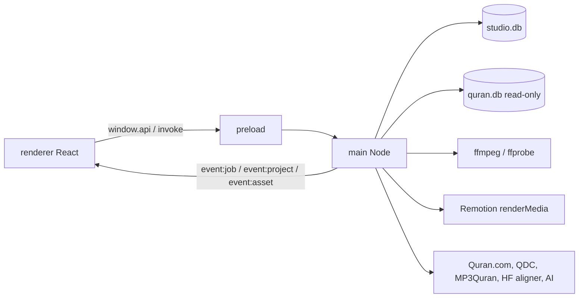

# Engineering Overview & Local Build Guide

This document summarizes the Electron + Remotion architecture and build/test workflow in English (see [`01_TECHNICAL_HANDOFF.md`](01_TECHNICAL_HANDOFF.md) and [`07_BUILD_DAN_TEST.md`](07_BUILD_DAN_TEST.md) for the Indonesian documents, and [`adr/0007-pindah-ke-electron.md`](adr/0007-pindah-ke-electron.md) for the Electron migration decision).

## 1. Non-Negotiable Rules

1. **Clean-room:** Never copy, open, or adapt code, assets, prompts, UI strings, or visual design from Quran Caption (CC BY-NC 4.0). Public services that it also calls (Quran.com, MP3Quran, HF Space aligner) may be used independently.
2. **Verbatim Quranic text:** Arabic text is never altered or generated by AI. Kemenag text comes verbatim from `resources/quran.db`; Uthmani and QPC scripts come from Quran.com. AI only produces timings and partial-verse translation trims.
3. **Single render path:** Preview (`@remotion/player`) and export (`@remotion/renderer`) run the exact same Remotion composition (`src/remotion/`) with the same `VideoProps`; only `baseUrl` differs. The composition must be pure with respect to frame numbers (no `Date`, no randomness).
4. **No Python at runtime:** Cloud AI alignment runs on a public Hugging Face Space; manual segment editing is always available offline.
5. **No team secrets in the app:** User API keys are encrypted locally using Electron `safeStorage` (OS keychain/credential store).
6. **MIT license compatibility:** Bundled dependencies and assets must remain compatible with MIT distribution (see [`../../THIRD_PARTY_NOTICES.md`](../../THIRD_PARTY_NOTICES.md)).

## 2. Process Architecture & IPC



- **Window isolation:** `sandbox: true`, `contextIsolation: true`, `nodeIntegration: false`, and strict CSP in `src/renderer/index.html`. External `https://` links open in the default browser via `shell.openExternal`; in-app navigation away from the app is blocked.
- **Typed IPC:** Every method on `StudioApi` (`src/shared/api.ts`) maps to an IPC channel `group:method`. Preload constructs `window.api` from `CHANNELS`; the main process registers typed handlers via `handle()` (`src/main/ipc.ts`).
- **Asset & font serving:** Local project media, nature sounds, and fonts are served through `studio://asset/<project>/<path>`, `studio://ambient/<id>.m4a`, and `studio://fonts/<file>` with HTTP Range support (`src/main/protocol.ts`). During export, `main` starts a temporary local HTTP server (`src/main/renderServer.ts`) because Chrome Headless Shell cannot read `studio://`.

## 3. Data & Storage

User data lives in `app.getPath('userData')` (override during development with `QR_USER_DATA=<dir>`):

- `studio.db` (`src/main/db.ts`, append-only `MIGRATIONS`): `projects` (JSON per project), `assets`, `jobs`, `settings`, `secrets`, `cache`, `editions`, and `edition_text`.
- `resources/quran.db`: bundled read-only Kemenag dataset (`114` surahs, `6,236` ayahs, `id.kemenag` translation; see [`02_DATABASE_SPECIFICATION.md`](02_DATABASE_SPECIFICATION.md)).
- **Canonical word indexing:** Word positions follow Quran.com (`1`-based, excluding ayah-end markers). Every Arabic script's `Verse.words` has the same length; empty strings represent words merged with the preceding word, and `src/shared/wordMap.ts` maps Kemenag and aligner word boundaries to canonical indices.
- **Project state ownership:** The renderer holds active edits in `useProject` (Zustand) with undo/redo and 1.2s autosave. Main-process jobs write results via `patchProject`, emitting `event:project`; the renderer merges patches via `applyPatch` and calls `flush()` before invoking main-process jobs.
- **Job queues (`src/main/jobs.ts`):** `net` (3 concurrent), `cpu` (1 concurrent for FFmpeg/Remotion), and `align` (1 concurrent). Interrupted jobs are marked failed when the app restarts.

## 4. External Services

| Service | Purpose |
|---|---|
| Quran.com API v4 | Uthmani text, QPC glyph codes, translation catalog and editions |
| Quran.com Font CDN | Per-page QPC fonts and Uthmani Hafs font |
| MP3Quran API v3 & QDC (`api.qurancdn.com`) | Reciter catalogs, surah audio files, and verse/word timings |
| HF Space `hetchyy-quranic-universal-aligner` | Cloud AI sync: verse detection, word timings, basmalah, isti'adzah |
| OpenAI-compatible APIs (user-configured) | Translation AI trim, Publish copy (`/chat/completions`), AI background images (`/images/generations`) |
| Local AI CLIs (`claude`, `codex`, `opencode`, custom) | Keyless alternative for translation AI trim and Publish copy (`src/main/cli.ts`); Codex also supports image generation |
| Pollinations (`image.pollinations.ai`) | Free keyless default AI background provider (cropped ~7% on right/bottom edges to remove its corner watermark) |
| Pexels, Unsplash, Pixabay | Stock photos and videos (user-supplied free API keys; photographer credits preserved) |
| `yt-dlp` GitHub Releases | Downloaded on demand into `userData/tools/` when the YouTube source feature is used |

## 5. Building & Testing Locally

**Prerequisites:** Node.js `22+` with npm (macOS or Windows). `ffmpeg-static`, `ffprobe-static`, and Chrome Headless Shell are installed via npm or `npm run prepare:remotion`.

```bash
npm install
QR_USER_DATA=/tmp/qr-dev npm run dev   # dev app with isolated test data
```

### Verification Commands

| Command | Description |
|---|---|
| `npm run typecheck` | Strict TypeScript checks (`tsconfig.node.json` and `tsconfig.web.json`) |
| `npm test` | Vitest unit tests (`src/shared/*.test.ts` and `src/remotion/layout.test.ts`), including i18n dictionary parity |
| `npm run lint:design` | Verifies every `qr-*` class and `var(--token)` in `src/renderer/src` is defined |
| `npm run lint:a11y` | Static JSX accessibility checks and WCAG contrast checks on `design/system/tokens.css` |
| `npm run build` | Builds main, preload, and renderer bundles to `out/` |

### Remotion Bundle & Installers

During development, the main process rebuilds `resources-gen/remotion-bundle` automatically when `src/remotion` or `src/shared` changes. To prepare the bundle and Chrome Headless Shell manually or package installers into `dist/`:

```bash
npm run prepare:remotion            # build Remotion bundle + ensure Chrome Headless Shell
node scripts/prepare-remotion.mjs --bundle   # build bundle only
npm run dist:mac                    # build unsigned macOS DMG in dist/
npm run dist:win                    # build unsigned Windows NSIS installer in dist/
```
