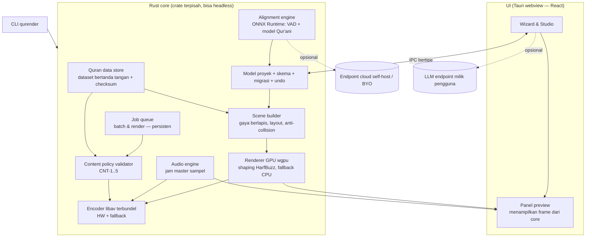

# PRD — QuranRender

| Item | Nilai |
|---|---|
| Status | **TERKUNCI — Baseline v1.0** (2026-10-22). Perubahan hanya lewat Change Request yang dicatat di §17. |
| Tanggal | 2026-10-22 |
| Pertanyaan tertunda | Q5, Q8, Q9 (§15.2) ditunda atas keputusan pemilik produk. Pertanyaan ini tidak memblokir fase 0–1, tetapi wajib selesai sebelum beta publik. |
| Pemilik | Product Owner QuranRender |
| Lisensi produk | MIT (kode). Konten pihak ketiga mengikuti lisensinya masing-masing (§11) |
| Kerangka UI | React (di dalam Tauri 2) |
| Platform rilis 1 | Desktop: macOS (Apple Silicon & Intel), Windows 10+, Linux (x86_64) |
| Platform berikutnya | Android & iOS (fase 3) |

---

## 1. Ringkasan

QuranRender adalah studio desktop gratis dan open source untuk mengubah rekaman tilawah Al-Qur'an
menjadi video berteks: ayat Arab, terjemahan, dan sorotan per kata yang sinkron dengan suara qari.
Hasilnya siap diunggah ke YouTube, Shorts, Reels, dan TikTok. Pengguna mengunggahnya sendiri;
aplikasi menyiapkan paket unggah (file video, thumbnail, dan teks deskripsi beserta atribusi).

Produk ini terinspirasi dari kategori yang dirintis Quran Caption. QuranRender dibangun ulang dari
nol (clean-room) dengan empat taruhan utama:

1. **Satu mesin render untuk preview dan export (WYSIWYG).** Video hasil export identik piksel demi
   piksel dengan preview, termasuk animasi karaoke per kata yang halus.
2. **AI lokal tanpa Python.** Segmentasi ayat dan timing per kata berjalan offline lewat model ONNX
   yang dibundel. Server cloud bersifat opsional dan dapat di-host sendiri (*bring-your-own*).
3. **Template dan produksi massal.** Satu tilawah panjang dapat diubah menjadi puluhan klip siap
   unggah dalam satu antrean.
4. **Amanah teks yang ditegakkan sistem.** Export ditolak bila teks Arab tidak utuh per kata,
   dataset tidak terverifikasi, glyph hilang, atau terjemahan tampil tanpa atribusi (§7.15).

Pasar awal adalah kreator dakwah Indonesia (UI Bahasa Indonesia & Inggris). Arsitektur i18n, RTL, dan
katalog terjemahan disiapkan untuk ekspansi global.

---

## 2. Latar belakang & analisis kompetitor

### 2.1 Quran Caption (referensi utama)

Sumber: reverse engineering build macOS 3.7.52 (REA, 2026-10-22), dokumentasi publik di
`github.com/zonetecde/QuranCaption`, dan daftar issue publiknya.

**Yang sudah dikerjakan dengan baik dan harus kita setarai:**

- Segmentasi otomatis per ayat, termasuk potongan di tengah ayat, deteksi jeda, basmalah, dan
  isti'adzah.
- Timing per kata (WBW) dan sorotan kata.
- Banyak terjemahan, serta pemotongan terjemahan berbantuan AI saat ayat terpotong.
- Kustomisasi visual yang lengkap: font, outline, bayangan, overlay gradien, nama surah, nama qari,
  nomor ayat.
- Export ke rasio landscape, potret, dan persegi. Ada juga export subtitle (SRT/VTT) dan upload
  YouTube.
- Unduh audio/video dari YouTube (yt-dlp), stok video dari Pexels/Pixabay, dan Discord Rich
  Presence.

**Kelemahan yang menjadi peluang kita:**

| Area | Temuan | Bukti |
|---|---|---|
| Pipeline export | Preview memakai DOM/CSS. Export memotret DOM (`modern-screenshot`) hanya pada perubahan state, lalu PNG → TGA → FFmpeg. Fade dihitung ulang di Rust, dan export memakai fade = 0 saat capture. Ada jalur khusus per OS untuk font. | `documentations/rendering.md`, `video-export.md` |
| Kesetiaan preview vs export | Dua jalur render: CSS untuk preview, screenshot + komposit untuk export. Hasilnya, bug export spesifik per OS dan per font. | Issue #14, #66, #111, #137 |
| AI lokal | Butuh Python 3.10+, venv, dan torch (~2–3 GB). Model diunduh dari HF/GitHub LFS. Banyak pengguna gagal menyiapkannya. | `Resources/python/*requirements.txt`; issue #64, #67, #121 |
| Distribusi | Binary macOS tidak ditandatangani dan tanpa hardened runtime. ffmpeg/ffprobe bawaan ditautkan dinamis ke `/usr/local/Cellar/ffmpeg-full/...` sehingga gagal jalan di mesin lain. Dukungan Intel Mac dihentikan. AppImage Linux layar putih. | REA `inspect-signature`, `otool -L`; issue #154, #34, #134 |
| Keandalan proyek | Backup/restore proyek gagal, proyek tidak bisa diimpor, dan mobile crash saat impor backup. | Issue #24, #26, #29, #61, #141 |
| Sinkronisasi | Audio dan subtitle kadang bergeser setelah disimpan. | Issue #27 |
| Keamanan | API key OpenAI, Pexels, dan Pixabay disimpan plaintext di `settings.json` (izin 644). Client secret OAuth Google tertanam di binary. ATS mengizinkan HTTP tanpa enkripsi. | Inspeksi `settings.json`, string binary, `Info.plist` |
| Fitur yang sering diminta | Volume >100%, reverse video, video kustom di sembarang posisi timeline, durasi fade yang bisa diatur, subtitle bertumpuk, font kustom, export caption transparan/PNG, trim dengan shortcut. | Issue #149, #148, #109, #128, #127, #126, #123, #136, #110 |
| Lisensi | CC BY-NC 4.0: tidak boleh dipakai komersial dan tidak cocok dengan ekosistem OSS standar. | `LICENCE` |

### 2.2 Batasan clean-room

QuranRender **tidak boleh** menyalin kode, aset, data olahan, prompt, string UI, atau desain visual
dari Quran Caption. Lisensinya CC BY-NC 4.0 tidak kompatibel dengan GPL-3.0. Yang kita ambil hanya
pemahaman kategori produk dan masalah penggunanya. Semua data Quran, font, terjemahan, dan model
harus didapat langsung dari sumber aslinya dengan lisensi yang tercatat (§11).

---

## 3. Tujuan & non-tujuan

### 3.1 Tujuan

- G1 — Pengguna baru bisa menghasilkan video berteks pertama yang sinkron **≤ 10 menit** sejak
  instalasi, tanpa menginstal dependensi tambahan.
- G2 — Hasil export **identik** dengan preview (selisih per-piksel di bawah ambang yang ditetapkan
  di §8.2).
- G3 — Segmentasi ayat dan timing per kata berjalan **offline** di laptop kelas menengah.
- G4 — Satu tilawah panjang dapat dipecah menjadi banyak klip pendek dalam satu antrean batch.
- G5 — Instalasi bersih di tiga OS desktop tanpa dependensi sistem: semua dependensi native
  terbundel. Code signing OS ditunda (§3.2), tetapi pembaruan tetap ditandatangani.
- G6 — Teks Al-Qur'an yang ditampilkan **selalu** berasal dari sumber terverifikasi dan tidak pernah
  diubah oleh AI.

### 3.2 Non-tujuan (rilis 1)

- Editor video umum (multicam, color grading, efek bebas). Kita fokus pada video tilawah.
- Rekam audio di dalam aplikasi.
- Akun pengguna, sinkronisasi cloud, dan kolaborasi tim.
- Aplikasi mobile (fase 3).
- Layanan cloud yang dioperasikan dan dibiayai tim proyek. Cloud hanya tersedia dalam bentuk
  self-host atau milik pengguna.
- Monetisasi, watermark, atau paywall.
- Integrasi publikasi ke platform (YouTube, TikTok, Instagram), termasuk OAuth dan upload dari
  aplikasi. Penggantinya adalah paket unggah (§7.11).
- Code signing Apple (Developer ID + notarisasi) dan sertifikat code signing Windows. Build rilis 1
  tidak ditandatangani sertifikat OS (§7.14).

---

## 4. Pengguna

### 4.1 Persona

| Persona | Konteks | Kebutuhan utama |
|---|---|---|
| **Admin channel dakwah** (primer) | Mengelola channel YouTube/IG masjid atau kajian dan rutin mengunggah tilawah imam atau qari. | Cepat, konsisten dengan identitas channel, bisa batch, deskripsi dan atribusi siap salin. |
| **Kreator konten pendek** | Membuat Reels/TikTok 30–90 detik dari potongan tilawah populer. | Template vertikal yang menarik, animasi kata, potong ayat favorit dengan mudah. |
| **Qari / santri** | Merekam tilawah sendiri dan ingin membagikannya dengan teks. | Akurasi teks dan riwayat, sinkron otomatis, sedikit pengaturan. |
| **Lembaga pendidikan Qur'an** | Membuat materi untuk ditonton ulang. | Terjemahan resmi (Kemenag), kejelasan teks, export subtitle untuk platform belajar. |

### 4.2 Jobs-to-be-done

- "Saat saya punya rekaman tilawah, saya ingin teks ayatnya muncul tepat ketika dibaca, tanpa
  mengatur timing manual."
- "Saat saya punya tilawah 40 menit, saya ingin memecahnya menjadi klip per beberapa ayat yang siap
  diunggah ke Shorts."
- "Saat saya mengunggah rutin, saya ingin semua video punya tampilan yang konsisten tanpa mengulang
  pengaturan."

---

## 5. Prinsip produk

1. **Amanah terhadap teks.** Teks Arab dimuat dari dataset terverifikasi (checksum). AI hanya
   menentukan *kapan*, tidak pernah *apa*. Terjemahan selalu mencantumkan sumber dan penerjemah.
2. **Yang terlihat adalah yang diekspor.** Hanya ada satu fungsi `render(scene, t)`.
3. **Offline-first, cloud opsional.** Setiap fitur inti bisa dipakai tanpa internet setelah aset
   diunduh.
4. **Alur terpandu, kontrol penuh.** Wizard empat langkah membawa pengguna baru ke hasil. Studio
   lengkap tersedia untuk pengguna mahir.
5. **Tidak ada data yang hilang.** Autosave, riwayat versi, dan format proyek yang terdokumentasi
   dan bisa dimigrasi.
6. **Privasi secara default.** Telemetri mati kecuali pengguna memilih ikut. Rahasia disimpan di
   keychain OS.

---

## 6. Arah pengalaman pengguna

Identitas visual akan dirinci di `docs/design/`. Bagian ini hanya menetapkan arah yang **sengaja
berbeda** dari Quran Caption.

- **Alur utama empat langkah** yang terlihat di header proyek: **Sumber → Sinkron → Tampilan →
  Ekspor**. Setiap langkah bisa dilewati, dan studio lengkap selalu bisa diakses.
- **Studio berpusat pada kanvas.** Preview menjadi pusat layar. Panel *Inspector* kontekstual di
  satu sisi menampilkan properti objek yang dipilih. Timeline multi-track ada di bawah. Tidak ada
  tab yang memisahkan editor subtitle, terjemahan, dan gaya. Semuanya diedit langsung pada objek di
  kanvas atau timeline.
- **Command palette** (`⌘K` / `Ctrl+K`) untuk semua aksi, beserta pintasan keyboard yang bisa
  diubah.
- **Layar beranda** berupa daftar proyek dengan filter status, galeri template, dan antrean render
  dalam satu tempat.
- **Teks Arab mendapat panggung utama.** Preview tipografi yang akurat, tanpa elemen UI yang
  menutupi kanvas.
- Mendukung tema terang/gelap dan UI RTL (siap untuk lokal Arab/Urdu).

---

## 7. Kebutuhan fungsional

Prioritas: **P0** wajib untuk v1.0, **P1** target v1.x, **P2** setelahnya.

### 7.1 Proyek & penyimpanan

| ID | Prio | Kebutuhan | Kriteria penerimaan |
|---|---|---|---|
| PRJ-1 | P0 | Membuat proyek dari audio/video lokal, URL, atau pustaka qari. | Proyek tersimpan dengan metadata: qari, riwayat, rentang ayat, rasio, kategori. |
| PRJ-2 | P0 | Format proyek berupa paket `.qrproj` (direktori/zip) berisi `project.json` berversi skema, referensi aset (path relatif + hash), dan cache yang bisa dibuang. | Skema JSON dipublikasikan. Membuka proyek versi lama otomatis menjalankan migrasi dengan backup. |
| PRJ-3 | P0 | Autosave atomik (tulis ke file sementara lalu rename) dan riwayat versi minimal 20 snapshot. | Mematikan proses paksa tidak pernah merusak proyek. Pengguna bisa memulihkan snapshot. |
| PRJ-4 | P0 | Undo/redo tanpa batas dalam sesi untuk semua operasi editor. | Termasuk operasi hasil AI (segmentasi, trim terjemahan). |
| PRJ-5 | P0 | Export/impor arsip proyek mandiri: aset dan media opsional dibundel. | Arsip yang diimpor di OS lain terbuka dan terender identik. Aset yang hilang dilaporkan dengan opsi *relink*. |
| PRJ-6 | P1 | Duplikat proyek, kategori/tag, pencarian, dan status (draf/siap/terbit). | — |

### 7.2 Sumber media

| ID | Prio | Kebutuhan | Kriteria penerimaan |
|---|---|---|---|
| SRC-1 | P0 | Impor audio (mp3, m4a, aac, wav, flac, ogg, opus) dan video (mp4, mov, mkv, webm) lewat drag & drop. | Durasi dan waveform tampil ≤ 2 detik untuk file 60 menit (waveform dibuat bertahap). |
| SRC-2 | P0 | Trim audio/video sumber, gain hingga **+12 dB**, normalisasi loudness (target LUFS sesuai platform), fade in/out. | Menjawab issue #149. Nilai LUFS terukur ±1 LU dari target. |
| SRC-3 | P1 | Unduh dari URL (YouTube dan sejenisnya) lewat yt-dlp terbundel yang bisa diperbarui sendiri, dengan peringatan hak cipta. | Gagal unduh menampilkan pesan yang bisa ditindaklanjuti, tanpa stack trace. |
| SRC-4 | P1 | Pustaka qari: telusuri dan unduh audio per surah dari sumber berlisensi (§11), lengkap dengan timing ayat bila tersedia sehingga segmentasi bisa dilewati. | — |
| SRC-5 | P1 | Latar: warna, gradien, gambar, video lokal (loop, reverse, kecepatan), atau stok Pexels/Pixabay (API key pengguna). | Menjawab issue #148 dan #74. |

### 7.3 Data Al-Qur'an

| ID | Prio | Kebutuhan | Kriteria penerimaan |
|---|---|---|---|
| QRN-1 | P0 | Dataset teks dasar: **Kemenag, Mushaf Standar Indonesia (riwayat Hafs)** dari folder repo `data/` (format API Kemenag: `aya_id`, `sura_id`, `aya_number`, `aya_text`, `juz_id`, `page_number`). Teks Arab disimpan **verbatim**: tanpa normalisasi Unicode, hanya spasi di awal/akhir yang dipangkas. 5.713 ayat tidak dalam bentuk NFC, dan normalisasi akan mengubah urutan tanda. Checksum SHA-256 dihitung atas hasil ingest dan diperiksa saat load. | 6.236 ayat, `aya_id` 1–6236 berurutan, dan isi `surah/` identik dengan `juz/` (terverifikasi 2026-10-22, Lampiran B). Checksum tidak cocok → aplikasi menolak menampilkan teks dan meminta unduh ulang. |
| QRN-2 | P0 | Data kata diturunkan dari teks dengan aturan tokenisasi terdokumentasi, karena dataset Kemenag tidak menyertakan segmentasi kata: pisah per spasi. Token yang hanya berisi tanda (waqaf ۗ ۚ ۙ ۖ ۛ ۘ ۜ, ࣖ, ۢ) dan ۩ (sajdah) digabung ke kata sebelumnya; ۞ (rub' al-hizb) digabung ke kata berikutnya. Penanda akhir juz ۔ tidak dihitung sebagai kata. | Tokenisasi deterministik dengan golden test untuk 6.236 ayat. Tidak ada kata tanpa huruf. |
| QRN-3 | P0 | **Indonesia:** terjemahan Kemenag dari `data/` (`translation_aya_text`) adalah acuan dan dibundel. Tidak ada pengunduh Kemenag. **Inggris:** Saheeh International, diunduh dari Quran.com (QRN-12). Edisi ini dibundel hanya setelah izin pemegang hak diperoleh (diurus pemilik produk, D12). Field `translation_en` di `data/` (diduga terjemahan Muhammad Asad) **tidak dipakai dan tidak dibundel**. | Ingest membuang tag HTML dari terjemahan (saat ini hanya 1:1 yang memuat `<p>`). Atribusi penerjemah dan sumber tampil di UI dan masuk ke paket unggah. Build gagal bila `translation_en` terbawa ke bundel, atau bila Saheeh dibundel tanpa status izin "disetujui" di manifest. |
| QRN-4 | P1 | Katalog terjemahan yang bisa diunduh (≥ 30 bahasa), metadata lisensi per terjemahan, dan arah teks (RTL/LTR) per edisi. | Terjemahan yang lisensinya tidak mengizinkan redistribusi tidak dibundel; pengguna mengunduhnya sendiri dari sumber. |
| QRN-5 | P1 | Riwayat selain Hafs (Warsh, Qalun, dll.) bila datanya tersedia dan berlisensi. | — |
| QRN-6 | P1 | Terjemahan per kata (WBW translation) untuk ID dan EN. | — |
| QRN-7 | P2 | Mode halaman mushaf (layout per halaman, Madinah 604 halaman) dengan sorotan ayat/kata. | — |
| QRN-8 | P0 | Pengguna boleh mengedit **terjemahan** per proyek. Teks Arab hanya bisa dipotong pada batas kata, tidak bisa diketik ulang. | Edit terjemahan ditandai "diubah pengguna". |
| QRN-9 | P0 | Metadata surah dan juz dari `data/surah/list-surah.json` dan `data/juz/list_juz.json` (nama Arab/latin, arti, tempat turun, jumlah ayat, deskripsi, rentang juz). `deskripsi` mengandung HTML dan disanitasi dengan allowlist `<i>` dan `<br>`; hanya tampil di UI, tidak di video. Field `audio` (URL CDN equran.id) tidak dibundel dan tidak dipakai sampai lisensi rekamannya jelas. | Jumlah ayat per surah di metadata sama dengan isi `data/surah/*.json`. |
| QRN-10 | P0 | Basmalah dirender dari teks ayat 1:1 dengan font dataset (LPMQ). Tidak ada font kaligrafi basmalah terpisah. | Basmalah di awal surah (kecuali 1 dan 9) memakai teks dan font yang sama dengan ayat 1:1. |
| QRN-11 | P1 | Dataset alternatif Uthmani Madani (Tanzil/QUL) untuk pengguna di luar Indonesia, dipasangkan dengan font Uthmani (§11.2). | Proyek menyimpan ID dataset. Berganti dataset memicu tokenisasi dan sinkronisasi ulang dengan peringatan. |
| QRN-12 | P0 | Adapter **Quran.com** untuk mengunduh terjemahan (rilis 1: Saheeh International, `resource_id` 20). Memakai API lama tanpa autentikasi: `GET https://api.quran.com/api/v4/quran/translations/20?foot_notes=true&fields=verse_key` (satu permintaan, 6.236 ayat, ±1,5 MB, catatan kaki ikut di field `foot_notes`). Daftar edisi diambil dari `GET /api/v4/resources/translations`. Adapter terisolasi (base URL, header auth, pemetaan respons) sehingga migrasi ke Quran Foundation Content API (`https://apis.quran.foundation/content/api/v4/...`, OAuth2 + header `x-auth-token`/`x-client-id`) cukup dengan mengganti adapter. | Respons ditolak bila jumlahnya bukan 6.236 atau urutan `verse_key` berbeda dari dataset. Hasil disimpan di cache lokal dengan hash. Kegagalan jaringan atau HTTP menampilkan pesan yang bisa ditindaklanjuti, dan aplikasi tetap berfungsi dengan edisi yang sudah ada. Tidak ada permintaan ke Quran.com tanpa aksi pengguna. |
| QRN-13 | P0 | Catatan kaki terjemahan (`<sup foot_note=…>`) **dibuang dari teks video**. Isinya disimpan dan bisa dibaca di editor (UI). | Teks di video dan subtitle default tidak memuat penanda catatan kaki. Saheeh: 1.612 ayat bercatatan kaki, 1.903 catatan. |
| QRN-14 | P0 | Proyek mengunci edisi terjemahan beserta hash isinya. Pembaruan edisi tidak mengubah proyek lama secara diam-diam. | Membuka proyek dengan edisi yang hash-nya berbeda menampilkan diff dan pilihan "perbarui" atau "pertahankan". |

### 7.4 Sinkronisasi (segmentasi & alignment)

| ID | Prio | Kebutuhan | Kriteria penerimaan |
|---|---|---|---|
| SYN-1 | P0 | Segmentasi ayat otomatis **lokal**: VAD + pengenalan/alignment fonem atau karakter Qur'ani berbasis ONNX Runtime di Rust, **tanpa Python**. | Berjalan di instalasi bersih. Audio 10 menit selesai ≤ 2 menit di CPU referensi (§8.1). |
| SYN-2 | P0 | Deteksi rentang ayat otomatis: pengguna tidak wajib memasukkan surah/ayat. Pengguna bisa mengunci rentang untuk akurasi lebih tinggi. | Akurasi identifikasi ayat ≥ 98% pada set uji (§12). |
| SYN-3 | P0 | Menangani potongan tengah ayat, pengulangan (qari mengulang ayat), jeda panjang, basmalah, isti'adzah, takbir, dan *sadaqallah*. | Setiap kasus punya contoh di set uji dan lulus. |
| SYN-4 | P0 | Timing per kata (WBW) dari alignment yang sama. | Median galat batas kata ≤ 80 ms pada set uji. |
| SYN-5 | P0 | Skor keyakinan per segmen. Segmen berkeyakinan rendah disorot untuk ditinjau. | UI menyediakan navigasi "berikutnya yang perlu ditinjau". |
| SYN-6 | P0 | Koreksi manual cepat: geser batas dengan snap ke waveform atau jeda, tombol "set akhir di sini" saat playback, split/merge, dan pilih ayat lewat pencarian. | Semua aksi punya pintasan keyboard (menjawab issue #110). |
| SYN-7 | P1 | Mode cloud opsional: endpoint inferensi self-host (image Docker resmi, model lebih besar/GPU) atau endpoint milik pengguna. Kontrak API dipublikasikan. | Aplikasi tetap berfungsi penuh saat endpoint tidak dikonfigurasi. |
| SYN-8 | P1 | Paket model dapat diunduh per tingkat (Kecil/Standar/Akurat) dan diverifikasi (hash + tanda tangan). | Unduhan bisa dilanjutkan setelah terputus dan tidak dimuat bila hash tidak cocok. |
| SYN-9 | P0 | Jam master adalah posisi sampel audio. Timing disimpan dalam **sampel** atau µs, bukan float ms. | Uji simpan-buka-export 100× tidak menghasilkan drift (menjawab issue #27). |

### 7.5 Editor timeline

| ID | Prio | Kebutuhan |
|---|---|---|
| TML-1 | P0 | Track: Audio, Latar (video/gambar, banyak klip), Ayat (Arab), Terjemahan (≥ 1 track per edisi), Overlay (teks/gambar/video kustom), Penanda (bab/marker untuk batch). |
| TML-2 | P0 | Klip media kustom bisa ditempatkan di posisi mana pun (menjawab #109, #128). Ada picture-in-picture. |
| TML-3 | P0 | Zoom, scroll, snap, multi-select, ripple delete, dan thumbnail video di track latar. |
| TML-4 | P0 | Visual merge: beberapa segmen pendek ditampilkan sebagai satu blok teks, dengan mode Arab/terjemahan/keduanya. |
| TML-5 | P1 | Subtitle bertumpuk: dua ayat/terjemahan ditampilkan bersamaan pada slot berbeda (menjawab #126). |
| TML-6 | P1 | Keyframe properti (posisi, skala, opasitas, warna) dengan kurva easing. |

### 7.6 Gaya & template

| ID | Prio | Kebutuhan | Kriteria penerimaan |
|---|---|---|---|
| STY-1 | P0 | Sistem gaya berlapis: **Template → Gaya proyek → Override per klip**, dengan indikator yang menunjukkan asal setiap nilai. | Mengubah template memperbarui semua proyek yang memakainya kecuali properti yang di-override. |
| STY-2 | P0 | Properti teks: font, ukuran (absolut atau auto-fit area), spasi huruf/baris, perataan, warna/gradien isi, outline, bayangan, glow, latar blok (warna, radius, padding, blur). | — |
| STY-3 | P0 | Elemen dekoratif: nama surah (font **Amiri**, dari `nama` di `list-surah.json`), nama qari, nomor ayat (glyph ayat), bingkai/ornamen, logo/watermark kreator. | Amiri mencakup semua karakter nama surah (terverifikasi 2026-10-22). |
| STY-4 | P0 | Overlay latar: warna, gradien multi-arah, vignette, blur. | — |
| STY-5 | P0 | Layout aman per platform: guide *safe area* untuk Shorts/Reels/TikTok supaya teks tidak tertutup UI platform. | Guide akurat untuk rasio 9:16, 1:1, 16:9, 4:5. |
| STY-6 | P0 | Galeri template bawaan (≥ 12: landscape, vertikal, minimal, kaligrafi, mushaf-like) dalam format `.qrtemplate` (JSON + aset) yang bisa diimpor/ekspor dan dibagikan. | Template dari pengguna lain tampil identik bila fontnya tersedia. Font yang hilang dilaporkan. |
| STY-7 | P0 | Font kustom dari file (TTF/OTF/WOFF2) dan font sistem, dengan dukungan OpenType features (liga, salt, ss01..). | Menjawab #123. Shaping Arab benar (§8.2). |
| STY-8 | P1 | Anti-collision otomatis antar blok teks dan auto-fit teks panjang. | Tidak ada tumpang tindih pada set uji layout. |
| STY-9 | P2 | Repositori template komunitas (git/HTTP statis, tanpa backend kita). | — |

### 7.7 Animasi

| ID | Prio | Kebutuhan |
|---|---|---|
| ANM-1 | P0 | Transisi masuk/keluar per blok: fade, slide, scale, blur. Durasi bisa diatur per gaya dan per klip (menjawab #127). |
| ANM-2 | P0 | Karaoke per kata: sorotan warna isi atau latar yang bergerak, garis bawah, *reveal* bertahap, dan transisi warna halus (bukan berganti per frame state). |
| ANM-3 | P0 | Animasi dievaluasi per frame dari waktu kontinu `t`, sehingga 24/30/60 fps konsisten. |
| ANM-4 | P1 | Preset animasi yang bisa dikombinasikan dengan template. |

### 7.8 Renderer & preview

| ID | Prio | Kebutuhan | Kriteria penerimaan |
|---|---|---|---|
| RND-1 | P0 | Renderer GPU native di Rust: `render(scene, t) → frame`. Preview dan export memanggil fungsi yang sama. | Uji kesetaraan: frame preview (resolusi penuh) vs frame export pada 50 timestamp memenuhi ambang di §8.2. |
| RND-2 | P0 | Shaping teks dengan HarfBuzz (atau padanan Rust yang setara), bidi, fallback font, serta tanda waqaf dan harakat yang benar. | Lulus set uji tipografi Arab (§12). |
| RND-3 | P0 | Preview real-time ≥ 30 fps pada resolusi preview dan scrubbing tanpa jeda di mesin referensi. | — |
| RND-4 | P0 | Renderer berjalan headless (CLI) untuk export, batch, dan uji regresi visual. | `qurender render project.qrproj --out x.mp4` berfungsi tanpa UI. |
| RND-5 | P0 | Fallback renderer CPU bila GPU tidak tersedia atau driver gagal. | Export tetap selesai, mungkin lebih lambat. |

### 7.9 Export

| ID | Prio | Kebutuhan | Kriteria penerimaan |
|---|---|---|---|
| EXP-1 | P0 | Video MP4 (H.264/H.265) pada 720p–4K, 24/30/60 fps, dan preset rasio per platform. | — |
| EXP-2 | P0 | Encoder hardware (VideoToolbox, NVENC, QSV, AMF) dengan uji ketersediaan nyata dan fallback libx264/libx265. | Kegagalan encoder HW otomatis jatuh ke software tanpa membatalkan export. |
| EXP-3 | P0 | Export transparan: MOV ProRes 4444 dan WebM VP9 alpha, plus urutan PNG (menjawab #136). | Alpha benar (straight/premultiplied terdokumentasi). |
| EXP-4 | P0 | Subtitle SRT, VTT, dan ASS (dengan gaya dasar) per track (Arab/terjemahan), opsi nomor ayat, tanpa nomor indeks (menjawab #79), dan opsi P1 untuk menyertakan catatan kaki terjemahan. | Default tanpa catatan kaki (QRN-13). |
| EXP-5 | P0 | Pola nama file, sedangkan konflik nama otomatis diberi sufiks dan tidak menimpa (menjawab #90). | — |
| EXP-6 | P0 | Validasi pra-export: aset hilang, font hilang, durasi nol, stream input tidak valid (menjawab #137), dan seluruh aturan kebijakan konten §7.15. Setiap pesan bisa ditindaklanjuti. | Tidak ada export yang gagal di tengah karena masalah yang bisa dideteksi sebelumnya. |
| EXP-7 | P0 | Export dapat dijeda, dibatalkan, dan dilanjutkan. Log diagnostik bisa disalin. | — |
| EXP-8 | P1 | Thumbnail otomatis dari template + frame terpilih. | — |
| EXP-9 | P1 | Export audio saja (mp3/m4a) dan audio hafalan (pengulangan ayat N kali). | Belum dikerjakan; rancangan di [`ROADMAP.md`](ROADMAP.md) §5.2. |

### 7.10 Batch / produksi massal

| ID | Prio | Kebutuhan | Kriteria penerimaan |
|---|---|---|---|
| BAT-1 | P0 | Pecah satu proyek menjadi banyak klip berdasarkan: per N ayat, per durasi maksimum, per marker, atau pilihan manual ayat. | Setiap klip mewarisi gaya, timing, dan terjemahan tanpa segmentasi ulang. |
| BAT-2 | P0 | Antrean render global: urutan, prioritas, jeda/lanjut, paralelisme sesuai kapasitas encoder, dan melanjutkan antrean setelah aplikasi ditutup. | Antrean 50 klip selesai tanpa intervensi. Klip yang gagal tidak menghentikan antrean. |
| BAT-3 | P0 | Variabel template untuk judul dan deskripsi, mis. `{surah_name}`, `{ayah_range}`, `{reciter}`, `{translation_credit}`. | — |
| BAT-4 | P1 | Proyek multi-audio: banyak file tilawah diproses dengan satu template. | — |
| BAT-5 | P1 | Multi-rasio: satu proyek diekspor sekaligus ke 16:9, 9:16, dan 1:1 dengan layout per rasio. | — |

### 7.11 Paket unggah (tanpa integrasi platform)

Integrasi API YouTube, TikTok, dan Instagram berada di luar cakupan (§3.2). Pengguna mengunggah
sendiri. Aplikasi menyiapkan semua yang dibutuhkan.

| ID | Prio | Kebutuhan | Kriteria penerimaan |
|---|---|---|---|
| PKG-1 | P0 | Setiap export menghasilkan paket unggah di samping file video: `*.credits.txt` (atribusi teks Qur'an, terjemahan, qari, dan font) dan `*.upload.txt` (judul, deskripsi, hashtag dari variabel template BAT-3). | File dibuat untuk setiap export, termasuk batch. Atribusi selalu lengkap (CNT-3). |
| PKG-2 | P0 | Panel "Siap unggah" setelah export: salin judul/deskripsi/hashtag per tombol, buka folder output, dan preset rasio/durasi per platform (Shorts ≤ 60 dtk, Reels, TikTok, YouTube landscape). | Peringatan bila durasi atau rasio melanggar batas platform yang dipilih. |
| PKG-3 | P1 | Penanda bab (chapters) YouTube otomatis dari timestamp ayat atau marker, disisipkan ke deskripsi. | Format `00:00 Al-Fatihah 1–7` valid untuk YouTube. |
| PKG-4 | P1 | Thumbnail dari template + frame terpilih, diekspor bersama paket (lihat EXP-8). | — |

### 7.12 Asisten AI teks (opsional, BYO)

| ID | Prio | Kebutuhan | Kriteria penerimaan |
|---|---|---|---|
| AIT-1 | P1 | Memotong terjemahan agar sesuai potongan ayat yang dibaca, memakai LLM endpoint milik pengguna (OpenAI-compatible: OpenAI, OpenRouter, Groq, DeepSeek, Gemini, lokal Ollama/LM Studio). | Setiap hasil AI ditandai, bisa ditinjau sebagai diff, dan diterima/ditolak per item. **Tidak pernah** mengubah teks Arab. |
| AIT-2 | P1 | Menghasilkan judul/deskripsi/hashtag dari metadata proyek. | — |
| AIT-3 | P2 | Pembagian terjemahan per kata (WBW) berbantuan AI untuk bahasa yang tidak punya data WBW. | — |

### 7.13 Pengaturan, i18n, aksesibilitas

| ID | Prio | Kebutuhan |
|---|---|---|
| SET-1 | P0 | UI dalam Bahasa Indonesia dan Inggris dengan kerangka i18n berbasis ICU message format, siap RTL. |
| SET-2 | P0 | Semua rahasia (API key LLM, API key stok media, token HF, kredensial endpoint cloud) disimpan di keychain OS (Keychain, Credential Manager, Secret Service). Tidak ada rahasia di file pengaturan. |
| SET-3 | P0 | Pintasan keyboard yang bisa diubah dan command palette. |
| SET-4 | P0 | Navigasi keyboard penuh, label aksesibilitas, kontras AA, dan skala UI. |
| SET-5 | P0 | Telemetri dan laporan crash **opt-in**, dengan pratinjau data yang dikirim. Endpoint bisa diganti atau dimatikan. |
| SET-6 | P1 | Discord Rich Presence (opsional, mati secara default). |

### 7.14 Distribusi & pembaruan

| ID | Prio | Kebutuhan | Kriteria penerimaan |
|---|---|---|---|
| DST-1 | P0 | macOS: binary universal (arm64 + x86_64) dengan tanda tangan ad-hoc (wajib untuk arm64) dan entitlements minimal. Tanpa Developer ID dan notarisasi di rilis 1. | Berjalan di Intel dan Apple Silicon (menjawab #154). Panduan "buka pertama kali" (Gatekeeper) ada di situs dan halaman rilis. |
| DST-2 | P0 | Windows: installer NSIS/MSI tanpa sertifikat, disertai panduan SmartScreen. Linux: AppImage + Flatpak (Flathub) + .deb (menjawab #132). | Uji asap otomatis di CI per format: aplikasi terbuka dan render 1 frame. |
| DST-3 | P0 | Dependensi native (FFmpeg/libav, ONNX Runtime) terbundel dan **tidak** mereferensikan path build host. | CI memeriksa `otool -L` / `ldd` / dumpbin: tidak ada path absolut di luar sistem. |
| DST-4 | P0 | Auto-update dengan kanal stable dan beta, ditandatangani kunci updater proyek (minisign, tidak butuh sertifikat berbayar). Setiap rilis menerbitkan checksum SHA-256. Perubahan skema proyek selalu memicu backup. | Update dengan tanda tangan tidak valid ditolak. |
| DST-5 | P0 | Font Qur'an inti dibundel dari folder repo `assets/fonts/quran/` (§11.1). Aset besar lain (paket model tingkat lanjut, katalog terjemahan, font mushaf per halaman) diunduh sesuai kebutuhan dan tervalidasi hash. | Installer inti ≤ 150 MB per OS. Build gagal bila font wajib di manifest tidak ada di `assets/fonts/quran/`. |
| DST-6 | P2 | Code signing Developer ID + notarisasi macOS dan sertifikat code signing Windows, bila pendanaan tersedia. | `spctl --assess` lulus. SmartScreen tanpa peringatan. |

### 7.15 Kebijakan konten (amanah teks)

Aturan berikut diperiksa oleh validasi pra-export (EXP-6) untuk setiap export, termasuk batch dan
CLI. Pelanggaran **memblokir export** dan menampilkan lokasi masalah beserta cara memperbaikinya.
Tidak ada opsi untuk mengabaikan aturan ini.

| ID | Prio | Aturan | Kriteria penerimaan |
|---|---|---|---|
| CNT-1 | P0 | Teks Arab di setiap segmen harus berupa rentang kata utuh dan berurutan dari dataset terverifikasi. Tidak boleh ada kata yang terpotong, kata yang disisipkan, atau urutan yang diacak, termasuk dalam visual merge. | Segmen dengan `wordFrom`/`wordTo` di luar batas atau tidak berurutan memblokir export. Editor tidak menyediakan cara untuk membuatnya. |
| CNT-2 | P0 | Dataset teks Arab dan data kata harus lolos verifikasi checksum (QRN-1). | Checksum gagal memblokir export dan menawarkan unduh ulang. |
| CNT-3 | P0 | Setiap terjemahan yang tampil di video wajib diatribusikan (nama edisi, penerjemah, dan sumber) melalui paket unggah (PKG-1, selalu dibuat). Kredit di layar bersifat opsional lewat elemen template. | Export memblokir bila metadata atribusi edisi kosong atau pembuatan `*.credits.txt` gagal. |
| CNT-4 | P0 | Terjemahan yang diubah pengguna atau AI ditandai "disunting" di atribusi. | `*.credits.txt` mencantumkan edisi asal dan jumlah segmen yang disunting. |
| CNT-5 | P0 | Font yang dipakai untuk teks Arab harus memiliki semua glyph yang dibutuhkan dataset proyek (tanpa kotak/tofu, harakat dan tanda waqaf lengkap). Setiap dataset punya font default yang lulus pemeriksaan ini (§11.2). | Pemeriksaan cakupan glyph per segmen. Glyph yang hilang memblokir export dan menyebut ayat serta karakternya. |

---

## 8. Kebutuhan non-fungsional

### 8.1 Mesin referensi

- **R-Mac:** MacBook Air M1, 8 GB.
- **R-Win:** Intel Core i5 gen 10 / Ryzen 5 3600, 16 GB, iGPU atau GTX 1650.
- **R-Low:** Intel Core i3 gen 8, 8 GB, iGPU (target minimum yang didukung).

### 8.2 Target kinerja & kualitas

| Metrik | Target |
|---|---|
| Cold start hingga beranda | ≤ 2 dtk (R-Mac/R-Win) |
| Buka proyek 60 menit | ≤ 3 dtk |
| Preview 1080p (resolusi preview ½) | ≥ 30 fps stabil; scrubbing ≤ 50 ms per frame |
| Export 1080p30, 60 dtk, latar statis | ≤ 20 dtk dengan encoder HW (≥ 3× real-time) |
| Export 1080p30, latar video | ≥ 1,5× real-time dengan encoder HW |
| Segmentasi lokal, audio 10 menit | ≤ 2 menit (R-Mac/R-Win), ≤ 5 menit (R-Low) |
| Kesetaraan preview vs export | SSIM ≥ 0,995 dan selisih maks per kanal ≤ 2/255 di luar tepi glyph (setelah konversi warna) |
| Drift audio-teks | 0 sampel setelah siklus simpan/buka/export |
| Crash-free sessions | ≥ 99,5% (dari laporan opt-in) |
| Memori saat export 4K | ≤ 2,5 GB |

### 8.3 Keandalan

- Penulisan file atomik. Proyek tidak pernah ditulis sebagian.
- Semua proses anak (encoder, yt-dlp) dibatalkan bersih saat pengguna membatalkan atau menutup
  aplikasi.
- Semua kegagalan menghasilkan pesan berbahasa pengguna + kode error + tombol "salin diagnostik".

### 8.4 Keamanan & privasi

- Tidak ada pengecualian ATS/HTTP tanpa enkripsi. Semua jaringan memakai HTTPS, kecuali endpoint
  lokal (`localhost`) yang dikonfigurasi pengguna secara eksplisit.
- Domain jaringan bawaan dibatasi allowlist: `api.quran.com` (QRN-12), host update, host paket
  model, serta endpoint yang dikonfigurasi pengguna.
- Tidak ada rahasia milik tim yang dibundel di binary.
- Permission Tauri (capabilities) minimal: akses file hanya lewat dialog atau scope proyek, dan
  `shell`/`process` hanya untuk sidecar yang dikenal.
- Model, paket data, dan update diverifikasi tanda tangan dan hash sebelum dimuat.
- Audio pengguna tidak pernah dikirim ke jaringan kecuali pengguna mengaktifkan endpoint cloud
  secara eksplisit.

### 8.5 Kompatibilitas

- macOS 12+, Windows 10 22H2+, Linux glibc 2.31+ (Ubuntu 20.04+) dengan Wayland dan X11.
- Proyek dan template lintas-OS. Path disimpan relatif.

---

## 9. Arsitektur tingkat tinggi



Keputusan kunci:

- **Satu jalur render.** Panel preview menampilkan tekstur atau frame dari renderer Rust (shared
  surface atau streaming frame ke webview; mekanisme ditentukan lewat spike S1). Tidak ada DOM/CSS
  untuk konten video.
- **UI web hanya untuk kontrol.** Konten video tidak pernah dirender oleh webview, sehingga
  perbedaan WebKit/WebView2/WebKitGTK tidak memengaruhi hasil.
- **Tanpa Python di runtime.** Python hanya dipakai di pipeline training/konversi model (repo
  terpisah), yang hasilnya berupa artefak ONNX bertanda tangan.
- **Core sebagai library dan CLI.** Memungkinkan uji regresi visual di CI, batch headless, dan
  menjadi dasar port mobile (fase 3) yang memakai core yang sama.
- **IPC bertipe.** Tipe TS digenerate dari Rust (mis. `specta`/`ts-rs`), sehingga tidak ada nama
  command berbasis string yang tidak tervalidasi.

### 9.1 Spike teknis sebelum komitmen

| ID | Pertanyaan | Kriteria lulus |
|---|---|---|
| S1 | Cara menampilkan frame wgpu di jendela Tauri dengan latensi rendah di 3 OS | ≥ 30 fps 1080p½, tanpa tearing, di R-Low |
| S2 | Kualitas shaping Arab Uthmani (harakat bertumpuk, waqaf, glyph ayat) dengan stack Rust (rustybuzz/harfrust + parley/cosmic-text atau HarfBuzz C) | Lulus set uji tipografi vs referensi HarfBuzz `hb-view` |
| S3 | Model alignment Qur'ani open-license yang bisa dikonversi ke ONNX dan memenuhi target SYN | Memenuhi target akurasi dan kecepatan di §8.2 |
| S4 | Pipeline frame GPU → encoder HW tanpa salinan berlebih (readback ganda) | Memenuhi target export §8.2 |
| S5 | Arsitektur timeline React berperforma tinggi: virtualisasi DOM vs timeline yang digambar di canvas, serta strategi state (store terpisah dari tree React) | Timeline 2.000 klip tetap 60 fps saat scroll/zoom |

---

## 10. Model data (ringkas)

```text
Project
├─ meta: id, nama, qari, riwayat, kategori, status, schemaVersion, createdAt/updatedAt
├─ assets[]: id, tipe, pathRelatif, hash, durasi, sampleRate
├─ timeline
│  ├─ audioTracks[]: clips[{assetId, in, out, gainDb, fades}]
│  ├─ backgroundTracks[]: clips[{assetId|stock|color, in, out, loop, reverse, speed}]
│  ├─ verseTrack: segments[{start, end (sampel), surah, ayah, wordFrom, wordTo,
│  │                        words[{index, start, end}], confidence, kind(ayah|basmalah|isti'adzah|...)}]
│  ├─ translationTracks[]: {editionId, overrides{segmentId → teks}, aiEdits[]}
│  ├─ overlayTracks[]: clips[{type(text|image|video), ...}]
│  └─ markers[]
├─ style: {templateRef, projectOverrides, clipOverrides{clipId → props}, keyframes}
└─ outputs[]: preset export & paket unggah
```

Format template `.qrtemplate`: `template.json` (properti gaya per rasio + animasi) dan `assets/`
(font, gambar, ornamen) dengan manifest lisensi per aset.

---

## 11. Konten & lisensi

Setiap dataset dicatat di `content-manifest.json` dengan: sumber, versi, lisensi, atribusi,
izin redistribusi, dan hash. Pemilik produk mengonfirmasi (2026-10-22) bahwa font KFGQPC/QPC,
dataset QUL, bobot model alignment, serta teks dan terjemahan Kemenag **boleh dibundel**.
Atribusi dan lisensi tetap wajib dicatat per item.

| Konten | Sumber | Kebijakan distribusi |
|---|---|---|
| Teks Arab (dasar) | Kemenag, Mushaf Standar Indonesia, di `data/surah/` dan `data/juz/` | Dibundel. Verbatim dengan atribusi (QRN-1). |
| Teks Arab (alternatif, P1) | Tanzil.net (Uthmani) / Quranic Universal Library (QUL, Tarteel) | Dibundel saat QRN-11 dikerjakan. Teks tidak boleh diubah. |
| Layout mushaf | QUL (mushaf layouts) | Diunduh sesuai kebutuhan (QRN-7). |
| Font Al-Qur'an | `assets/fonts/quran/` (§11.2) | Dibundel. Lisensi setiap font dicatat di manifest. |
| Terjemahan Indonesia | Kemenag RI, di `data/` (`translation_aya_text`) | Dibundel dan menjadi acuan (D13). Edisi Kemenag di Quran.com (id 33) **tidak dipakai**: berbeda dari `data/` di 3.241 ayat (Lampiran B). |
| Terjemahan Inggris | Saheeh International via Quran.com (`resource_id` 20, QRN-12) | Diunduh pengguna lewat aplikasi. Dibundel setelah izin disetujui (D12). `translation_en` di `data/` tidak dipakai. |
| Terjemahan lain | Tanzil translations, Quran Foundation API | Ditandai per edisi. Edisi yang tidak mengizinkan redistribusi diunduh pengguna sendiri. |
| Audio qari | EveryAyah, mp3quran.net, Quran Foundation API (timing ayat), equran.id (URL di `list-surah.json`) | Hak cipta rekaman milik qari/penerbit. Diunduh atas permintaan pengguna, tidak dibundel. |
| Model alignment | Open-weight terpilih lewat spike S3 (Whisper Qur'an fine-tune, wav2vec2/FastConformer CTC Qur'ani, Silero VAD) | Model tingkat Standar dibundel. Tingkat lain diunduh dan diverifikasi (SYN-8). |
| Stok media | Pexels, Pixabay API | API key milik pengguna. Patuhi syarat atribusi. |

Karena produk ini GPL-3.0, FFmpeg dengan libx264/libx265 (GPL) boleh dibundel. Kode sumber dan
konfigurasi build wajib disertakan.

### 11.1 Folder aset di repo

Font dan data yang dibundel disimpan di repo dan masuk ke installer saat build.

```text
data/                      ← dataset Kemenag dari pemilik produk
├─ surah/1.json … 114.json   teks + terjemahan per surah
├─ surah/list-surah.json     metadata surah
├─ juz/juz_1.json … 30.json  teks + terjemahan per juz (identik dengan surah/)
└─ juz/list_juz.json         metadata juz
assets/
└─ fonts/quran/            ← font Qur'an dari pemilik produk (§11.2)
content-manifest.json      ← sumber, versi, lisensi, atribusi, SHA-256 per file di data/ dan assets/
```

Pipeline ingest saat build mengubah `data/` menjadi dataset runtime: teks verbatim yang dipangkas
spasinya, terjemahan tanpa HTML, data kata hasil tokenisasi QRN-2, serta checksum. `translation_en`
dibuang. Build memverifikasi bahwa setiap entri manifest ada dan hash-nya cocok. File yang tidak
tercatat di manifest menggagalkan build.

### 11.2 Font Al-Qur'an & cakupan glyph

Diukur 2026-10-22 terhadap 74 codepoint non-spasi yang dipakai dataset Kemenag (`fc-query`).

| File | Font | Glyph dataset yang tidak ada | Peran |
|---|---|---|---|
| `LPMQ.ttf` | LPMQ Isep Misbah (font Mushaf Standar Indonesia) | 0 | **Default teks Arab** untuk dataset Kemenag |
| `Uthmanic.ttf` | me_quran | 5 (U+0608, U+0609, U+06D4, U+06D5, U+08D6) | Kandidat untuk dataset Uthmani Madani (QRN-11). Tidak lulus CNT-5 untuk dataset Kemenag. |
| `Amiri-Regular.ttf`, `Amiri-Bold.ttf` | Amiri | 1 (U+08D6, dipakai di 554 ayat) | Teks Arab non-ayat (nama surah, judul, UI). Tidak lulus CNT-5 untuk ayat. |
| `IndoPak.ttf` | AlQuran IndoPak by QuranWBW | 3 (U+0608, U+0609, U+08D6) | Pilihan gaya tulisan IndoPak untuk teks non-ayat dan dataset IndoPak di masa depan. Tidak lulus CNT-5 untuk ayat dataset Kemenag. Byte-identik dengan aset bundle Quran Caption; asal resminya (QuranWBW) dan lisensinya wajib dicatat di manifest (Q8). |

`Basmalah-1-to-122.ttf` dikeluarkan dari repo (D10) karena byte-identik dengan file di bundle Quran
Caption. Basmalah memakai teks dengan LPMQ (QRN-10).

---

## 12. Kualitas & pengujian produk

- **Set uji alignment** (berlisensi, tidak dibundel): ≥ 50 qari × variasi (studio, masjid
  bergema, tarawih, murattal/mujawwad, pengulangan, potongan ayat). Metrik: akurasi identifikasi
  ayat, galat batas ayat dan kata (median/P90).
- **Set uji tipografi Arab:** semua ayat dengan harakat bertumpuk, tanda sajdah, waqaf, saktah,
  dan glyph nomor ayat, dibandingkan dengan render referensi.
- **Uji regresi visual** di CI lewat renderer headless: frame emas per template × rasio × OS.
- **Uji kesetaraan preview–export** (RND-1) pada setiap rilis.
- **Uji asap instalasi** per OS dan per format paket (DST-2/DST-3).
- **Uji ketahanan proyek:** fuzz pada migrasi skema, kill-during-save, dan impor arsip lintas OS.

---

## 13. Metrik keberhasilan

Telemetri hanya dari pengguna yang opt-in. Sisanya dari sinyal publik.

| Metrik | Target 6 bulan setelah v1.0 |
|---|---|
| Waktu ke video pertama (median, opt-in) | ≤ 10 menit |
| Persentase segmen yang diterima tanpa koreksi manual | ≥ 90% |
| Export berhasil / export dimulai | ≥ 98% |
| Issue berlabel "install/setup" | ≤ 10% dari total issue |
| Unduhan rilis (GitHub + Flathub + situs) | Baseline ditetapkan setelah rilis beta |
| Template komunitas yang dibagikan | ≥ 50 |

---

## 14. Rencana rilis

| Fase | Isi | Gerbang keluar |
|---|---|---|
| **0 — Fondasi** | Spike S1–S5, pipeline ingest `data/` + `content-manifest.json`, verifikasi Q5, skema proyek, CI multi-OS dengan build universal macOS dan kunci updater | Semua spike lulus. Dataset `data/` dan font `assets/fonts/quran/` lolos verifikasi manifest dan golden test tokenisasi. |
| **1 — Alpha** | Proyek, impor, segmentasi lokal + WBW, timeline dasar, renderer + preview, export MP4/SRT, 4 template | Kesetaraan preview–export lulus. Target segmentasi tercapai di R-Mac/R-Win. |
| **2 — Beta publik** | Semua P0: gaya berlapis, animasi karaoke, galeri template, export transparan, batch, paket unggah, kebijakan konten, adapter Quran.com (Saheeh), distribusi (tanpa sertifikat OS) + auto-update bertanda tangan | Uji asap instalasi 3 OS lulus. Crash-free ≥ 99%. |
| **v1.0** | Hardening, dokumentasi, i18n ID/EN lengkap | Seluruh kriteria P0 terpenuhi. |
| **v1.x** | P1: cloud self-host, multi-rasio, pustaka qari, katalog terjemahan, asisten AI teks, subtitle bertumpuk, keyframe, chapters YouTube | — |
| **v2** | P2: code signing OS (DST-6), mode halaman mushaf, repositori template komunitas. Integrasi publikasi platform dievaluasi ulang. | — |
| **Fase 3** | Android/iOS memakai Rust core yang sama, editor yang disederhanakan | — |

---

## 15. Keputusan & pertanyaan terbuka

### 15.1 Keputusan pemilik produk (2026-10-22)

| ID | Topik | Keputusan | Dampak di PRD |
|---|---|---|---|
| D1 | Terjemahan Kemenag | Boleh dibundel. *(Pengunduh dari sumber resmi digantikan D13.)* | QRN-3, §11 |
| D2 | Font KFGQPC/QPC, dataset QUL, bobot model | Boleh dibundel. Font yang belum dimiliki tim akan ditaruh pemilik produk di `assets/fonts/quran/`. | DST-5, §11, §11.1 |
| D3 | Integrasi YouTube/TikTok/Instagram | Tidak dikerjakan dulu. | §3.2, §7.11 (paket unggah) |
| D4 | Code signing Apple/Windows | Tidak dikerjakan dulu. | DST-1, DST-2, DST-6, R6 |
| D5 | Kerangka UI | React (QuranCaption memakai SvelteKit). | Header, §9, S5 |
| D6 | Kebijakan konten | Ya: export ditolak bila teks Arab terpotong atau terjemahan tanpa atribusi. | §7.15 |
| D7 | Dataset dasar | Pemilik produk menyediakan dataset Kemenag di `data/`. | QRN-1..3, QRN-9, §11.1 |
| D8 | Model alignment | Pilihan model ditentukan oleh hasil spike S3. | SYN-1..4, §11 |
| D9 | Font Qur'an inti | Sudah ditaruh di `assets/fonts/quran/`. LPMQ menjadi default karena satu-satunya yang lulus cakupan glyph. | §11.2, CNT-5 |
| D10 | Font Basmalah | Dikeluarkan. Basmalah memakai teks dengan font LPMQ. | QRN-10, §11.2 |
| D11 | Terjemahan Inggris | Ganti dengan edisi yang izinnya jelas (Saheeh International, The Clear Quran, dll.). `translation_en` di `data/` tidak dipakai. | QRN-3, §11 |
| D12 | Edisi Inggris | Saheeh International. Izin ke pemegang hak diurus pemilik produk. | QRN-3, §11 |
| D13 | Acuan terjemahan Kemenag | `data/` menjadi acuan. Quran.com hanya dipakai untuk Saheeh. | QRN-3, §11 |
| D14 | Sumber online | Quran.com, lewat API lama `api.quran.com/api/v4` tanpa autentikasi. | QRN-12, R4 |
| D15 | Font IndoPak | File baru valid dan dipertahankan. | §11.2 |
| D16 | Font nama surah | Amiri. | STY-3 |
| D17 | Catatan kaki terjemahan | Dibuang dari video, disimpan untuk UI. | QRN-13, EXP-4 |

### 15.2 Pertanyaan terbuka

| ID | Pertanyaan | Dampak |
|---|---|---|
| Q5 | Codepoint tak lazim di dataset: U+0608 *ARABIC RAY* di 18:74 (posisi yang seharusnya spasi), U+0609 ×2 di akhir 17:86, dan U+06D4 sebagai penanda akhir juz (29 ayat). Apakah ini tanda khusus Mushaf Standar Indonesia (LPMQ punya glyph-nya) atau kesalahan data? Perlu dicocokkan dengan mushaf resmi. | QRN-1, QRN-2, CNT-1 |
| Q8 | Catat sumber resmi dan lisensi `IndoPak.ttf` (QuranWBW) dan font lain di `assets/fonts/quran/` ke `content-manifest.json`. | §11.2, R8 |
| Q9 | Status izin Saheeh International dari pemegang hak (diurus pemilik produk). Sebelum disetujui, Saheeh hanya bisa diunduh pengguna dan tidak dibundel. | QRN-3 |

---

## 16. Risiko & mitigasi

| ID | Risiko | Mitigasi |
|---|---|---|
| R1 | Model lokal tidak mencapai akurasi target di CPU lemah | Paket model bertingkat. Mode cloud self-host. UI peninjauan berbasis skor keyakinan. |
| R2 | Integrasi wgpu ↔ webview Tauri tidak stabil di Linux/Wayland | Spike S1 lebih dulu. Fallback: frame dikirim sebagai buffer ke `<canvas>` di webview. Fallback CPU. |
| R3 | Shaping Arab dengan stack Rust murni kurang akurat | Pakai HarfBuzz C lewat binding bila rustybuzz/harfrust gagal di set uji. |
| R4 | API lama `api.quran.com/api/v4` dimatikan atau dibatasi (status *legacy*; Quran Foundation mengarahkan migrasi ke Content API ber-OAuth) | Adapter terisolasi (QRN-12). Edisi yang sudah diunduh tetap tersimpan di cache. Jalur migrasi: Content API dengan snapshot dari CI (secret hanya di CI) atau kredensial milik pengguna. Fitur inti tidak bergantung pada jaringan. |
| R5 | Tanpa integrasi publikasi, alur "satu klik terbit" yang dimiliki kompetitor hilang | Paket unggah (PKG-1/PKG-2) membuat unggah manual tetap cepat. Integrasi dievaluasi ulang di v2. |
| R6 | Build tanpa sertifikat OS memicu peringatan Gatekeeper/SmartScreen dan menurunkan kepercayaan | Panduan buka pertama kali. Checksum SHA-256 + tanda tangan minisign di setiap rilis. Distribusi Flathub untuk Linux. DST-6 saat pendanaan tersedia. |
| R7 | Cakupan P0 terlalu luas untuk tim kecil | Gerbang fase ketat. P1 tidak masuk sebelum v1.0. |
| R8 | Kemiripan dengan Quran Caption memicu sengketa | Proses clean-room yang terdokumentasi, tidak memakai kode/aset/string mereka, dan identitas visual sendiri. |
| R9 | Anomali di dataset (Q5) ternyata kesalahan data, sehingga teks yang tampil tidak sesuai mushaf | Ayat yang memuat codepoint tak lazim ditandai di ingest. Ayat-ayat itu diverifikasi manual terhadap mushaf resmi sebelum beta. Koreksi hanya dilakukan lewat pembaruan dataset bertanda tangan, tidak di runtime. |

---

## Lampiran A — Pemetaan masalah kompetitor ke kebutuhan

| Masalah Quran Caption | Kebutuhan QuranRender |
|---|---|
| Export via screenshot DOM, bug font per OS | RND-1, RND-2, RND-4 |
| Setup Python/torch untuk AI lokal | SYN-1, SYN-8, DST-5 |
| ffmpeg bergantung path Homebrew sehingga gagal di mesin lain | DST-3 |
| Intel Mac dihentikan | DST-1 (universal binary) |
| Linux layar putih / tidak merespons | DST-2 (uji asap CI), R2 |
| Backup/restore gagal | PRJ-2, PRJ-3, PRJ-5 |
| Drift sinkronisasi | SYN-9 |
| API key plaintext | SET-2 |
| Volume > 100% | SRC-2 |
| Reverse/loop video latar | SRC-5 |
| Video kustom di mana saja, PiP | TML-2 |
| Durasi fade | ANM-1 |
| Subtitle bertumpuk | TML-5 |
| Font kustom | STY-7 |
| Export caption transparan/PNG | EXP-3 |
| Trim dengan shortcut | SYN-6 |
| Validasi stream input FFmpeg | EXP-6 |
| Rename alih-alih timpa | EXP-5 |
| Teks Arab terpotong / terjemahan tanpa atribusi | CNT-1..5 |

## Lampiran B — Audit dataset & font (2026-10-22)

Pemeriksaan statis atas `data/` dan `assets/fonts/quran/` yang disediakan pemilik produk.

| Pemeriksaan | Hasil |
|---|---|
| Jumlah surah / ayat | 114 / 6.236 |
| `aya_id` | 1–6236, berurutan tanpa celah |
| `jumlah_ayat` di `list-surah.json` vs isi file surah | Cocok untuk 114 surah |
| Urutan `aya_number` dan `sura_id` | Konsisten |
| `surah/` vs `juz/` (teks Arab dan terjemahan ID) | Identik untuk 6.236 ayat |
| Teks Arab dengan spasi di awal/akhir | 3.371 ayat (dipangkas saat ingest) |
| Teks Arab yang bukan bentuk NFC | 5.713 ayat (disimpan verbatim, tidak dinormalisasi) |
| Jumlah codepoint unik di teks Arab | 75, termasuk spasi |
| Codepoint tak lazim | U+0608 di 18:74, U+0609 ×2 di 17:86, U+06D4 di 29 ayat akhir juz (Q5) |
| Token yang hanya berisi tanda (bukan kata) | Waqaf dan tanda lain, terutama ۗ 759, ࣖ 549, ۚ 327, ۙ 230, ۞ 181 (aturan QRN-2) |
| HTML di terjemahan Indonesia | 1 ayat (1:1, `<p>`) |
| HTML di `deskripsi` surah | Ada (`<i>`, `<br>`) |
| Penanda catatan kaki di terjemahan Indonesia (`data/`) | Tidak ditemukan |
| `translation_en` | Diduga terjemahan Muhammad Asad berdasarkan gaya teksnya, mis. 2:2 "THIS DIVINE WRIT…". Tidak dipakai (D11). |
| Field `audio` di `list-surah.json` | URL CDN equran.id per surah (QRN-9) |
| Kemenag `data/` vs Quran.com id 33 | Sama di 2.995 ayat, berbeda di 3.241 ayat (setelah HTML dan catatan kaki dibuang, spasi dinormalkan). Kebanyakan beda ejaan, mis. "Al-Qur'an"/"Alquran", "Alif Lam Mim"/"Alif Lām Mīm", huruf kapital. |
| Quran.com Saheeh (id 20) | 6.236 ayat, urutan `verse_key` sama dengan dataset, 1.612 ayat bercatatan kaki (1.903 catatan) |
| `IndoPak.ttf` (versi baru) | Font valid "AlQuran IndoPak by QuranWBW", SHA-256 `4c8f002e…ddff5`, identik dengan aset bundle Quran Caption 3.7.52 |
| `Basmalah-1-to-122.ttf` | SHA-256 `ae82114…ef15`, identik dengan aset bundle Quran Caption 3.7.52. Dikeluarkan (D10). |
| Cakupan glyph font | Lihat §11.2 |

## 17. Riwayat perubahan & kontrol perubahan

PRD ini terkunci sejak baseline v1.0. Perubahan cakupan, prioritas, atau kriteria penerimaan wajib
diajukan sebagai Change Request (CR) dan dicatat di tabel ini sebelum diimplementasikan. Dokumen
engineering di `docs/engineering/` mengacu ke baseline ini.

| Versi | Tanggal | Ringkasan |
|---|---|---|
| v0.1 | 2026-10-22 | Draft awal dari analisis Quran Caption |
| v0.2 | 2026-10-22 | D1–D6: lisensi konten, tanpa integrasi publikasi, tanpa code signing OS, React, kebijakan konten |
| v0.3 | 2026-10-22 | D7–D11: dataset `data/`, font `assets/`, LPMQ default, Basmalah dikeluarkan, `translation_en` tidak dipakai |
| v0.4 | 2026-10-22 | D12–D17: Saheeh via Quran.com (API lama), Kemenag dari `data/`, IndoPak, Amiri untuk nama surah, catatan kaki |
| **v1.0** | 2026-10-22 | **Dikunci sebagai baseline.** Q5, Q8, Q9 ditunda. |
| CR-1 | 2026-11-12 | Pemilik produk: stack Tauri + Rust diganti Electron + React + Remotion (D5); fitur mengikuti Quran Caption 3.6.73 secara clean-room (unduh qari MP3Quran/QDC, YouTube, sinkron AI cloud, terjemahan Quran.com + AI trim, karaoke per kata, preset gaya, SRT/VTT/chapter); alur pola Storyset (Sumber → Sinkron → Teks → Editor → Ekspor); rilis pertama hanya macOS; UI hanya Bahasa Indonesia; teks Arab Kemenag, Uthmani Hafs, QPC. Detail: `docs/engineering/08_MIGRASI_ELECTRON.md`. Requirement yang bertentangan di dokumen ini (render native Rust, ONNX lokal, i18n en, Windows/Linux, batch, `.qrpack`) digantikan CR ini. |
